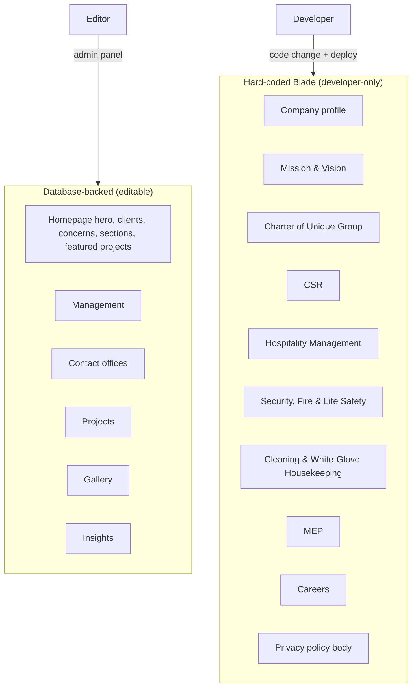

# 01 — Project Overview

> **Purpose:** Explain what this website is, who it is for, what it can do today, and where its boundaries lie.
> **Audience:** Everyone — new developers, the site owner, marketing, and reviewers.
> **Last reviewed:** 2026-10-24
> **Evidence basis:** Source inspection across the whole repository. No runtime verification (shell unavailable).

**Verification legend:** ✅ source-verified · 🟡 runtime-unverified · ⚠️ partial · ⛔ missing · 🕓 legacy · ❓ unknown

---

## 1. What this is

The corporate website for **HANSA Management Ltd.**, an integrated hospitality and facility management company in Bangladesh and a concern of Unique Group.

| Fact | Value | Source |
|---|---|---|
| Public domain | `https://hansamgt.com` | `config/site.php:37`, controller canonicals |
| Legal name | HANSA Management Ltd. | `config/site.php:36` |
| Parent | Unique Group | `config/site.php:40-41` |
| Founded | 2015 | `config/site.php:42` |
| HQ | Borak Mehnur (Level-18), 51/B Kemal Ataturk Avenue, Banani, Dhaka 1213 | `config/site.php:60` |
| Timezone | `Asia/Dhaka` | `config/app.php` |
| Locale | `en` (single language) | `config/app.php` |

The site has two halves:

1. **A public marketing site** — 18 public surfaces (15 static pages + the `/insights` index + 1 dynamic detail page + 1 RSS feed), server-rendered.
2. **An admin panel** at `/admin` — where staff edit a subset of the content.

---

## 2. What a visitor can do

| Capability | Where | Status |
|---|---|---|
| Read about the company, mission, charter, CSR | 4 about pages | ✅ |
| Read about 4 service lines | 4 service pages | ✅ |
| Browse projects (with an ongoing/upcoming filter) | `/projects` | ✅ |
| Browse a photo gallery | `/gallery` | ✅ |
| Meet the leadership team | `/management` | ✅ |
| Read articles | `/insights` + detail | ✅ |
| Subscribe to articles via RSS | `/insights/feed` | ✅ |
| Find office addresses and phone numbers | `/contact`, homepage | ✅ |
| Open a Google Map for a verified office | `/contact`, homepage | ⚠️ only with coordinates |
| Send an enquiry | homepage + `/contact` | ✅ |
| Chat on WhatsApp | floating button | ⚠️ only when a number is configured |
| Apply for a job | `/careers` → email | ⚠️ email only, no form |
| Read the privacy policy | `/privacy-policy` | ✅ |
| Accept or decline analytics | banner + footer control | ✅ |

**There is no:** user account, login for visitors, e-commerce, search, comment system, newsletter signup, multi-language switch, or downloadable brochure.

---

## 3. What an editor can do

Via `/admin` (Filament v4):

| Content | Resource | Create | Edit | Delete | Reorder |
|---|---|---|---|---|---|
| Insights articles | `PostResource` | ✅ | ✅ | ✅ | by date |
| Projects | `ProjectResource` | ✅ | ✅ | ✅ | drag |
| Gallery photos | `GalleryResource` | ✅ | ✅ | ✅ | drag |
| Team members | `TeamMemberResource` | ✅ | ✅ | ✅ | drag |
| Hero slides | `HeroSlideResource` | ✅ | ✅ | ✅ | drag |
| Client logos | `ClientResource` | ✅ | ✅ | ✅ | drag |
| Business concern logos | `ConcernResource` | ✅ | ✅ | ✅ | drag |
| Homepage section items | `HomepageSectionItemResource` | ✅ | ✅ | ✅ | numeric |
| Offices | `OfficeResource` | ✅ | ✅ | ✅ | drag |
| Enquiries | `ContactSubmissionResource` | ⛔ | ⛔ | ✅ | newest first |
| Site settings (5 tabs) | `ManageSettings` | n/a | ✅ | n/a | n/a |

**What an editor cannot do:** edit any static page copy (company profile, mission/vision, charter, CSR, the four service pages, careers, privacy body), manage users, assign roles, reset passwords, restore deleted records, preview unpublished posts, or see an audit trail.

See [11 — Admin Panel Reference](11-admin-panel-reference.md).

---

## 4. Two content systems

This is the defining characteristic of the codebase and the most common source of confusion.



| System | Pages | Who edits | How |
|---|---|---|---|
| Database-backed | 6 surfaces | content staff | admin panel, no deploy |
| Hard-coded | 10 pages + homepage section headings | developer | edit Blade, commit, deploy |

⚠️ **Section headings are not editable.** The admin manages *items inside* homepage sections, not the headings above them. Editors routinely expect otherwise.

---

## 5. Technology in one table

| Layer | Choice |
|---|---|
| Language | PHP 8.2+ |
| Framework | Laravel 12 |
| Admin | Filament v4 (Livewire) |
| Templating | Blade |
| CSS | Tailwind v4 (CSS-first) + large hand-written component layer |
| JS | Plain ES modules, no framework |
| Build | Vite 7 |
| Database | SQLite by default (MySQL/Postgres supported) |
| Cache / session / queue | database |
| Mail | `log` by default (**must be changed for production**) |
| Tests | PHPUnit 11.5, 11 files, 72 methods |

Full detail: [03 — Technology Stack](03-technology-stack.md).

---

## 6. Repository layout

```text
hansamgt-website-new/
├── app/
│   ├── Console/Commands/         (GenerateSitemap, CreateAdmin)
│   ├── Filament/
│   │   ├── Pages/ManageSettings.php
│   │   ├── Resources/            (10 resources, 29 page classes)
│   │   └── Widgets/DashboardStats.php
│   ├── Http/
│   │   ├── Controllers/          (Home, Contact, Insight)
│   │   └── Middleware/           (RedirectIndexPhp, SecurityHeaders)
│   ├── Models/                   (12)
│   ├── Providers/                (AppServiceProvider, Filament/AdminPanelProvider)
│   └── Support/                  (Settings, ImageUrl, OfficeMap, Consent, Breadcrumbs)
├── bootstrap/app.php             ← middleware + routing config
├── config/                       (13 files)
├── database/
│   ├── migrations/               (16)
│   ├── seeders/                  (10 + data/)
│   └── factories/
├── docs/                         (5 historical + technical/)
├── public/                       (document root: index.php, .htaccess, images, build)
├── resources/
│   ├── css/app.css
│   ├── js/                       (5 modules)
│   └── views/                    (~54 Blade files)
├── routes/                       (web.php, console.php)
├── storage/app/public/           (uploads: team/, hero-slides/)
├── tests/                        (11 files)
└── hansamgtWebsite_old/          ← legacy CodeIgniter, git-ignored, out of scope
```

---

## 7. Provenance

The site is a **migration from CodeIgniter** to Laravel. Evidence is pervasive:

| Evidence | Location |
|---|---|
| Controller method names (`hardService`, `payperUse`, `siteManagement`) | `HomeController.php` |
| Legacy URL map (`/home/history`, `/index.php/home/...`) | `RedirectIndexPhp.php:15-29` |
| `.htaccess` rules for `index.php/home/*` | `public/.htaccess:23-38` |
| Bootstrap 3 classes (`media-left`, `media-body`) | `partials/header.blade.php:4,7` |
| Theme class names (`vc-hoverbox`, `icon_box style_1`) | `resources/css/app.css` |
| Legacy icon fonts (`stm93ff`, `icomoon0b43`) | `public/fonts/` |
| Old image tree (`images/pages/icons/mission-1-120x111.png`) | `public/images/` |
| The original site itself | `hansamgtWebsite_old/` 🕓 |

`hansamgtWebsite_old/` is a full CodeIgniter application (PHP >= 5.3.7) and is **git-ignored** (`.gitignore:26`). It is out of scope for this documentation except as provenance. ⚠️ It contains a compromised Google Maps API key that must be revoked — see [17 §9](17-security-and-hardening.md#9-secrets-and-repository-hygiene).

---

## 8. Current maturity

| Dimension | Assessment |
|---|---|
| Public site completeness | **High** — all pages exist, content is real, SEO is thorough |
| Admin coverage | **Medium** — 9 content surfaces + settings, but 10 pages are code-only |
| Code quality | **High** — small surface, clear naming, unusually good docblocks |
| Test coverage | **Low–Medium** — strong on utilities; the admin access gate now has feature tests (authored, not yet executed); the contact form is still untested |
| Security | **Mixed** — good headers and consent; panel access gated by `is_admin`, but no fine-grained roles; raw HTML rendering |
| Operations | **Low** — no CI, no backups, no scheduler, no monitoring, no error tracking |
| Documentation | **Mixed** — rich historical docs, several stale claims; this set is current |

---

## 9. The five things to know first

1. **Authorization is a single binary gate.** Only `users.is_admin = true` can enter `/admin`; a logged-in non-admin gets 403. Once inside, every admin can do everything, including reading every enquiry — there is no role system. → [17 §4](17-security-and-hardening.md#4-authorization)
2. **The storage symlink is missing.** Uploaded images resolve to `/storage/...` and will 404 until `php artisan storage:link` runs. → [14 §4](14-media-and-image-pipeline.md#42-the-missing-symlink)
3. **Mail defaults to `log`.** With the shipped example config, enquiries are stored but never emailed, while the visitor sees success. → [10 §6](10-contact-and-enquiries.md#6-email)
4. **Ten pages are code-only.** Company profile, mission/vision, charter, CSR, four services, careers, and the privacy body cannot be edited in the admin. → [07 §15](07-public-pages-reference.md#15-content-source-summary)
5. **Failures are silent.** Every public DB read falls back to static content and returns HTTP 200. → [02 §4](02-architecture-and-request-lifecycle.md#4-the-fallback-pattern)

---

## 10. How to read this documentation

| If you want to… | Read |
|---|---|
| Set up locally | [04](04-local-development-setup.md) |
| Understand the code | [02](02-architecture-and-request-lifecycle.md), [06](06-routing-and-url-map.md) |
| Edit content | [07](07-public-pages-reference.md), [11](11-admin-panel-reference.md), [12](12-site-settings.md) |
| Work on the database | [13](13-database-and-data-dictionary.md) |
| Work on images | [14](14-media-and-image-pipeline.md) |
| Work on SEO | [15](15-seo-and-structured-data.md) |
| Work on analytics/privacy | [16](16-analytics-consent-and-privacy.md) |
| Review security | [17](17-security-and-hardening.md) |
| Deploy | [20](20-deployment-and-operations.md) |
| Know what is broken | [21](21-known-issues-decisions-and-roadmap.md) |

Start at [00 — Index](00-index.md) for the full map.

---

## Known limitations

- No page was rendered; visual and content claims are source-derived.
- Live configuration (`.env`), database contents, and host setup were not inspected.
- The `hansamgtWebsite_old/` directory was identified but not audited beyond confirming its framework and the presence of a key that must be revoked.
- Business facts (founding year, address, service lines) are taken from `config/site.php` and page copy; they were not independently verified.

---

## Related chapters

- [00 — Index](00-index.md)
- [02 — Architecture & Request Lifecycle](02-architecture-and-request-lifecycle.md)
- [03 — Technology Stack](03-technology-stack.md)
- [07 — Public Pages Reference](07-public-pages-reference.md)
- [11 — Admin Panel Reference](11-admin-panel-reference.md)
- [21 — Known Issues](21-known-issues-decisions-and-roadmap.md)
