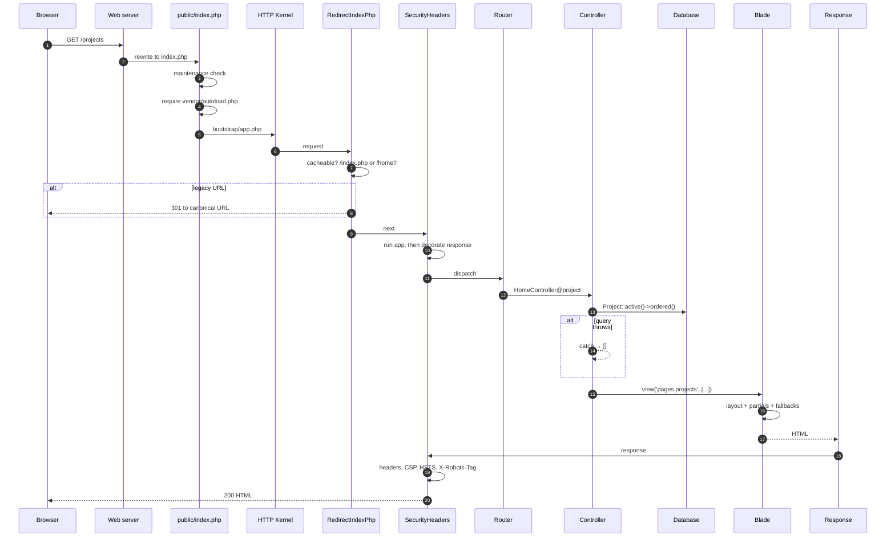
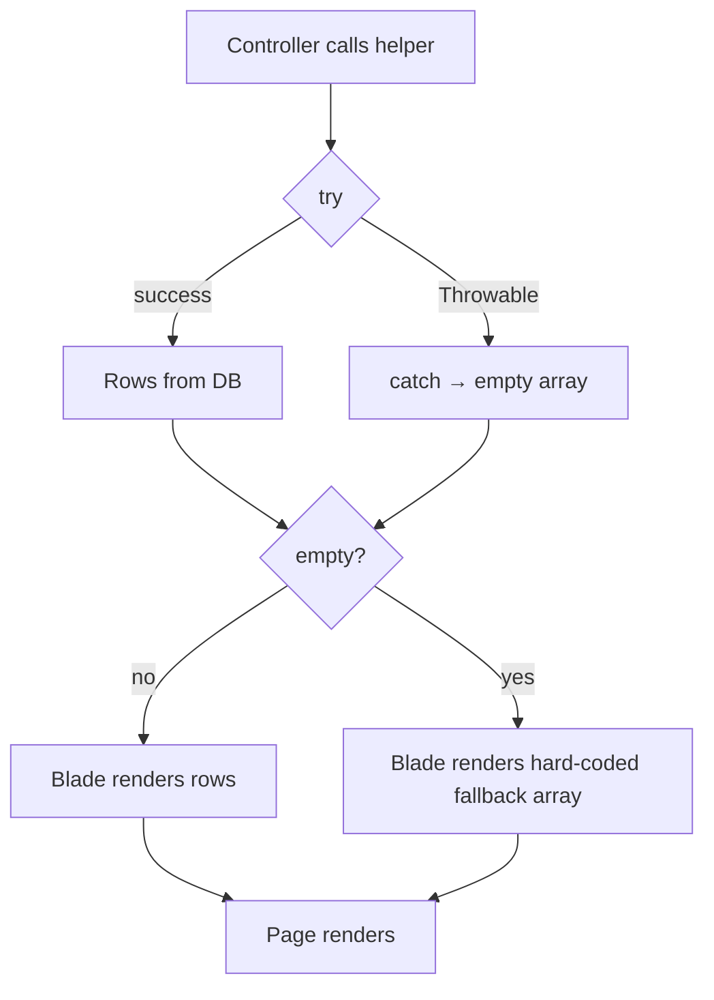
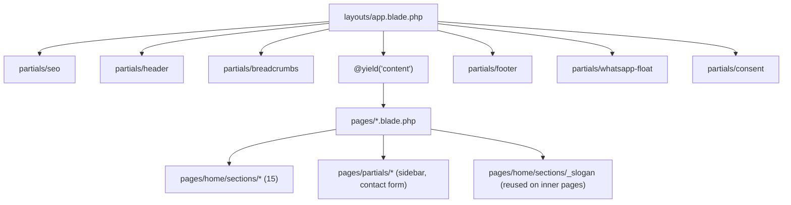
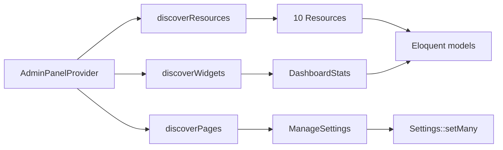
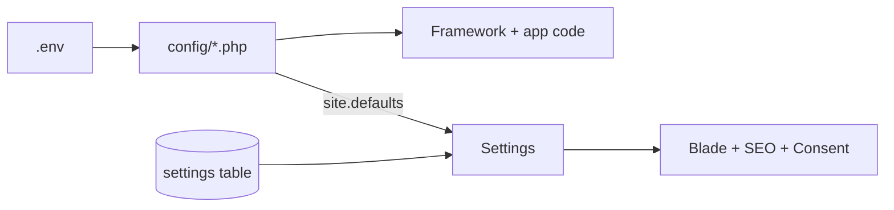

# 02 — Architecture & Request Lifecycle

> **Purpose:** Explain how a request becomes a page: entry point, bootstrap, middleware, routing, controllers, models, views, and the fallback strategy that shapes the whole application.
> **Audience:** Developers joining the project, and reviewers assessing structural risk.
> **Last reviewed:** 2026-10-24
> **Evidence basis:** `public/index.php`, `bootstrap/app.php`, `bootstrap/providers.php`, `routes/web.php`, `routes/console.php`, `app/Http/Controllers/*`, `app/Http/Middleware/*`, `app/Models/*`, `app/Support/*`, `app/Providers/*`, `resources/views/layouts/app.blade.php`. Nothing was executed.

**Verification legend:** ✅ source-verified · 🟡 runtime-unverified · ⚠️ partial · ⛔ missing · ❓ unknown

---

## 1. Shape of the application

This is a **classic server-rendered Laravel monolith** with one admin panel bolted on:

- No API, no SPA, no mobile client, no microservices.
- Public pages are Blade templates rendered by two controllers.
- The admin is Filament v4 (Livewire under the hood) at `/admin`.
- One database, one cache store, one session store — all the same database.
- No background jobs, no queue consumers in practice, no scheduler.

| Layer | Count | Location |
|---|---|---|
| Controllers | 3 | `app/Http/Controllers/` |
| Models | 12 | `app/Models/` |
| Support classes | 5 | `app/Support/` |
| Middleware | 2 custom | `app/Http/Middleware/` |
| Service providers | 2 | `app/Providers/` |
| Console commands | 1 custom | `app/Console/Commands/` |
| Filament resources | 10 | `app/Filament/Resources/` |
| Filament pages | 1 custom | `app/Filament/Pages/` |
| Filament widgets | 1 | `app/Filament/Widgets/` |
| Blade views | ~54 | `resources/views/` |
| Migrations | 16 | `database/migrations/` |

⛔ Absent: `app/Http/Requests`, `app/Policies`, `app/Events`, `app/Listeners`, `app/Jobs`, `app/Notifications`, `app/Mail`, `app/Observers`, `app/Enums`, `app/Casts`, `app/View`, `app/Exceptions`, `routes/api.php`, `routes/channels.php`.

---

## 2. Request lifecycle



### 2.1 Entry point

`public/index.php` (20 lines):

1. `LARAVEL_START` constant.
2. Maintenance-mode check → `storage/framework/maintenance.php`.
3. Composer autoload.
4. `require bootstrap/app.php`.
5. `$app->handleRequest(Request::capture())`.

Standard Laravel 12 skeleton, unmodified. ✅

### 2.2 Bootstrap

`bootstrap/app.php` (19 lines) is the entire application configuration:

| Concern | Setting |
|---|---|
| Web routes | `routes/web.php` |
| Console routes | `routes/console.php` |
| Health check | `/up` |
| Global middleware | `RedirectIndexPhp`, `SecurityHeaders` (appended) |
| Exceptions | **empty closure** — no custom rendering |

`bootstrap/providers.php` registers exactly two providers: `AppServiceProvider` (both methods empty) and `AdminPanelProvider` (Filament).

⚠️ **There is no `app/Http/Kernel.php`.** Laravel 12 uses the `bootstrap/app.php` style. Anyone looking for the traditional kernel will not find it.

### 2.3 Middleware order

Global stack (framework default, then appended):

```text
TrustProxies? (not configured)
ValidatePostSize
TrimStrings
ConvertEmptyStringsToNull
... framework defaults ...
RedirectIndexPhp      ← appended
SecurityHeaders       ← appended
```

⚠️ `TrustProxies` is **not** configured. If the site sits behind a load balancer or CDN that terminates TLS, `$request->secure()` may return false, and:

- HSTS will not be emitted (`SecurityHeaders.php:44`).
- Generated URLs may use `http://`.
- `RedirectIndexPhp` builds absolute URLs from the perceived scheme (56).

This is a real deployment risk on any proxied host. **Unverified** because the host is unknown.

`SecurityHeaders` decorates the response **after** `$next($request)` (13), so it also applies to redirects and error responses. ✅

### 2.4 Routing

`routes/web.php` — 56 lines, no groups, no prefixes, no resource routes. 19 public routes: **18 GET** (15 static pages + `/insights` index + `/insights/feed` + `/insights/{slug}`) and **1 POST**, plus **18** legacy redirect routes generated in the loop (13 map entries + 5 lowercase variants) and one explicit `/home` redirect.

See [06 — Routing & URL Map](06-routing-and-url-map.md) for the full table.

---

## 3. Controller responsibilities

### 3.1 `HomeController` — 15 actions + 6 helpers

| Group | Methods |
|---|---|
| Pages | `index`, `history`, `vision`, `charter`, `management`, `csr`, `contact`, `hardService`, `softService`, `payperUse`, `riskManagement`, `project`, `siteManagement`, `privacy`, `careers` |
| Data helpers | `homepageSections`, `featuredProjects`, `galleryPhotos`, `teamMembers`, `projects`, `offices` |
| Constants | `DEFAULT_OFFICES` |

**Every action follows the same pattern:**

```php
public function project(): View
{
    return view('pages.projects', [
        'projects' => $this->projects(),
        'seo' => [ 'title' => …, 'description' => …, 'canonical' => … ],
    ]);
}
```

No dependency injection beyond the framework. No service classes. Helpers are `private` methods on the controller.

⚠️ **This is a "god controller"** by modern standards: 500 lines, 15 actions, 6 query helpers, and a 38-line constant of fallback office data. It works, but it is the main structural debt.

### 3.2 `ContactController` — 1 action

`store()` (20-63). Validation → persist → mail → redirect. See [10](10-contact-and-enquiries.md).

### 3.3 `InsightController` — 3 actions + 2 schema builders

`index`, `show`, `feed`, plus `itemListSchema`, `articleSchema`, `relatedPosts`, and `PER_PAGE = 9`. See [09](09-insights-subsystem.md).

---

## 4. The fallback pattern

This is the single most important architectural characteristic.

### 4.1 Two levels of fallback



| Level | Where | Behaviour |
|---|---|---|
| 1 | Controller helper | `try/catch (\Throwable)` → returns `[]` or `collect()` |
| 2 | Blade template | `@if (empty($items))` → renders a hard-coded array |

### 4.2 What this buys

- A database outage produces a **fully rendered page** with legacy content.
- A missing table during a partial migration does not 500.
- The site works on a fresh clone before seeding.

### 4.3 What this costs

- **Failures are invisible.** Most `catch` blocks do not call `report()`, so nothing is logged. An outage looks like normal operation.
- **Stale content is indistinguishable from live content.** An editor who deactivates all offices still sees four offices, because `DEFAULT_OFFICES` substitutes them.
- **Monitoring is defeated.** HTTP 200 is returned during a total DB failure.
- **Fallback drift.** The Blade fallbacks are copies of the seeded data; when the seed changes, the fallback does not.

### 4.4 Coverage of the pattern

| Surface | Fallback? |
|---|---|
| Homepage hero, clients, concerns, sections, projects, news | ✅ Blade arrays |
| Homepage offices / contact offices | ✅ `DEFAULT_OFFICES` |
| Projects page | ✅ 11 hard-coded cards |
| Gallery page | ✅ 12 hard-coded photos |
| Management page | ⛔ **no fallback** — renders empty |
| Insights index | ✅ empty state message |
| Insight detail | ⛔ 404 on DB failure |
| Settings | ✅ `config/site.php` defaults |
| Admin panel | ⛔ fails loudly (correct) |

⚠️ `management` is the odd one out: an empty `team_members` table produces a page with a heading and no people. Worth knowing before deactivating all team members.

---

## 5. Data access

### 5.1 Models

12 models, all thin:

| Model | Table | Notable |
|---|---|---|
| `Post` | `posts` | `scopePublished`, `scopeOrdered`, `getRouteKeyName`, schema helpers |
| `Setting` | `settings` | `$fillable = ['key','value']` |
| `Office` | `offices` | casts, `hasCoordinates()` |
| `Project` | `projects` | `CATEGORIES`, two orderings, homepage accessors |
| `GalleryImage` | `gallery_images` | `scopeActive`, `scopeOrdered` |
| `TeamMember` | `team_members` | `displayName()`, `imageAlt()` |
| `HomepageSectionItem` | `homepage_section_items` | `SECTIONS`, `ICONS`, `display_value` |
| `HeroSlide` | `hero_slides` | `scopeActive`, `scopeOrdered` |
| `ContactSubmission` | `contact_submissions` | — |
| `Client` | `clients` | `scopeActive`, `scopeOrdered` |
| `Concern` | `concerns` | `scopeActive`, `scopeOrdered` |
| `User` | `users` | `hashed` cast, `$hidden` |

⛔ **No Eloquent relationships anywhere.** No `hasMany`, `belongsTo`, `belongsToMany`, or `morph*`. See [13 §5](13-database-and-data-dictionary.md#5-relationships-that-do-not-exist).

### 5.2 Query patterns

- All reads are `Model::query()->scope()->get()` or `->paginate()`.
- No raw SQL, no `DB::raw`, no joins.
- No eager loading (nothing to eager load).
- No global scopes; scopes are called explicitly.
- No observers, no model events.

### 5.3 Caching

Exactly one cache key: `site-settings:v1` (`Settings.php:53`). Content queries are **not** cached. Every page hits the database.

For a brochure site this is fine. It does mean the database is on the critical path for every request.

---

## 6. Support classes

| Class | Responsibility | Lines |
|---|---|---|
| `Settings` | cached key/value access, defaults, phone/WhatsApp/social helpers, image URLs | 402 |
| `ImageUrl` | resolve legacy `public/` paths and storage uploads to URLs, memoised | 79 |
| `OfficeMap` | validate coordinates, build keyless embed + directions URLs | 175 |
| `Consent` | analytics gate, measurement id, consent version, storage key | 53 |
| `Breadcrumbs` | route-name → trail label map | 47 |

These are **static utility classes**, not injected services. They are called directly from Blade (`\App\Support\Settings::get(...)`) and controllers.

⚠️ Static access from views is pragmatic but makes testing and mocking harder. `SettingsCacheTest` works around it with static reset helpers.

---

## 7. View composition



- Every page extends one layout.
- No Blade components (`<x-...>`), no anonymous components, no view composers.
- Partials receive data via `@include(..., [...])` or inherited variables.
- Fallback arrays live **inside** the Blade partials.

⚠️ **No Blade component layer** means repeated markup (breadcrumbs, section headings, cards) is duplicated rather than parameterised. Consistent with the legacy origin.

---

## 8. Admin architecture

Filament v4 auto-discovers resources, pages, and widgets from `app/Filament/`.



- Each resource = model + form schema + table + 3 page classes (list/create/edit), except `ContactSubmissionResource` (list/view only).
- `ManageSettings` is a custom `Page` with a 5-tab form, saving through `Settings::setMany()`.
- `DashboardStats` is a `StatsOverviewWidget` with 5 counts.
- **No policies, no gates.** Panel access is gated by `User::canAccessPanel()` (`is_admin = true`); once inside, every admin is allowed everything. See [11 §2](11-admin-panel-reference.md#2-authorization-reality).

---

## 9. Console architecture

| Command | Source | Scheduled |
|---|---|---|
| `inspire` | `routes/console.php:6-8` | n/a (framework demo) |
| `sitemap:generate` | `app/Console/Commands/GenerateSitemap.php` | ⛔ **never** |
| `admin:create` | `app/Console/Commands/CreateAdmin.php` | n/a (interactive; local only) |

`routes/console.php` is 8 lines and registers no schedule. There is no `app/Console/Kernel.php` (Laravel 12 style).

---

## 10. Configuration architecture

Two layers, deliberately separated (see [05](05-configuration-reference.md)):



- **Infrastructure** (DB, mail, key, env) → `.env` → `config/`.
- **Public content** (phone, email, social, GA4 id, branding) → `settings` table, editable in the panel, defaults in `config/site.php`.

The rule is documented in `config/site.php:14-19` and is genuinely followed: no secret is stored in the database.

⚠️ `GA4_ENABLED` breaks the rule slightly by being read in two config files (see [16 §2](16-analytics-consent-and-privacy.md#2-gate-chain)).

---

## 11. Architectural strengths

| Strength | Why it matters |
|---|---|
| Small, comprehensible surface | 3 controllers, 12 models, 19 routes — a new developer can read the whole app in a day |
| No unnecessary abstraction | no repositories, no DTOs, no service layer for its own sake |
| Explicit fallbacks | the public site degrades instead of failing |
| Separation of secrets from content | a database leak does not expose SMTP credentials |
| Third-party requests deferred | no Google contact before consent or map click |
| Legacy URL preservation | SEO equity retained through three redirect layers |
| High-quality inline documentation | docblocks explain rationale, not mechanics |

---

## 12. Architectural risks

| Risk | Consequence |
|---|---|
| God controller (`HomeController`, 500 lines) | hard to test, easy to break |
| Fallback masks failures | outages are invisible |
| No fine-grained authorization | any `is_admin` account can do anything |
| No service/domain layer | business rules live in controllers and Blade |
| Static support classes | hard to mock; global state |
| No events/jobs | nothing is decoupled; everything is synchronous |
| Raw HTML rendering | stored XSS |
| Single database for cache/session/queue/content | one outage breaks everything |
| No API boundary | any future integration requires new work |

---

## Known limitations

- No request was executed; the lifecycle diagram is reconstructed from source and standard Laravel 12 behaviour.
- `TrustProxies` configuration was not found, but a host-level proxy may still be configured outside the repo.
- The exact framework middleware order (before the two appended ones) is Laravel's default and was not dumped.
- Filament's internal request lifecycle (Livewire round-trips) is not documented here; see the admin chapter.
- No profiling or query-count measurement was performed.

---

## Related chapters

- [01 — Project Overview](01-project-overview.md)
- [03 — Technology Stack](03-technology-stack.md)
- [05 — Configuration Reference](05-configuration-reference.md)
- [06 — Routing & URL Map](06-routing-and-url-map.md)
- [07 — Public Pages Reference](07-public-pages-reference.md)
- [11 — Admin Panel Reference](11-admin-panel-reference.md)
- [13 — Database & Data Dictionary](13-database-and-data-dictionary.md)
- [17 — Security & Hardening](17-security-and-hardening.md)
