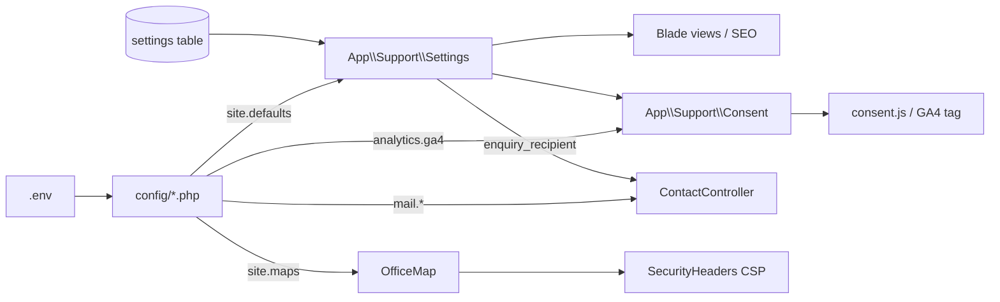

# 05 — Configuration Reference

> **Purpose:** List every configuration key that affects behaviour, what it controls, its safe default, and how it interacts with the database `settings` table.
> **Audience:** Developers, DevOps, and anyone preparing a production environment.
> **Last reviewed:** 2026-10-19
> **Evidence basis:** All 13 files in `config/` were read (some partially, where only defaults matter), plus `.env.example`. **`.env` was not read** — it contains secrets and is excluded by policy.

**Verification legend:** ✅ source-verified · 🟡 runtime-unverified · ⚠️ partial · ⛔ absent · ❓ unknown

> **Secret policy:** This chapter documents **variable names and safe example values only**. No real credential, token, key, or production value appears here, and none should be added.

---

## 1. Two-layer configuration

The application has **two** configuration layers, and confusing them is the most common source of bugs:

| Layer | Location | Holds | Editable at runtime? |
|---|---|---|---|
| Environment/config | `.env` → `config/*.php` | infrastructure: DB, mail transport, app key, feature kill-switches | No (requires deploy) |
| Database settings | `settings` table via `App\Support\Settings` | public site content: phone, email, address, social URLs, GA4 id, branding | Yes (admin panel) |

`config/site.php:14-19` states the rule explicitly: secrets stay in `.env`; anything stored in `settings` is **public by definition** because a database row is readable by every admin and exposed in any database leak.

Resolution order for a site setting (`app/Support/Settings.php:167-186`):

1. Stored value in `settings` (if non-empty, or if the key is in `CLEARABLE_KEYS`)
2. Explicit `$default` argument
3. `config('site.defaults.<key>')`

---

## 2. Application (`config/app.php`)

| Key | Env var | Default | Notes |
|---|---|---|---|
| `name` | `APP_NAME` | `Laravel` | ⚠️ `.env.example:1` still ships `Laravel`; used by `MAIL_FROM_NAME` |
| `env` | `APP_ENV` | `production` | controls `noindex` behaviour and Vite dev CSP |
| `debug` | `APP_DEBUG` | `false` | `.env.example:4` sets `true` (local only) |
| `url` | `APP_URL` | `http://localhost` | affects generated asset/URLs |
| `timezone` | — | `Asia/Dhaka` | hard-coded ✅ |
| `locale` | `APP_LOCALE` | `en` | single locale |
| `fallback_locale` | `APP_FALLBACK_LOCALE` | `en` | |
| `key` | `APP_KEY` | — | required; `composer setup` generates it |

⚠️ `APP_NAME=Laravel` and `APP_URL=http://localhost` in `.env.example` are launch risks if copied unchanged: `APP_URL` affects asset URLs and the default mail-from name reads "Laravel".

---

## 3. Site defaults (`config/site.php`)

This is the **content baseline**. Every key here is a public value.

### 3.1 Branding

| Key | Default | Used by |
|---|---|---|
| `logo` | `images/hansa_logo_new.png` | header (`partials/header.blade.php:5`) |
| `footer_logo` | `images/hansa_logo_new.png` | footer |
| `favicon` | `images/hansa_logo_new.png` | `<link rel=icon>` (`seo.blade.php:207-208`) |
| `og_image` | `images/hansa_logo_new.png` | OG/Twitter + Organization schema |

### 3.2 Organisation

| Key | Default |
|---|---|
| `legal_name` | `HANSA Management Ltd.` |
| `site_url` | `https://hansamgt.com/` |
| `description` | integrated hospitality/facility management description |
| `footer_about` | footer paragraph |
| `parent_name` | `Unique Group` |
| `parent_url` | `https://www.uniquegroupbd.com/` |
| `founding_year` | `2015` |
| `latitude`, `longitude`, `opening_hours` | `null` — omitted from schema until set |

### 3.3 Contact

| Key | Default | Notes |
|---|---|---|
| `phone_primary` | `+8801708800870` | `phoneDisplay()` strips `+88` |
| `phone_emergency` | `null` | clearable |
| `whatsapp` | `null` | **null by default**, so the float button does not render until set |
| `whatsapp_enabled` | `true` | second gate; needs a number |
| `fax` | `88-02-8823392` | clearable |
| `email` | `info@hansamgt.com` | |
| `enquiry_recipient` | `info@hansamgt.com` | contact form recipient |
| `postal_address` | Borak Mehnur address | |
| `street_address`, `address_locality`, `postal_code`, `address_country` | schema.org parts | |

### 3.4 Social

| Key | Default |
|---|---|
| `facebook` | `https://www.facebook.com/HANSAManagementLtd/` |
| `linkedin` | `https://www.linkedin.com/in/hansa-management-ltd-222838196/` |
| `youtube`, `twitter`, `instagram` | `null` (icon hidden) |

### 3.5 Analytics & legal

| Key | Default | Env |
|---|---|---|
| `ga4_enabled` | `'1'` / `'0'` | `GA4_ENABLED` (line 78) |
| `ga4_id` | `G-NJDKQTDFB5` | `GA4_MEASUREMENT_ID` (line 79) |
| `consent_version` | `'1'` | `CONSENT_VERSION` (line 83) |
| `privacy_updated` | `2026-10-17` | — |

### 3.6 Maps (`config/site.php:116-121`)

| Key | Env | Default |
|---|---|---|
| `enabled` | `OFFICE_MAP_ENABLED` | `true` |
| `endpoint` | `OFFICE_MAP_ENDPOINT` | `https://www.google.com/maps` |
| `zoom` | `OFFICE_MAP_ZOOM` | `16` (clamped 1-21) |
| `language` | `OFFICE_MAP_LANGUAGE` | `en` (stripped to letters/hyphens) |

⚠️ **Duplicate-source warning:** `ga4_enabled` and `ga4_id` exist in **both** `config/site.php` (78-79) and `config/analytics.php` (17-20). `Consent::analyticsEnabled()` reads `config('analytics.ga4.enabled')` **and** `Settings::bool('ga4_enabled')` (`Consent.php:21,25`). Changing only one of the two `GA4_ENABLED` reads can produce a state where the tag is off but the banner is on, or vice versa. Treat `GA4_ENABLED=false` as a hard kill switch and keep both definitions in sync.

---

## 4. Database (`config/database.php`)

| Key | Env | Default |
|---|---|---|
| `default` | `DB_CONNECTION` | `sqlite` (line 20) |
| `connections.sqlite.database` | `DB_DATABASE` | `database_path('database.sqlite')` (38) |
| `connections.sqlite.foreign_key_constraints` | `DB_FOREIGN_KEYS` | `true` (40) |

MySQL, MariaDB, PostgreSQL and SQL Server connection blocks exist but are unused by default. ⚠️ If switching to MySQL, the `offices.latitude/longitude` `decimal(10,7)` and all indexes migrate unchanged; no driver-specific SQL was found. ✅

---

## 5. Cache, session, queue

| Concern | Key | Default | Env |
|---|---|---|---|
| Cache store | `cache.default` | `database` | `CACHE_STORE` |
| Cache prefix | `cache.prefix` | `Str::slug(APP_NAME).'-cache-'` | `CACHE_PREFIX` |
| Session driver | `session.driver` | `database` | `SESSION_DRIVER` |
| Session lifetime | `session.lifetime` | `120` min | `SESSION_LIFETIME` |
| Session encryption | `session.encrypt` | `false` | `SESSION_ENCRYPT` |
| Queue connection | `queue.default` | `database` | `QUEUE_CONNECTION` |
| Queue retry | `queue.connections.database.retry_after` | framework default | — |

⚠️ Because cache **and** session **and** queue all use the database, a database outage breaks login and settings reads at the same moment. `Settings::readCached()` and `writeCached()` are individually guarded (`Settings.php:133-158`) precisely for this case, but the admin panel itself would fail.

---

## 6. Mail (`config/mail.php`)

| Key | Env | Default |
|---|---|---|
| `default` | `MAIL_MAILER` | `log` (line 17) |
| `mailers.smtp.*` | `MAIL_HOST`, `MAIL_PORT`, `MAIL_USERNAME`, `MAIL_PASSWORD`, `MAIL_SCHEME` | standard |
| `from.address` | `MAIL_FROM_ADDRESS` | `.env.example:56` → `hello@example.com` |
| `from.name` | `MAIL_FROM_NAME` | `${APP_NAME}` |

⚠️ **Launch blocker:** `.env.example` ships `MAIL_MAILER=log` and `MAIL_FROM_ADDRESS="hello@example.com"`. The real `.env` was not read, so whether production has been corrected is **unknown**. With `log`, contact-form emails are written to `storage/logs/laravel.log` and never delivered — and the form still reports success to the visitor (`ContactController.php:60-62`). See [10 — Contact & Enquiries](10-contact-and-enquiries.md#7-failure-modes).

---

## 7. Filesystems (`config/filesystems.php`)

| Key | Default |
|---|---|
| `default` | `local` (`FILESYSTEM_DISK`) |
| `disks.local.root` | `storage/app/private` |
| `disks.public.root` | `storage/app/public` |
| `disks.public.url` | `/storage` |

Every admin upload uses `->disk('public')`. Serving those files requires the `public/storage` symlink, which **does not exist** in this checkout. See [14 — Media & Image Pipeline](14-media-and-image-pipeline.md#42-the-missing-symlink).

---

## 8. Auth (`config/auth.php`)

| Key | Default |
|---|---|
| `defaults.guard` | `web` |
| `defaults.passwords` | `users` |
| `guards.web.driver` | `session` |
| `guards.web.provider` | `users` (Eloquent, `App\Models\User`) |
| `passwords.users.expire` | 60 min |
| `passwords.users.throttle` | 60 s |

No additional guards, no API guard, no role provider.

---

## 9. SEO (`config/seo.php`)

Single key:

| Key | Default |
|---|---|
| `default_robots` | `index, follow, max-image-preview:large, max-snippet:-1, max-video-preview:-1` |

All other SEO values are per-page `$seo` arrays in the controller. See [15 — SEO](15-seo-and-structured-data.md).

---

## 10. Analytics (`config/analytics.php`)

| Key | Env | Default |
|---|---|---|
| `ga4.enabled` | `GA4_ENABLED` | `true` |
| `ga4.measurement_id` | `GA4_MEASUREMENT_ID` | `G-NJDKQTDFB5` |
| `consent_version` | `CONSENT_VERSION` | `1` |
| `consent_storage_key` | — | `hansa.consent` |

See the duplicate-source warning in §3.5.

---

## 11. Logging (`config/logging.php`)

| Key | Env | Default |
|---|---|---|
| `default` | `LOG_CHANNEL` | `stack` |
| stack channels | `LOG_STACK` | `single` |
| level | `LOG_LEVEL` | `debug` (`.env.example:21`) |

⚠️ `LOG_LEVEL=debug` in production would write verbose detail — including, potentially, mail exception messages. Not verified for the live environment.

---

## 12. Environment variable reference (names only)

Never commit real values. This table exists so a deployer knows **which names matter**.

| Variable | Purpose | Safe local value |
|---|---|---|
| `APP_NAME` | app/mail-from name | `HANSA Management` |
| `APP_ENV` | `local` / `production` | `local` |
| `APP_KEY` | encryption | generated, never shared |
| `APP_DEBUG` | error detail | `true` local / `false` production |
| `APP_URL` | base URL | `http://localhost` |
| `APP_LOCALE`, `APP_FALLBACK_LOCALE` | locale | `en` |
| `DB_CONNECTION` | driver | `sqlite` |
| `DB_DATABASE` | path/name | `database/database.sqlite` |
| `SESSION_DRIVER`, `SESSION_LIFETIME`, `SESSION_ENCRYPT` | session | `database`, `120`, `false` |
| `CACHE_STORE` | cache | `database` |
| `QUEUE_CONNECTION` | queue | `database` |
| `FILESYSTEM_DISK` | default disk | `local` |
| `MAIL_MAILER` | transport | `log` locally |
| `MAIL_HOST`, `MAIL_PORT`, `MAIL_USERNAME`, `MAIL_PASSWORD`, `MAIL_SCHEME` | SMTP | host-specific, secret |
| `MAIL_FROM_ADDRESS`, `MAIL_FROM_NAME` | sender | real `@hansamgt.com` in production |
| `GA4_ENABLED` | analytics kill switch | `true` |
| `GA4_MEASUREMENT_ID` | GA4 property | `G-XXXXXXXXXX` |
| `CONSENT_VERSION` | consent re-prompt | `1` |
| `OFFICE_MAP_ENABLED` | map kill switch | `true` |
| `OFFICE_MAP_ENDPOINT` | embed endpoint | `https://www.google.com/maps` |
| `OFFICE_MAP_ZOOM`, `OFFICE_MAP_LANGUAGE` | map display | `16`, `en` |
| `LOG_CHANNEL`, `LOG_STACK`, `LOG_LEVEL` | logging | `stack`, `single`, `debug` local |

---

## 13. Configuration interaction diagram

---

## Known limitations

- `.env` was not read. Every statement about live values is conditional.
- `composer.lock` / `package-lock.json` not read, so transitive configuration defaults could differ.
- No `config:cache` artefact was inspected; if the production host caches config, editing `.env` without re-caching has no effect.
- `config/session.php`, `config/cache.php`, `config/queue.php`, `config/logging.php`, `config/filesystems.php` were read only to the extent needed for defaults; uncommon keys are not documented.

---

## Related chapters

- [04 — Local Development Setup](04-local-development-setup.md)
- [12 — Site Settings](12-site-settings.md) — the database layer
- [14 — Media & Image Pipeline](14-media-and-image-pipeline.md) — disks and URLs
- [16 — Analytics, Consent & Privacy](16-analytics-consent-and-privacy.md) — GA4 keys
- [17 — Security & Hardening](17-security-and-hardening.md) — CSP and map endpoint coupling
- [20 — Deployment & Operations](20-deployment-and-operations.md) — production env checklist
