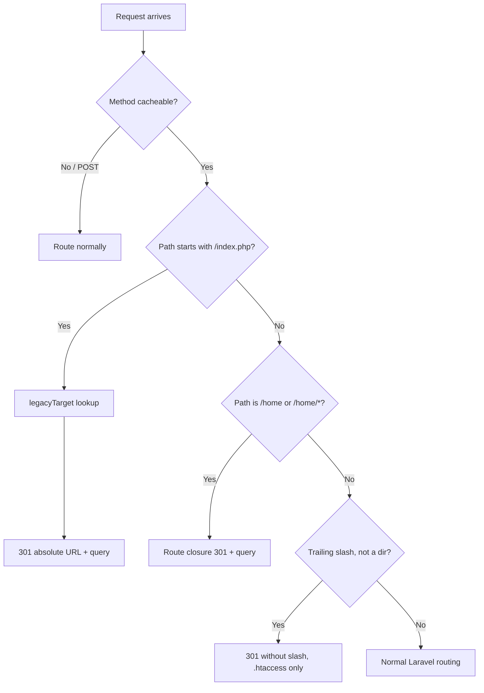

# 06 — Routing & URL Map

> **Purpose:** Document every declared route, how URLs map to controllers, how legacy CodeIgniter URLs are redirected, and where to add a new page.
> **Audience:** Backend developers, SEO/marketing, and anyone debugging a 404 or redirect.
> **Last reviewed:** 2026-10-24
> **Evidence basis:** `routes/web.php`, `routes/console.php`, `bootstrap/app.php`, `app/Http/Middleware/RedirectIndexPhp.php`, `public/.htaccess`, `public/robots.txt` — all read in full. Routes were **not** confirmed with `php artisan route:list` (shell unavailable).

**Verification legend:** ✅ source-verified · 🟡 runtime-unverified · ⚠️ partial · ⛔ missing · 🕓 legacy · ❓ unknown

---

## 1. Declared vs runtime-confirmed

Every route in this chapter is **declared in source and read directly**. None is **runtime-confirmed**: `php artisan route:list` could not run in this environment (shell exits with code 66). A cached route table (`bootstrap/cache/routes-v7.php`) could in principle differ from source, but no such file was inspected. Treat the table below as *authoritative for source*, *unverified for a running instance*.

`routes/web.php` is 56 lines and contains **no route groups, no prefixes, no middleware aliases beyond `throttle`, and no resource routes**. ✅

---

## 2. Middleware applied to every request

`bootstrap/app.php:13-16`:

```php
$middleware->append(\App\Http\Middleware\RedirectIndexPhp::class);
$middleware->append(\App\Http\Middleware\SecurityHeaders::class);
```

Both are appended to the **global** stack, so they run on public pages, the admin panel, and error responses.

| Order | Middleware | Responsibility |
|---|---|---|
| 1 | Laravel web group (session, CSRF, cookies, bindings) | framework default |
| 2 | `App\Http\Middleware\RedirectIndexPhp` | 301 `/index.php/*` and `/home/*` legacy URLs |
| 3 | `App\Http\Middleware\SecurityHeaders` | CSP, HSTS, `X-Robots-Tag`, security headers |

Health route `/up` is registered by `->withRouting(health: '/up')` (`bootstrap/app.php:11`).

---

## 3. Complete public route table

Source: `routes/web.php:9-33`.

| # | Method | URI | Route name | Handler | Notes |
|---|---|---|---|---|---|
| 1 | GET | `/` | `home` | `HomeController@index` | line 9 |
| 2 | GET | `/company-profile` | `company-profile` | `HomeController@history` | 10 |
| 3 | GET | `/mission-vision` | `mission-vision` | `HomeController@vision` | 11 |
| 4 | GET | `/charter-of-unique-group` | `charter-of-unique-group` | `HomeController@charter` | 12 |
| 5 | GET | `/management` | `management` | `HomeController@management` | 13 |
| 6 | GET | `/corporate-social-responsibility` | `corporate-social-responsibility` | `HomeController@csr` | 14 |
| 7 | GET | `/contact` | `contact` | `HomeController@contact` | 15 |
| 8 | **POST** | `/contact` | `contact.store` | `ContactController@store` | 16-18; `throttle:10,1` |
| 9 | GET | `/hospitality-management` | `hospitality-management` | `HomeController@hardService` | 19 |
| 10 | GET | `/security-fire-life-safety` | `security-fire-life-safety` | `HomeController@softService` | 20 |
| 11 | GET | `/cleaning-white-glove-housekeeping` | `cleaning-white-glove-housekeeping` | `HomeController@payperUse` | 21 |
| 12 | GET | `/mep-mechanical-electrical-plumbing` | `mep-mechanical-electrical-plumbing` | `HomeController@riskManagement` | 22 |
| 13 | GET | `/projects` | `projects` | `HomeController@project` | 23 |
| 14 | GET | `/gallery` | `gallery` | `HomeController@siteManagement` | 24 |
| 15 | GET | `/careers` | `careers` | `HomeController@careers` | 25 |
| 16 | GET | `/privacy-policy` | `privacy-policy` | `HomeController@privacy` | 28 |
| 17 | GET | `/insights` | `insights` | `InsightController@index` | 31 |
| 18 | GET | `/insights/feed` | `insights.feed` | `InsightController@feed` | 32 |
| 19 | GET | `/insights/{slug}` | `insights.show` | `InsightController@show` | 33 |

**Route-order dependency:** `/insights/feed` (line 32) is declared **before** `/insights/{slug}` (line 33). If that order were reversed, `feed` would be captured as a slug. This is intentional and correct as written. ⚠️ Fragile under future edits.

### 3.1 Controller method ↔ view map

| Route | Controller method | View |
|---|---|---|
| `home` | `HomeController::index` (18-99) | `pages.home` |
| `company-profile` | `history` (101-110) | `pages.company-profile` |
| `mission-vision` | `vision` (112-121) | `pages.mission-vision` |
| `charter-of-unique-group` | `charter` (123-132) | `pages.charter-of-unique-group` |
| `management` | `management` (134-144) | `pages.management` |
| `corporate-social-responsibility` | `csr` (146-155) | `pages.corporate-social-responsibility` |
| `contact` | `contact` (157-167) | `pages.contact` |
| `contact.store` | `ContactController::store` (20-63) | redirect back |
| `hospitality-management` | `hardService` (169-183) | `pages.hospitality-management` |
| `security-fire-life-safety` | `softService` (185-199) | `pages.security-fire-life-safety` |
| `cleaning-white-glove-housekeeping` | `payperUse` (201-215) | `pages.cleaning-white-glove-housekeeping` |
| `mep-mechanical-electrical-plumbing` | `riskManagement` (217-231) | `pages.mep-mechanical-electrical-plumbing` |
| `projects` | `project` (233-243) | `pages.projects` |
| `gallery` | `siteManagement` (245-255) | `pages.gallery` |
| `careers` | `careers` (268-277) | `pages.careers` |
| `privacy-policy` | `privacy` (257-266) | `pages.privacy` |
| `insights` | `InsightController::index` (21-41) | `pages.insights` |
| `insights.feed` | `InsightController::feed` (83-94) | `pages.insights-feed` (RSS) |
| `insights.show` | `InsightController::show` (46-78) | `pages.insight` |

⚠️ **Naming mismatch worth knowing:** the method names `hardService`, `softService`, `payperUse`, `riskManagement`, `siteManagement`, `project`, `history`, `vision`, `charter` are **legacy CodeIgniter controller names** kept to preserve the URL map. They do not describe the page. Do not "clean them up" without also updating `RedirectIndexPhp::LEGACY_MAP`.

---

## 4. Legacy redirect routes

### 4.1 Application-level (`/home/*`)

`routes/web.php:35-56` iterates `RedirectIndexPhp::LEGACY_MAP` and registers a 301 closure for each key, plus a lowercase variant when the key has capitals.

| Legacy URL | 301 target |
|---|---|
| `/home` | `/` |
| `/home/index` | `/` |
| `/home/history` | `/company-profile` |
| `/home/vision` | `/mission-vision` |
| `/home/charter` | `/charter-of-unique-group` |
| `/home/management` | `/management` |
| `/home/csr` | `/corporate-social-responsibility` |
| `/home/contact` | `/contact` |
| `/home/hardService` and `/home/hardservice` | `/hospitality-management` |
| `/home/softService` and `/home/softservice` | `/security-fire-life-safety` |
| `/home/payperUse` and `/home/payperuse` | `/cleaning-white-glove-housekeeping` |
| `/home/riskManagement` and `/home/riskmanagement` | `/mep-mechanical-electrical-plumbing` |
| `/home/project` | `/projects` |
| `/home/siteManagement` and `/home/sitemanagement` | `/gallery` |

Query strings are preserved (`routes/web.php:47-48`). ✅

### 4.2 Middleware-level (`/index.php/*`)

`app/Http/Middleware/RedirectIndexPhp.php:31-62`:

- Skips any non-cacheable method (33-36) — **POSTs are never redirected**.
- Inspects the raw request URI (39) because `Request::path()` strips the script name.
- Any path equal to `/index.php` or starting with `/index.php/` is resolved via `legacyTarget()` (64-79) to a single canonical hop, preserving the query string (50-56).
- Builds an **absolute** URL from scheme + host (52-56) to avoid a redirect loop when PHP executes `public/index.php` directly.

### 4.3 Web-server-level (`public/.htaccess`)

`public/.htaccess:16-38` duplicates the mapping for Apache:

- POST requests excluded (20-21).
- 13 explicit `index.php/home/<segment>` rules (23-35) plus `/index.php/home/` → `/` (36).
- A catch-all rule for `/index.php/<clean-page>` (37).
- `/index.php` and `/index.php/` → `/` (38).
- Trailing-slash removal for non-directories (40-43).
- Front-controller rewrite (45-48).

⚠️ These rules are **inert on Nginx** or any host that ignores `.htaccess`. The file itself says so at lines 67-70. See [20 — Deployment](20-deployment-and-operations.md#4-web-server-configuration).

### 4.4 Redirect flow



---

## 5. Admin routes

Filament registers its own routes under `/admin` from `app/Providers/Filament/AdminPanelProvider.php:27-29`.

| URI pattern | Purpose | Auth |
|---|---|---|
| `/admin/login` | Filament login | public |
| `/admin` | Dashboard | `is_admin` + authenticated |
| `/admin/posts`, `/admin/posts/create`, `/admin/posts/{record}/edit` | Insights | `is_admin` + authenticated |
| `/admin/projects`, `/admin/projects/create`, `/admin/projects/{record}/edit` | Projects | `is_admin` + authenticated |
| `/admin/gallery-images`, `/admin/gallery-images/create`, `/admin/gallery-images/{record}/edit` | Gallery | `is_admin` + authenticated |
| `/admin/team-members`, `/admin/team-members/create`, `/admin/team-members/{record}/edit` | Team | `is_admin` + authenticated |
| `/admin/hero-slides`, `/admin/hero-slides/create`, `/admin/hero-slides/{record}/edit` | Hero | `is_admin` + authenticated |
| `/admin/clients`, `/admin/clients/create`, `/admin/clients/{record}/edit` | Clients | `is_admin` + authenticated |
| `/admin/concerns`, `/admin/concerns/create`, `/admin/concerns/{record}/edit` | Concerns | `is_admin` + authenticated |
| `/admin/homepage-section-items`, `/admin/homepage-section-items/create`, `/admin/homepage-section-items/{record}/edit` | Homepage sections | `is_admin` + authenticated |
| `/admin/offices`, `/admin/offices/create`, `/admin/offices/{record}/edit` | Offices | `is_admin` + authenticated |
| `/admin/contact-submissions`, `/admin/contact-submissions/{record}` | Enquiries (list + view only) | `is_admin` + authenticated |
| `/admin/settings` | Site Settings | `is_admin` + authenticated |

Slugs are **derived from the resource class name** by Filament unless overridden. Two are explicitly overridden: `TeamMemberResource::$slug = 'team-members'` (`TeamMemberResource.php:32`) and `HomepageSectionItemResource::$slug = 'homepage-section-items'` (`HomepageSectionItemResource.php:33`). The rest follow Filament's pluralised kebab-case convention. ⚠️ Exact generated slugs for the non-overridden resources were **not runtime-confirmed**; they follow Filament v4 defaults from the class names (`PostResource` → `posts`, `GalleryResource` → `galleries`, `HeroSlideResource` → `hero-slides`, `ClientResource` → `clients`, `ConcernResource` → `concerns`, `OfficeResource` → `offices`, `ContactSubmissionResource` → `contact-submissions`).

`AdminPanelProvider` enables `->login()` only (line 29). ⛔ No `->passwordReset()`, no `->registration()`, no `->profile()`.

All panel routes except `/admin/login` require **both** an authenticated session and `User::canAccessPanel()` — i.e. `is_admin = true` (`app/Models/User.php:59-62`). A guest is redirected to `/admin/login`; a logged-in non-admin receives **403**. The gate is independent of `APP_ENV`.

---

## 6. Auxiliary and system routes

| URI | Source | Notes |
|---|---|---|
| `/up` | `bootstrap/app.php:11` | Laravel health check; returns 200 when the app boots |
| `/storage/{path}` | `public/storage` symlink | **Symlink absent** — see [14 — Media](14-media-and-image-pipeline.md#42-the-missing-symlink) |
| `/build/{asset}` | `public/build/` | Vite output; present on disk, git-ignored |
| `/images/*`, `/fonts/*` | `public/` | static |
| `/css/filament/*`, `/js/filament/*` | `public/` | Filament published assets |
| `/sitemap.xml` | `public/sitemap.xml` | static file, not a route |
| `/robots.txt` | `public/robots.txt` | static file |
| `/favicon.ico` | `public/favicon.ico` | static |

**Absent:** `routes/api.php`, `routes/channels.php`, any `Route::apiResource`, any `Route::prefix` group, any webhook endpoint, any broadcast auth route. ⛔

---

## 7. Custom error routes

`resources/views/errors/404.blade.php` and `500.blade.php` exist and are picked up automatically by Laravel's exception handler for the corresponding status codes. `bootstrap/app.php:17-19` configures no custom exception rendering, so default Laravel behaviour applies with these views. ✅

`SecurityHeaders` adds `X-Robots-Tag: noindex, nofollow` to any response with status ≥ 400 (`SecurityHeaders.php:39-41`).

⚠️ `abort_if($post === null, 404)` in `InsightController::show` (line 54) is the only explicit 404 in application code. A DB failure in that method is caught and also results in 404 (48-52), meaning **a database outage makes every article look "not found"** rather than returning a 500.

---

## 8. URL policy summary

| Policy | Implementation |
|---|---|
| Canonical host | `https://hansamgt.com` hard-coded in `$seo['canonical']` per page and in `config/site.php:37` (`site_url`) |
| Trailing slash | Removed by `.htaccess:40-43`; Laravel routes are slash-less |
| Lowercase | Legacy segments accept both cases via the `strtolower` loop (`routes/web.php:41-44`); clean URLs are lowercase |
| `index.php` in URL | Always 301 to clean URL |
| Query strings | Preserved on all legacy redirects |
| POST redirects | Never performed (legacy parity) |
| WWW vs non-WWW | **Not handled in application code** — depends on host/DNS ❓ |
| HTTP → HTTPS | **Not handled in application code** — HSTS is emitted only when the request is already secure (`SecurityHeaders.php:44-46`) ❓ |

---

## 9. Adding a new page

The pattern used by every existing static page:

1. Add `Route::get('/your-page', [HomeController::class, 'yourMethod'])->name('your-page');` to `routes/web.php`.
2. Add a `yourMethod(): View` to `app/Http/Controllers/HomeController.php` returning `view('pages.your-page', ['seo' => ['title' => …, 'description' => …, 'canonical' => 'https://hansamgt.com/your-page']])`.
3. Create `resources/views/pages/your-page.blade.php` extending `layouts.app` with one `<h1>`.
4. Add the label to `App\Support\Breadcrumbs::TRAILS` (`app/Support/Breadcrumbs.php:13-29`) if it should have a breadcrumb.
5. Add the path to `GenerateSitemap::paths()` (`app/Console/Commands/GenerateSitemap.php:24-41`).
6. Add the route to `tests/Feature/PageHeadingTest::publicPages()` (`tests/Feature/PageHeadingTest.php:29-46`).
7. Run `php artisan sitemap:generate`.

⚠️ There is no navigation-file abstraction: header (`partials/nav.blade.php`), mobile nav (`partials/nav-mobile.blade.php`), footer (`partials/footer.blade.php`) and the service sidebar (`pages/partials/_sidebar-services.blade.php`) each hard-code their links. A new page must be added to each one where it should appear.

---

## Known limitations

- **Route table not runtime-confirmed.** `php artisan route:list` was not run (shell exit 66).
- Filament-generated slugs for resources without an explicit `$slug` are inferred from class names, not observed.
- WWW/non-WWW canonicalisation and HTTP→HTTPS enforcement live outside this repository (host/DNS/proxy) and were not inspected.
- `.htaccess` behaviour is Apache-only and unverified on the deployed host.
- No `php artisan route:cache` artefact was inspected; whether the production host caches routes is unknown.

---

## Related chapters

- [02 — Architecture & Request Lifecycle](02-architecture-and-request-lifecycle.md)
- [07 — Public Pages Reference](07-public-pages-reference.md)
- [11 — Admin Panel Reference](11-admin-panel-reference.md)
- [15 — SEO & Structured Data](15-seo-and-structured-data.md) — canonical/sitemap/robots
- [17 — Security & Hardening](17-security-and-hardening.md) — middleware detail
- [20 — Deployment & Operations](20-deployment-and-operations.md) — `.htaccess` caveat
