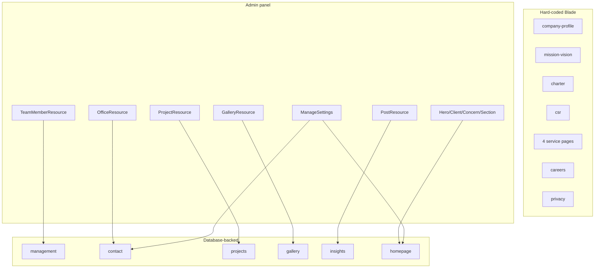

# 07 — Public Pages Reference

> **Purpose:** One authoritative entry per public page: URL, controller method, view, SEO metadata, content source, partials used, and known gaps.
> **Audience:** Content editors, developers, and QA.
> **Last reviewed:** 2026-10-19
> **Evidence basis:** `routes/web.php`, `app/Http/Controllers/HomeController.php`, `app/Http/Controllers/InsightController.php`, and all 19 page Blade files were read in full. Pages were not rendered in a browser (no shell).

**Verification legend:** ✅ source-verified · 🟡 runtime-unverified · ⚠️ partial · ⛔ missing · 🕓 legacy · ❓ unknown

---

## 1. Page inventory

| # | URL | View | Content | SEO array |
|---|---|---|---|---|
| 1 | `/` | `pages/home.blade.php` | DB + fallbacks | `HomeController.php:82-86` |
| 2 | `/company-profile` | `pages/company-profile.blade.php` | static | 104-108 |
| 3 | `/mission-vision` | `pages/mission-vision.blade.php` | static | 115-119 |
| 4 | `/charter-of-unique-group` | `pages/charter-of-unique-group.blade.php` | static | 126-130 |
| 5 | `/management` | `pages/management.blade.php` | DB `team_members` | 137-141 |
| 6 | `/corporate-social-responsibility` | `pages/corporate-social-responsibility.blade.php` | static | 149-153 |
| 7 | `/contact` | `pages/contact.blade.php` | DB `offices` + fallback | 160-164 |
| 8 | `/hospitality-management` | `pages/hospitality-management.blade.php` | static + Service schema | 172-181 |
| 9 | `/security-fire-life-safety` | `pages/security-fire-life-safety.blade.php` | static + Service schema | 188-197 |
| 10 | `/cleaning-white-glove-housekeeping` | `pages/cleaning-white-glove-housekeeping.blade.php` | static + Service schema | 204-213 |
| 11 | `/mep-mechanical-electrical-plumbing` | `pages/mep-mechanical-electrical-plumbing.blade.php` | static + Service schema | 220-229 |
| 12 | `/projects` | `pages/projects.blade.php` | DB `projects` | 236-240 |
| 13 | `/gallery` | `pages/gallery.blade.php` | DB `gallery_images` | 248-252 |
| 14 | `/careers` | `pages/careers.blade.php` | static, mailto | 271-275 |
| 15 | `/privacy-policy` | `pages/privacy.blade.php` | static | 260-264 |
| 16 | `/insights` | `pages/insights.blade.php` | DB `posts` | `InsightController.php:33-39` |
| 17 | `/insights/{slug}` | `pages/insight.blade.php` | DB `posts` | `InsightController.php:67-76` |
| 18 | `/insights/feed` | `pages/insights-feed.blade.php` | DB `posts` | n/a |

---

## 2. Layout and shared partials

Every page extends `resources/views/layouts/app.blade.php`.

| Order | Include | File |
|---|---|---|
| 1 | SEO head | `partials/seo.blade.php` |
| 2 | Vite assets | `@vite(['resources/css/app.css','resources/js/app.js'])` (line 8) |
| 3 | Skip link | inline (12-14) |
| 4 | Header | `partials/header.blade.php` (16) |
| 5 | Breadcrumbs | `partials/breadcrumbs.blade.php` (19) |
| 6 | Page content | `@yield('content')` (20) |
| 7 | Footer | `partials/footer.blade.php` (23) |
| 8 | WhatsApp float | `partials/whatsapp-float.blade.php` (25) |
| 9 | Consent banner | `partials/consent.blade.php` (27) |
| 10 | `@stack('scripts')` | (29) |

Breadcrumbs come from `App\Support\Breadcrumbs::forRoute(request()->route()?->getName())` (line 2). Only routes listed in `Breadcrumbs::TRAILS` (`Breadcrumbs.php:13-29`) get a trail; the homepage and insight detail pages supply their own.

---

## 3. Homepage — `/`

**Controller:** `HomeController::index` (18-99)
**View:** `pages/home.blade.php` (43 lines) → 14 section partials
**Full composition:** see [08 — Homepage Composition](08-homepage-composition.md)

SEO:

| Field | Value |
|---|---|
| title | `HANSA Management Ltd. \| Hospitality and Facility Management Services in Dhaka` |
| description | facility management, 5-star hotel staffing, security, cleaning, MEP |
| canonical | `https://hansamgt.com/` |

Data passed (81-98): `heroSlides`, `clients`, `concerns`, `latestPosts`, `offices`, `commitments`, `statistics`, `glanceCards`, `whyPoints`, `projects`, `hasHero => true`.

---

## 4. About pages

All five are **static Blade** with no database dependency. Each uses `pages/partials/_sidebar-about.blade.php` and ends with `_slogan`.

### 4.1 `/company-profile`

- Method `history` (101-110). View `pages/company-profile.blade.php`.
- Content: founding by Unique Group, incorporation in 2015, service scope.
- Canonical `https://hansamgt.com/company-profile`.
- ⚠️ Method name `history` is a legacy CodeIgniter name; the URL is `company-profile`.

### 4.2 `/mission-vision`

- Method `vision` (112-121). View `pages/mission-vision.blade.php`.
- Two cards (mission, vision) using `public/images/pages/icons/mission-1-120x111.png` and `vision-1-111x111.png`.
- Canonical `https://hansamgt.com/mission-vision`.

### 4.3 `/charter-of-unique-group`

- Method `charter` (123-132). View `pages/charter-of-unique-group.blade.php`.
- Content: Unique Group operating since 1982, values/timeline.
- Canonical `https://hansamgt.com/charter-of-unique-group`.

### 4.4 `/corporate-social-responsibility`

- Method `csr` (146-155). View `pages/corporate-social-responsibility.blade.php`.
- Content: green environment and community commitments. Banner images `CSR1.jpg`, `CSR2.jpg`, `CSR25.jpg`.
- Canonical `https://hansamgt.com/corporate-social-responsibility`.

### 4.5 `/management`

- Method `management` (134-144). View `pages/management.blade.php`.
- **DB-backed:** `$this->teamMembers()` (353-372) maps `TeamMember::active()->ordered()` into `id, src, alt, role, name, modalName, teaser, bio`.
- UI: flip cards; each card opens a native `<dialog>` whose id is the member's `slug`. The `chairman-message`, `md-message`, `ceo-message`, `coo-message` anchors are preserved by the seeded slugs (`2026_10_17_000006_create_team_members_table.php` docblock).
- **Fallback:** when the table is empty or the query throws, `teamMembers()` returns `[]` and the page renders with no cards. ⚠️ There is **no** hard-coded fallback list for management, unlike offices/projects/gallery.
- Canonical `https://hansamgt.com/management`.

---

## 5. Service pages

All four share a layout pattern: hero/banner, intro, service list (`svc-list`), `_sidebar-services`, `_slogan`. Each supplies a `service` array to the SEO partial, which emits a schema.org `Service` node (`seo.blade.php:128-140`).

| Page | Method | Service schema name | Canonical |
|---|---|---|---|
| `/hospitality-management` | `hardService` (169-183) | Hospitality Management | `…/hospitality-management` |
| `/security-fire-life-safety` | `softService` (185-199) | Security Surveillance, Fire Life Safety & Risk Management | `…/security-fire-life-safety` |
| `/cleaning-white-glove-housekeeping` | `payperUse` (201-215) | Cleaning & White-Glove Housekeeping | `…/cleaning-white-glove-housekeeping` |
| `/mep-mechanical-electrical-plumbing` | `riskManagement` (217-231) | MEP (Mechanical, Electrical & Plumbing) | `…/mep-mechanical-electrical-plumbing` |

Service schema shape (`HomeController.php:176-181` etc.):

```php
'service' => [
    'name' => '…',
    'type' => '… services',
    'description' => '…',
]
```

`seo.blade.php:130-139` adds `@id`, `url`, `provider` (`#organization`), and `areaServed: Country Bangladesh`.

⚠️ The service **copy** on these pages is hard-coded; editing it requires a code change. Only the four service *links* in the sidebar are centralised (`_sidebar-services.blade.php:3-8`), and even those are duplicated in `partials/nav.blade.php:32-43` and `partials/footer.blade.php:19-22`.

---

## 6. `/contact`

**Controller:** `contact` (157-167)
**View:** `pages/contact.blade.php`

Structure:

1. `<h1>Contact HANSA Management Ltd.</h1>` (line 5)
2. Contact strip: Information Desk phone (13), conditional Fax (16-24), Email (29) — all from `Settings`
3. Office cards loop over `$offices` (41-60):
   - address always
   - mobile only if `$office['phone']` (49-51)
   - landline only if set (52-54)
   - email only if set (55-57)
   - social icons via `partials.social-links` style `card`
4. Office map: `partials/office-map` — renders **only** when at least one office has a verified coordinate pair
5. Contact form: `pages/partials/_contact-form.blade.php` with `$prefix` unique per instance

**Fallback:** `HomeController::offices()` (428-452) returns `DEFAULT_OFFICES` (462-499) when the table is empty **or the query throws**. The constant duplicates the four seeded offices with `latitude`/`longitude` hard-coded `null`.

**Form target:** `url('contact')` (`_contact-form.blade.php`), POST, CSRF included. Validation and mail behaviour: [10 — Contact & Enquiries](10-contact-and-enquiries.md).

⚠️ Because `DEFAULT_OFFICES` exists, an empty `offices` table silently renders the four legacy offices — an editor who deactivates all offices will still see four on the page.

---

## 7. `/projects`

**Controller:** `project` (233-243)
**View:** `pages/projects.blade.php`

- `$this->projects()` (284-300) maps `Project::active()->ordered()` to `src, alt, title, location, cat`.
- `cat` is normalised: anything that is not `upcoming` becomes `ongoing` (293).
- **Filter:** inline JavaScript toggles cards by `data-category`; there is no server-side filter and no pagination.
- **Fallback:** returns `[]` on failure; the Blade carries **11 hard-coded fallback projects** when the array is empty.
- Canonical `https://hansamgt.com/projects`.

⚠️ The page has no per-project detail route. Projects are cards only.

---

## 8. `/gallery`

**Controller:** `siteManagement` (245-255)
**View:** `pages/gallery.blade.php`

- `$this->galleryPhotos()` (333-346) maps `GalleryImage::active()->ordered()` to `src, caption`.
- Lightbox: native `<dialog>` element; no JS library.
- Caption is used as both `<figcaption>` and `alt`.
- **Fallback:** `[]` → 12 hard-coded photos in the Blade.
- Canonical `https://hansamgt.com/gallery`.

⚠️ `gallery_images.image` is nullable in the schema, so an image-less row renders an empty `` unless the Blade guards it. (The Blade was read; it iterates the array without an explicit empty-src guard.)

---

## 9. `/careers`

**Controller:** `careers` (268-277)
**View:** `pages/careers.blade.php` (71 lines)

Content sections:

1. Intro + team photo (`images/home/slider/hansa-management-team-group-photo.jpg`)
2. "Why build your career at HANSA" — six cards (17-41)
3. "Areas we recruit for" — five categories in two lists (44-54)
4. "How to apply" — **email CV to `Settings::get('email')` or call the information desk** (58)
5. Sidebar CTA with `mailto:` button (61-67)
6. `_slogan`

⛔ **No application form, no file upload, no job listings table, no `Job` model.** Applications are handled entirely outside the application.

Canonical `https://hansamgt.com/careers`.

---

## 10. `/privacy-policy`

**Controller:** `privacy` (257-266)
**View:** `pages/privacy.blade.php`

- 13 numbered sections covering collection, use, cookies, consent, sharing, retention, rights, contact.
- Uses `Settings::get('privacy_updated')` for the "last updated" date.
- Links to the consent control so a visitor can change their choice.

⚠️ **Policy/implementation mismatch:** the page states specific retention periods (24 months / 12 months in the policy copy), but there is **no retention mechanism anywhere in the code** — no scheduled deletion, no expiry column, no pruning command. See [16 — Analytics, Consent & Privacy](16-analytics-consent-and-privacy.md#6-retention--the-central-gap) and [21 — Known Issues](21-known-issues-decisions-and-roadmap.md).

Canonical `https://hansamgt.com/privacy-policy`.

---

## 11. `/insights`

**Controller:** `InsightController::index` (21-41)
**View:** `pages/insights.blade.php`

- Query: `Post::published()->ordered()->paginate(9)` (`PER_PAGE = 9`, line 14).
- On DB failure: `new LengthAwarePaginator([], 0, 9)` (28) — an empty page, not a 500.
- Empty state: "New articles are on the way." with links to services and contact (10-18).
- Card: optional cover image (600×400, lazy), date, `<h2>` title link, 150-char summary, "Read article".
- Pagination links rendered below the grid.
- SEO adds `feed` link and an `ItemList` schema (`itemListSchema`, 122-141).

Full detail: [09 — Insights Subsystem](09-insights-subsystem.md).

---

## 12. `/insights/{slug}`

**Controller:** `InsightController::show` (46-78)
**View:** `pages/insight.blade.php`

- Looks up `Post::published()->where('slug', $slug)->first()`.
- `abort_if($post === null, 404)` (54).
- Renders: `<h1>`, date, optional cover (1120×630), excerpt as lede, **unescaped body** (`{!! $post->body !!}`, line 28), back link.
- Related articles: up to 3, excluding self (`relatedPosts`, 105-117); sidebar hidden unless ≥2 related (line 39).
- Breadcrumbs supplied manually: Home → Insights → truncated title (62-66).
- Schema: `BlogPosting` (`articleSchema`, 146-172).

⚠️ **Trust boundary:** the body is rich-text HTML from the Filament `RichEditor` and is rendered without escaping. Any authenticated admin can inject script. CSP allows `'unsafe-inline'` on the public site, so inline `<script>` in an article body would execute. Documented as a finding in [17 — Security](17-security-and-hardening.md#6-xss-trust-boundaries).

---

## 13. `/insights/feed`

**Controller:** `InsightController::feed` (83-94)
**View:** `pages/insights-feed.blade.php`

- Latest 20 published posts.
- `Content-Type: application/rss+xml; charset=UTF-8`.
- RSS 2.0 with `atom:link` self-reference, `pubDate` in RFC 2822, 300-char description.
- No caching headers set explicitly.

---

## 14. Error pages

| Status | View | Behaviour |
|---|---|---|
| 404 | `resources/views/errors/404.blade.php` | used by `abort_if` and unknown routes |
| 500 | `resources/views/errors/500.blade.php` | used on unhandled exceptions |

Both receive `X-Robots-Tag: noindex, nofollow` from `SecurityHeaders.php:39-41`. ✅

---

## 15. Content-source summary



| Page | Editable in admin? |
|---|---|
| Homepage hero, clients, concerns, sections, featured projects | ✅ |
| Management | ✅ |
| Contact offices | ✅ |
| Projects | ✅ |
| Gallery | ✅ |
| Insights | ✅ |
| Company profile, mission/vision, charter, CSR | ⛔ code only |
| Four service pages | ⛔ code only |
| Careers | ⛔ code only (email/phone values ✅) |
| Privacy policy | ⚠️ only the "last updated" date |

---

## Known limitations

- Pages were **not rendered**; visual/layout claims are from Blade source only.
- The gallery empty-`src` case was not exercised.
- `pages/placeholder.blade.php` exists but is **not routed** — a dev leftover.
- `resources/views/welcome.blade.php` exists but is **not routed**.
- Exact copy on static pages was read but not reproduced here; this chapter documents structure, not marketing text.

---

## Related chapters

- [06 — Routing & URL Map](06-routing-and-url-map.md)
- [08 — Homepage Composition](08-homepage-composition.md)
- [09 — Insights Subsystem](09-insights-subsystem.md)
- [10 — Contact & Enquiries](10-contact-and-enquiries.md)
- [15 — SEO & Structured Data](15-seo-and-structured-data.md)
- [18 — Frontend Assets & Accessibility](18-frontend-assets-and-accessibility.md)
