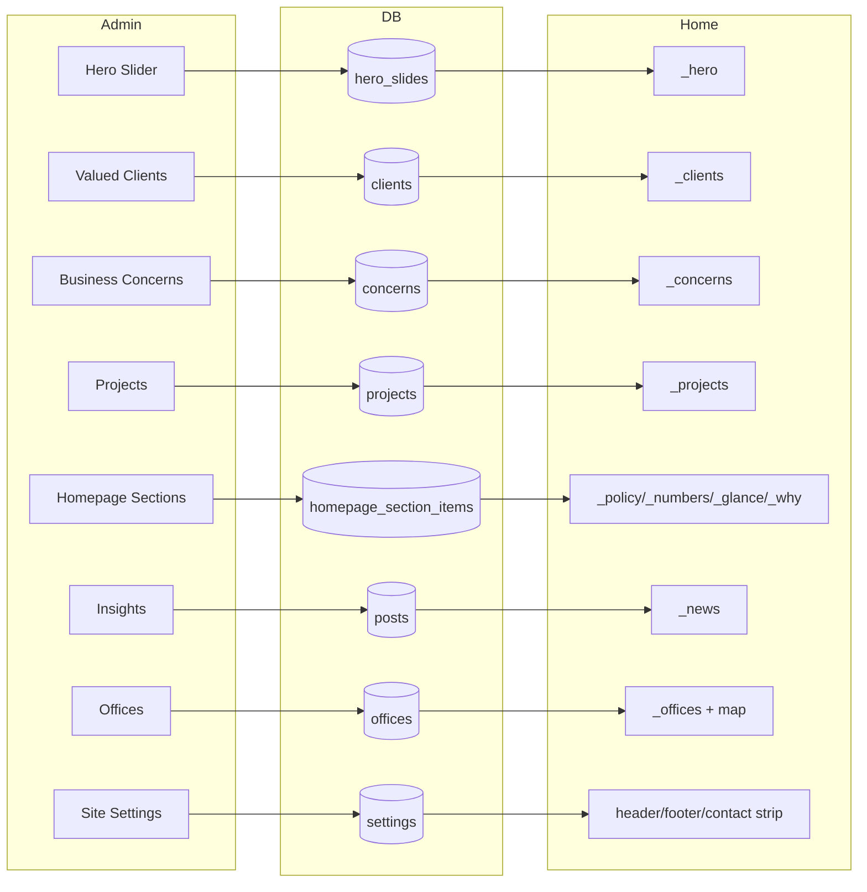

# 08 — Homepage Composition

> **Purpose:** Document the homepage block by block: order, data source, fallback content, interaction behaviour, and which admin resource controls it.
> **Audience:** Content editors and front-end developers.
> **Last reviewed:** 2026-10-19
> **Evidence basis:** `resources/views/pages/home.blade.php`, all 14 partials in `pages/home/sections/`, `app/Http/Controllers/HomeController.php:18-99, 383-418`, `app/Models/HomepageSectionItem.php`, `resources/js/app.js`. Not rendered in a browser.

**Verification legend:** ✅ source-verified · 🟡 runtime-unverified · ⚠️ partial · ⛔ missing · 🕓 legacy

---

## 1. Block order

`resources/views/pages/home.blade.php:28-42`:

| # | Partial | Anchor / purpose | Source |
|---|---|---|---|
| 1 | `_hero` | hero rotator | DB `hero_slides` + 7 fallbacks |
| 2 | `_slogan` | brand statement + canvas particles | static |
| 3 | `_policy` | 3 commitment cards | DB `homepage_section_items` section `commitments` |
| 4 | `_services` | 4 service cards | static, legacy icon fonts |
| 5 | `_numbers` | 5 statistics, count-up | DB section `numbers` |
| 6 | `_glance` | 8 flip cards | DB section `glance` |
| 7 | `_why` | 12 bullets, 2 columns | DB section `why` |
| 8 | `_clients` | logo carousel, 3000 ms | DB `clients` |
| 9 | `_projects` | 4 featured projects | DB `projects` (`is_featured`) |
| 10 | `_concerns` | logo carousel, 950 ms | DB `concerns` |
| 11 | `_news` | 2 latest posts | DB `posts` + 2 fallback cards |
| 12 | `_contact` | enquiry form | static form, POST `/contact` |
| 13 | `partials/office-map` | click-to-load maps | DB `offices` with coordinates |
| 14 | `_offices` | office cards | DB `offices` + `DEFAULT_OFFICES` |
| 15 | `_rail` | 7 anchor links | static |

> Note: the list has **15 includes** but 14 live in `pages/home/sections/`; `office-map` is a shared partial. Prior documents describe "14 sections" — that counts the section partials only.

---

## 2. Data loading

`HomeController::index` (18-99) performs, in order, each inside its own `try/catch (\Throwable)`:

| Data | Lines | Query | On failure |
|---|---|---|---|
| `$heroSlides` | 23-36 | `HeroSlide::active()->ordered()` → `[src, alt]` | `[]` |
| `$clients` | 38-51 | `Client::active()->ordered()` → `[src, alt]` | `[]` |
| `$concerns` | 53-66 | `Concern::active()->ordered()` → `[src, alt]` | `[]` |
| `$latestPosts` | 68-77 | `Post::published()->ordered()->limit(2)` | `collect()` |
| `$homepageSections` | 79 | `homepageSections()` (383-418) | `collect()` grouped |
| `$offices` | 92 | `offices()` (428-452) | `DEFAULT_OFFICES` |
| `$projects` | 97 | `featuredProjects()` (311-326) | `[]` |

Each Blade partial then applies its **own** hard-coded fallback when its array is empty. This is a two-level fallback: controller returns `[]`, view substitutes published content.

**Consequence:** a database outage produces a fully rendered homepage with legacy content, and **no visible error**. Uptime monitors that only check HTTP 200 will not detect the outage. See [02 — Architecture](02-architecture-and-request-lifecycle.md#4-the-fallback-pattern).

---

## 3. Block detail

### 3.1 Hero (`_hero.blade.php`)

- 7 hard-coded fallback slides.
- Rotator interval **5000 ms**.
- Arrows + dots; keyboard accessible.
- `home.blade.php:4` preloads the first slide with `fetchpriority="high"`.
- Height `clamp(560px, 92vh, 880px)`, reduced to `min(74vh, 620px)` ≤1024 px and `min(62vw, 300px)` ≤640 px (`home.blade.php:12,21,22`).
- Admin: **Hero Slider** (`HeroSlideResource`), upload to `hero-slides`, max 2 MB.

### 3.2 Slogan (`_slogan.blade.php`)

- Static brand statement.
- Canvas particle animation (`app.js:191-285`).
- Respects `prefers-reduced-motion` (see [18 — Frontend](18-frontend-assets-and-accessibility.md#23-motion-preferences)).

### 3.3 Policy / commitments (`_policy.blade.php`)

- 3 cards. Each: image, icon, title, body.
- Icon key from `homepage_section_items.icon`; allowed values `polygon`, `safety`, `bulb` (`HomepageSectionItem::ICONS`, 34-38). The SVG paths are inline in the Blade.
- Admin: **Homepage Sections**, section = `commitments`.

### 3.4 Services (`_services.blade.php`)

- 4 cards linking to the four service pages.
- Uses **legacy icon fonts** (`stm93ff`, `icomoon0b43`) rather than SVG. 🕓
- **Not editable in admin.** The migration docblock explicitly notes "Our Services" cards are *not* in `homepage_section_items` (`2026_10_17_000007_…:19-21`).

### 3.5 Numbers (`_numbers.blade.php`)

- 5 statistics with count-up animation (`app.js:369-425`).
- Value from `display_value`: fixed `value` or `years since value_from_year`.
- Admin: section = `numbers`. Fields: `title` (label), `value` **or** `value_from_year`.

### 3.6 Glance (`_glance.blade.php`)

- 8 flip cards: image, title, body.
- Admin: section = `glance`.

### 3.7 Why choose HANSA (`_why.blade.php`)

- Bullet list in two columns.
- `group` = `1` (left) or `2` (right).
- Admin: section = `why`. Only `body` and `group` are used.

### 3.8 Clients (`_clients.blade.php`)

- Logo carousel, autoplay **3000 ms**.
- 18 fallback logos when DB empty.
- Admin: **Valued Clients** (`ClientResource`), upload to `clients`, max 2 MB.

### 3.9 Featured projects (`_projects.blade.php`)

- 4 cards from `Project::active()->featured()->homepageOrdered()`.
- Wording comes from `homepageTitle/Location/Alt`, falling back to the main columns (`Project.php:104-117`).
- 4 hard-coded fallbacks.
- Admin: **Projects**, "Homepage card" section — `is_featured`, `homepage_title`, `homepage_location`, `homepage_alt`, `homepage_sort`.

### 3.10 Concerns (`_concerns.blade.php`)

- Logo carousel, autoplay **950 ms**.
- 13 fallback logos.
- Admin: **Business Concerns** (`ConcernResource`).

### 3.11 Latest news (`_news.blade.php`)

- 2 latest published posts.
- 2 hard-coded fallback cards when empty.
- Admin: **Insights** (`PostResource`).

### 3.12 Contact form (`_contact.blade.php`)

- `<form method="post" action="{{ url('contact') }}" aria-label="Contact HANSA">` (line 8).
- Success flash: `session('contact_success')` rendered as `role="status"` (10-11).
- Fields: name, email, phone, message + CSRF (`_contact-form.blade.php`).
- Same endpoint as `/contact`; the controller redirects `back()`, so the visitor stays on the homepage.

### 3.13 Office map (`partials/office-map.blade.php`)

- Renders **only** when `config('site.maps.enabled')` **and** at least one office has a valid coordinate pair (`OfficeMap::enabled`, 73-76).
- One iframe per verified office; no `src` until the visitor presses "Load Google Map".
- Directions link always visible.
- With the seeded data (all coordinates null), **nothing renders**. ✅

### 3.14 Offices (`_offices.blade.php`)

- Cards from `$offices` (same array as `/contact`).
- Falls back to `DEFAULT_OFFICES` (4 legacy offices).

### 3.15 Rail (`_rail.blade.php`)

- 7 anchor links to page sections.
- Smooth scroll + active-state highlighting (`app.js:349-368`).

---

## 4. Admin → public content flow

Every arrow is a plain `where is_active` query — **no caching layer** except `Settings` (which caches `settings` rows only).

---

## 5. What is *not* editable from the admin

| Homepage element | Why |
|---|---|
| Hero headline / CTA text | hard-coded in `_hero.blade.php` |
| Slogan band | hard-coded |
| Four "Our Services" cards | hard-coded; explicitly excluded from `homepage_section_items` |
| "Why choose HANSA" heading | hard-coded (only bullets are DB) |
| Section headings ("HANSA in Numbers", etc.) | hard-coded |
| Rail links | hard-coded |
| Contact section heading/copy | hard-coded |

⚠️ This is the single most common source of editor confusion: the admin manages *items inside* sections, not the section headings or the surrounding copy.

---

## 6. Front-end behaviour inventory

| Behaviour | File / lines | Notes |
|---|---|---|
| Sticky header | `app.js:9-17` | CSS var `--hansa-header-h: 105px` |
| Mobile menu | `app.js:18-84` | slide submenu |
| Hero rotator | `app.js:98-190` | 5 s, pauses on hover/focus |
| Slogan particles | `app.js:191-285` | canvas |
| Carousels | `app.js:286-348` | `[data-carousel]`, per-element interval |
| Rail links | `app.js:349-368` | scroll + active |
| Count-up | `app.js:369-425` | `[data-countup]`, IntersectionObserver |
| Scroll reveal | `app.js:426-469` | `[data-reveal]` |
| Consent | `consent.js` | see [16](16-analytics-consent-and-privacy.md) |
| Office map | `office-map.js` | click-to-load, 12 s slow hint |

All initialisation runs on `DOMContentLoaded` (`app.js:85`).

---

## Known limitations

- Carousel intervals were read from JS constants, not measured at runtime.
- Fallback slide/logo/project counts were read from the Blade arrays; not counted in a browser.
- Animation behaviour under `prefers-reduced-motion` is implemented in CSS/JS but was not visually verified.
- Whether the seeded database actually populates every section is unknown (no DB access).

---

## Related chapters

- [07 — Public Pages Reference](07-public-pages-reference.md)
- [11 — Admin Panel Reference](11-admin-panel-reference.md)
- [13 — Database & Data Dictionary](13-database-and-data-dictionary.md)
- [14 — Media & Image Pipeline](14-media-and-image-pipeline.md)
- [18 — Frontend Assets & Accessibility](18-frontend-assets-and-accessibility.md)
