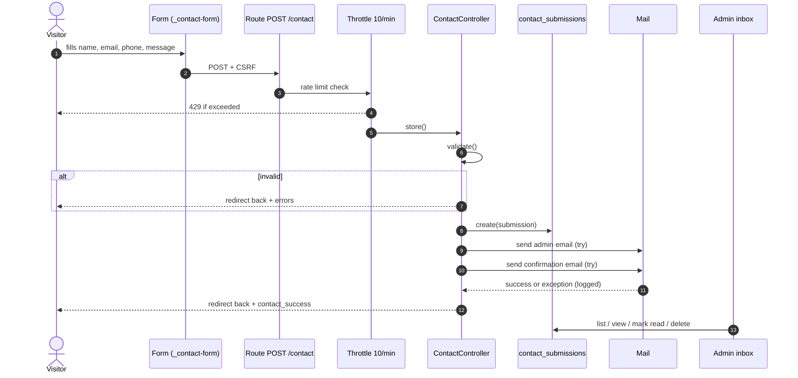

# 10 — Contact & Enquiries

> **Purpose:** Document the enquiry pipeline end to end — form, validation, persistence, mail, admin inbox, and the privacy/retention gaps.
> **Audience:** Developers, operations staff who triage enquiries, and anyone assessing PII handling.
> **Last reviewed:** 2026-10-24
> **Evidence basis:** `app/Http/Controllers/ContactController.php`, `resources/views/pages/partials/_contact-form.blade.php`, `resources/views/pages/home/sections/_contact.blade.php`, `resources/views/pages/contact.blade.php`, `resources/views/emails/contact-admin.blade.php`, `resources/views/emails/contact-confirmation.blade.php`, `app/Filament/Resources/ContactSubmissions/ContactSubmissionResource.php`, `app/Filament/Pages/ManageSettings.php:91-108`, `database/migrations/2026_10_15_000002_create_contact_submissions_table.php`, `routes/web.php:16-18`.

**Verification legend:** ✅ source-verified · 🟡 runtime-unverified · ⚠️ partial · ⛔ missing · ❓ unknown

> **No real enquiry data appears in this chapter.** Field names and limits only.

---

## 1. Pipeline overview



---

## 2. Where the form appears

| Location | View | Form action |
|---|---|---|
| Homepage "Let's Talk" section | `pages/home/sections/_contact.blade.php:8` | `url('contact')` |
| Contact page | `pages/contact.blade.php` includes `partials/_contact-form` | same endpoint |

Both post to **the same** `POST /contact` route. The controller redirects `back()`, so the visitor returns to whichever page hosted the form.

The form partial is parameterised by `$prefix` so the two instances have unique `id`/`for` pairs (`_contact-form.blade.php:6,11,16,21`).

---

## 3. Fields and validation

### 3.1 Form markup

`resources/views/pages/partials/_contact-form.blade.php`:

| Field | Type | Required | Autocomplete | Placeholder |
|---|---|---|---|---|
| `name` | text | ✅ | `name` | Full Name |
| `email` | email | ✅ | `email` | Email |
| `phone` | tel | ✅ | `tel` | Phone Number |
| `message` | textarea (4 rows) | ✅ | — | Your Message * |

Plus `@csrf` (line 2), a privacy note linking to `/privacy-policy` (26-29), and a submit button (30).

Labels are `sr-only` — the placeholder is the visible label. ⚠️ Placeholder-as-label is an accessibility weakness (WCAG 3.3.2); see [18 — Frontend](18-frontend-assets-and-accessibility.md#52-known-weaknesses).

### 3.2 Server-side validation

`ContactController::store` (22-36):

| Field | Rules |
|---|---|
| `name` | `required`, `string`, `max:120` |
| `email` | `required`, `email`, `max:190` |
| `phone` | `required`, `string`, `max:30` |
| `message` | `required`, `string`, `max:5000` |

Custom messages (29-35) cover name/email/phone/message `required` and `email.email`.

**Not validated:** no `company`, `service`, `property_type`, `location`, no honeypot, no CAPTCHA, no consent checkbox, no `min` length on message. ⛔

The column lengths in the migration (`name` 120, `email` 190, `phone` 30) match the validation limits exactly. ✅

---

## 4. Rate limiting

`routes/web.php:16-18`:

```php
Route::post('/contact', [ContactController::class, 'store'])
    ->middleware('throttle:10,1')
    ->name('contact.store');
```

**10 requests per minute per client** (Laravel's default key: IP for guests). Exceeding it returns HTTP 429 with the framework's default response.

⚠️ Limitations:
- A distributed botnet or rotating proxies bypasses IP throttling.
- No per-email or per-phone throttle, so the same address can be spammed from many IPs.
- No CAPTCHA or proof-of-work.

Severity: **Medium** — the form is the only public write endpoint and it stores PII plus sends two emails per submission.

---

## 5. Persistence

`ContactController.php:38`:

```php
$submission = ContactSubmission::query()->create($validated);
```

- Written **before** any mail attempt, so a mail outage never loses a lead. ✅
- Uses the validated array only; no extra request data is stored (no IP, no user agent, no referrer). ⚠️ This limits abuse investigation but also limits data collection.
- `read_at` defaults to `null` = unread.

Table: `contact_submissions` — columns and index in [13 — Database](13-database-and-data-dictionary.md#39-contact_submissions).

---

## 6. Email

### 6.1 Recipient resolution

```php
$recipient = Settings::get('enquiry_recipient') ?: (string) config('mail.from.address');
```

(43). The recipient is editable at **Settings → Site Settings → Contact → "Send enquiries to"** (`ManageSettings.php:96-101`, email + required + max 190).

### 6.2 Messages

| Mail | View | To | Reply-To | Subject |
|---|---|---|---|---|
| Admin notification | `emails/contact-admin.blade.php` | `enquiry_recipient` | submitter's email + name | `Website enquiry from {name}` |
| Auto-confirmation | `emails/contact-confirmation.blade.php` | submitter | — | `Thanks for contacting HANSA Management Ltd.` |

The confirmation template pulls phone, legal name and email from `Settings` so it stays in sync with the panel.

### 6.3 Failure handling

Both sends are inside **one** `try/catch` (45-58):

```php
try {
    Mail::send('emails.contact-admin', …);
    Mail::send('emails.contact-confirmation', …);
} catch (\Throwable $exception) {
    report($exception);
}
```

⚠️ **If the admin mail throws, the confirmation mail is never attempted.** The visitor still sees success. The exception is logged via `report()`.

### 6.4 Transport

`config/mail.php:17` defaults to `log`. `.env.example:50-56` ships `MAIL_MAILER=log` and `MAIL_FROM_ADDRESS="hello@example.com"`. The real `.env` was **not read**.

**Confirmed source finding:** with the shipped example values, no email leaves the server and the sender is a placeholder domain. **Runtime status of production mail is unverified.**

There is a "Send test email" action in the admin (`ManageSettings.php:307-316`, 334-…) that sends `Mail::raw` to the saved recipient and surfaces failures. It exposes the truncated exception message (300 chars) in a danger notification (356-362) — which can reveal SMTP host/username. ⚠️

---

## 7. Failure modes

| Scenario | Visitor sees | Data stored | Mail sent |
|---|---|---|---|
| Valid submission, mail OK | success flash | ✅ | ✅ both |
| Valid submission, admin mail fails | success flash | ✅ | ⛔ neither |
| Valid submission, confirmation mail fails | success flash | ✅ | admin only |
| `MAIL_MAILER=log` | success flash | ✅ | ⛔ written to log |
| DB down | 500 error page | ⛔ | ⛔ |
| Validation error | redirect back + field errors | ⛔ | ⛔ |
| 11th request in a minute | 429 | ⛔ | ⛔ |
| CSRF token missing/expired | 419 | ⛔ | ⛔ |

⚠️ The success message is shown even when **no email was delivered**. The only signal is the database row and the admin inbox.

---

## 8. Admin inbox — `/admin/contact-submissions`

`app/Filament/Resources/ContactSubmissions/ContactSubmissionResource.php`.

| Property | Value |
|---|---|
| Model | `ContactSubmission` |
| Navigation group | **Operations**, sort 1 (26-28) |
| Pages | `ListContactSubmissions` (`/`), `ViewContactSubmission` (`/{record}`) (97-103) |
| Create | ⛔ disabled (`canCreate(): false`, 105-108) |
| Edit | ⛔ no edit page |
| Delete | ✅ row action + bulk delete (88-93) |

### 8.1 List table

Columns (54-75): name (searchable), email (searchable), phone, message (50-char limit), `read_at` (labelled "Read", placeholder "Unread", sortable), `created_at` ("Received", sortable). Default sort `created_at DESC`.

### 8.2 Actions

| Action | Visibility | Effect |
|---|---|---|
| View | always | opens infolist |
| Mark as read | only when `read_at === null` | sets `read_at = now()` (78-82) |
| Mark as unread | only when `read_at !== null` | sets `read_at = null` (83-87) |
| Delete | always | deletes row |
| Bulk delete | — | deletes selected |

### 8.3 View page

Infolist (`30-52`): name, received datetime, email (copyable), phone (copyable), message (full width), read-at ("Unread" placeholder).

⛔ No reply action, no mailto link, no assignment, no notes, no status beyond read/unread.

### 8.4 Dashboard signal

`DashboardStats` shows **Unread Messages** = `whereNull('read_at')->count()` (`DashboardStats.php:50-57`).

---

## 9. Privacy and retention

### 9.1 What is collected

Personally identifiable: name, email, phone, free-text message. Plus `created_at`, `read_at`.

### 9.2 Retention

| Mechanism | Exists? |
|---|---|
| Retention column | ⛔ |
| Scheduled pruning command | ⛔ |
| Artisan cleanup command | ⛔ |
| Admin bulk-delete | ✅ manual only |
| Privacy-policy retention statement | ✅ text on `/privacy-policy` |

**Confirmed mismatch:** the privacy policy states retention periods; the application implements **no automatic deletion**. Data persists until an admin manually deletes it. Severity: **Medium** (compliance risk). See [16 — Privacy](16-analytics-consent-and-privacy.md#6-retention--the-central-gap).

### 9.3 Access control

Every `is_admin` account can read every enquiry. There is no role separation, so a content editor necessarily sees PII. See [17 — Security](17-security-and-hardening.md#4-authorization).

### 9.4 Logging risk

`report($exception)` writes mail failures to the configured log channel. Depending on the exception, log lines can include the recipient address and SMTP host. `LOG_LEVEL=debug` in `.env.example` increases verbosity. ⚠️

---

## 10. Testing coverage

| Area | Test |
|---|---|
| Form renders on `/` and `/contact` | ⚠️ indirectly via `PageHeadingTest`, `OfficeMapPageTest` |
| POST success path | ⛔ none |
| Validation errors | ⛔ none |
| Throttle | ⛔ none |
| Mail dispatch | ⛔ none |
| Admin inbox actions | ⛔ none |
| `enquiry_recipient` fallback | ⛔ none |

⛔ **The contact pipeline has no automated test at all.** This is the highest-value missing test area.

---

## 11. Recommended (not implemented)

Listed for planning only; **no code was changed**.

1. Add a honeypot field and/or CAPTCHA.
2. Add `company`, `service`, `property_type`, `location` fields to qualify enquiries.
3. Send admin and confirmation mail in separate `try/catch` blocks.
4. Add a retention command + scheduler entry.
5. Add a feature test for the POST path (success, validation, throttle).
6. Consider a `status` column (new / in progress / closed) rather than a boolean read flag.
7. Set a real `MAIL_FROM_ADDRESS` before launch.

---

## Known limitations

- The POST path was **not executed**; all behaviour is source-derived.
- Actual mail delivery, spam filtering, and bounce handling are unverified.
- The real `.env` mail configuration is unknown.
- Whether any enquiry rows currently exist is unknown (database not opened).
- Throttle key behaviour is Laravel's default (IP for guests); no custom key was configured.

---

## Related chapters

- [06 — Routing & URL Map](06-routing-and-url-map.md)
- [07 — Public Pages Reference](07-public-pages-reference.md#6-contact)
- [11 — Admin Panel Reference](11-admin-panel-reference.md#8-contact-submissions--admincontact-submissions)
- [13 — Database & Data Dictionary](13-database-and-data-dictionary.md#39-contact_submissions)
- [16 — Analytics, Consent & Privacy](16-analytics-consent-and-privacy.md)
- [17 — Security & Hardening](17-security-and-hardening.md)
- [19 — Testing & QA](19-testing-and-qa.md)
- [21 — Known Issues](21-known-issues-decisions-and-roadmap.md)
