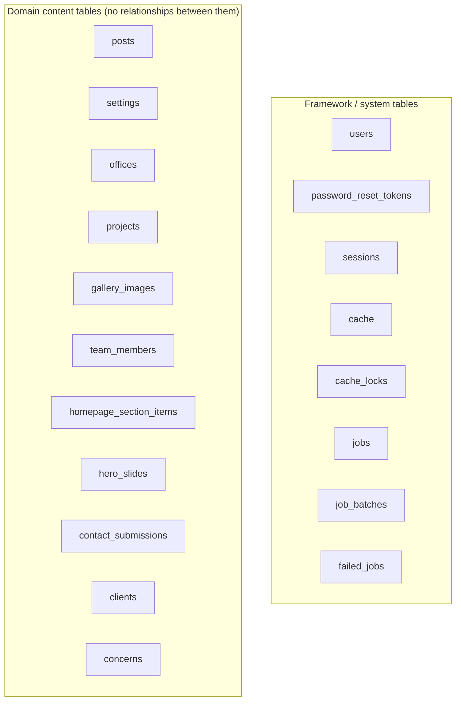

# 13 — Database & Data Dictionary

> **Purpose:** Describe every table the application creates, its columns, types, indexes and constraints, and — importantly — what relationships do *not* exist.
> **Audience:** Developers, DBAs, and anyone writing migrations, seeders, or admin features.
> **Last reviewed:** 2026-10-19
> **Evidence basis:** All 15 migration files under `database/migrations/` and all 10 seeders under `database/seeders/` were read in full. No database was queried (shell unavailable; see [Known limitations](#known-limitations)).

**Verification legend**

| Tag | Meaning |
|---|---|
| ✅ | Source-verified — implementing file read |
| 🟡 | Runtime-unverified — code read, not executed |
| ⚠️ | Partial |
| ⛔ | Not implemented |
| 🕓 | Legacy |
| ❓ | Unknown |

---

## 1. Summary

| Metric | Value |
|---|---|
| Tables created by migrations | **19** |
| Framework/system tables | 8 (`users`, `password_reset_tokens`, `sessions`, `cache`, `cache_locks`, `jobs`, `job_batches`, `failed_jobs`) |
| Domain tables | 11 (`posts`, `settings`, `offices`, `projects`, `gallery_images`, `team_members`, `homepage_section_items`, `hero_slides`, `contact_submissions`, `clients`, `concerns`) |
| Foreign keys | **0** ✅ |
| Eloquent relationships declared | **0** ✅ |
| Pivot tables | **0** ✅ |
| Soft deletes | **0** ✅ |
| Enums / check constraints | **0** ✅ |
| Migrations | 15 |
| Default connection | `sqlite` → `database/database.sqlite` (`config/database.php:20,35-44`) 🟡 live value unknown |

### 1.1 Why the model is flat

Every domain table is an independent content table. There is no author on a post, no client on a project, no office on a project, and no media table. Each table stores its own image *path string*. The only "relationship" is the implicit, unenforced `homepage_section_items.section` discriminator, which is validated only in the Filament form against `HomepageSectionItem::SECTIONS`.

> The diagram is deliberately disconnected. Drawing lines between these tables would invent relationships that do not exist in the schema or in any model. See [§5](#5-relationships-that-do-not-exist).

---

## 2. Framework tables

### 2.1 `users`

Migration: `database/migrations/0001_01_01_000000_create_users_table.php:14-22`

| Column | Type | Constraints |
|---|---|---|
| `id` | bigint unsigned, auto-increment | primary key |
| `name` | varchar(255) | not null |
| `email` | varchar(255) | not null, **unique** |
| `email_verified_at` | timestamp | nullable |
| `password` | varchar(255) | not null (hashed cast on the model) |
| `remember_token` | varchar(100) | nullable |
| `created_at`, `updated_at` | timestamp | nullable |

Model: `app/Models/User.php`. `$fillable = ['name','email','password']` (21-25); `$hidden = ['password','remember_token']` (32-35); casts `email_verified_at => datetime`, `password => hashed` (42-48). `MustVerifyEmail` is commented out (line 5), so email verification is **not** enforced. ⛔

There is **no** `role`, `is_admin`, `permissions`, or `last_login_at` column. ⛔ Authorization is discussed in [17 — Security](17-security-and-hardening.md#4-authorization).

### 2.2 `password_reset_tokens`

Same migration, lines 24-28.

| Column | Type | Constraints |
|---|---|---|
| `email` | varchar(255) | **primary key** |
| `token` | varchar(255) | not null |
| `created_at` | timestamp | nullable |

The table exists because it is part of the Laravel skeleton. **No password-reset UI is enabled** in the Filament panel (`AdminPanelProvider` never calls `->passwordReset()`), so the table is currently unused by application code. ⚠️

### 2.3 `sessions`

Same migration, lines 30-37.

| Column | Type | Constraints |
|---|---|---|
| `id` | varchar(255) | primary key |
| `user_id` | bigint unsigned | nullable, indexed |
| `ip_address` | varchar(45) | nullable |
| `user_agent` | text | nullable |
| `payload` | longText | not null |
| `last_activity` | integer | indexed |

`user_id` is indexed but **has no foreign-key constraint**. Session driver defaults to `database` (`config/session.php:21`), lifetime 120 minutes (`config/session.php:35`).

### 2.4 `cache` and `cache_locks`

Migration: `database/migrations/0001_01_01_000001_create_cache_table.php:14-24`.

| `cache` column | Type | Constraints |
|---|---|---|
| `key` | varchar(255) | primary key |
| `value` | mediumText | not null |
| `expiration` | integer | indexed |

| `cache_locks` column | Type | Constraints |
|---|---|---|
| `key` | varchar(255) | primary key |
| `owner` | varchar(255) | not null |
| `expiration` | integer | indexed |

Default cache store is `database` (`config/cache.php:18`). The application writes exactly one key of its own: `site-settings:v1` (`app/Support/Settings.php:53`), TTL 86400 s (line 63).

### 2.5 `jobs`, `job_batches`, `failed_jobs`

Migration: `database/migrations/0001_01_01_000002_create_jobs_table.php`.

`jobs` (14-22): `id`, `queue` (indexed), `payload` (longText), `attempts` (tinyint), `reserved_at`, `available_at`, `created_at`.

`job_batches` (24-…): `id` (PK), `name`, `total_jobs`, `pending_jobs`, `failed_jobs`, `failed_job_ids` (longText), `options`, `cancelled_at`, `created_at`, `finished_at`.

`failed_jobs`: standard Laravel shape in the same migration.

Queue connection defaults to `database` (`config/queue.php:16`), **but no job class exists** anywhere in `app/` (no `app/Jobs` directory). The tables are unused in practice. ⛔

---

## 3. Domain tables

### 3.1 `posts`

Migration: `database/migrations/2026_10_17_000001_create_posts_table.php:14-30`
Model: `app/Models/Post.php`

| Column | Type | Constraints / default | Notes |
|---|---|---|---|
| `id` | bigint unsigned | PK | |
| `title` | varchar(255) | not null | |
| `slug` | varchar(255) | not null, **unique** | public URL key (`getRouteKeyName`, `Post.php:50-53`) |
| `excerpt` | text | nullable | used for meta description fallback |
| `body` | longText | not null | rendered unescaped (`insight.blade.php:28`) |
| `cover_image` | varchar(255) | nullable | path on `public` disk or `public/` |
| `cover_image_alt` | varchar(255) | nullable | |
| `is_published` | boolean | default `false` | |
| `published_at` | timestamp | nullable | future dates hidden by `scopePublished` |
| `meta_title` | varchar(255) | nullable | max 70 in admin |
| `meta_description` | varchar(255) | nullable | max 180 in admin |
| `og_image` | varchar(255) | nullable | |
| `created_at`, `updated_at` | timestamp | nullable | |

Index: `(is_published, published_at)` (line 29). ✅

Publication rule (`Post::scopePublished`, `Post.php:60-67`): `is_published = true` **and** (`published_at IS NULL` **or** `published_at <= now()`). Ordering (`scopeOrdered`, 74-77): `published_at DESC, id DESC`. Display date accessor falls back to `created_at` (`publishedDate`, 83-86).

**Seeder:** `database/seeders/InsightsSeeder.php` creates 4 articles; body HTML lives in `database/seeders/data/insights/*.html`. 🟡

### 3.2 `settings`

Migration: `database/migrations/2026_10_17_000002_create_settings_table.php:22-27`
Model: `app/Models/Setting.php`

| Column | Type | Constraints |
|---|---|---|
| `id` | bigint unsigned | PK |
| `key` | varchar(255) | not null, **unique** |
| `value` | text | nullable |
| `created_at`, `updated_at` | timestamp | nullable |

Key/value store. Defaults for every key live in `config/site.php` (`site.defaults.*`), never in the table. Read path and cache behaviour: [12 — Site Settings](12-site-settings.md).

**No seeder writes to this table.** It is populated only through the admin panel. ✅

### 3.3 `offices`

Migration: `database/migrations/2026_10_17_000003_create_offices_table.php:20-30`
Coordinates migration: `database/migrations/2026_10_18_000001_add_coordinates_to_offices_table.php:24-27`
Model: `app/Models/Office.php`

| Column | Type | Constraints / default | Notes |
|---|---|---|---|
| `id` | bigint unsigned | PK | |
| `title` | varchar(255) | not null | |
| `address` | text | not null | |
| `phone` | varchar(255) | nullable | mobile |
| `landline` | varchar(255) | nullable | |
| `email` | varchar(255) | nullable | |
| `latitude` | decimal(10,7) | nullable | added later |
| `longitude` | decimal(10,7) | nullable | added later |
| `sort` | unsigned int | default `0` | |
| `is_active` | boolean | default `true` | |
| `created_at`, `updated_at` | timestamp | nullable | |

Indexes: **none** on this table. ✅

Model casts (`Office.php:32-40`): `is_active => boolean`, `sort => integer`, `latitude => float`, `longitude => float`. `hasCoordinates()` (49-57) requires both values present and within `[-90,90]` / `[-180,180]`.

**Seeder:** `OfficeSeeder.php` creates 4 offices; only the Corporate Office has phone/email; **all four have null coordinates** (21-53). 🟡

### 3.4 `projects`

Migration: `database/migrations/2026_10_17_000004_create_projects_table.php:20-35`
Model: `app/Models/Project.php`

| Column | Type | Constraints / default | Notes |
|---|---|---|---|
| `id` | bigint unsigned | PK | |
| `title` | varchar(255) | not null | |
| `location` | varchar(255) | not null | |
| `category` | varchar(255) | default `'ongoing'` | values from `Project::CATEGORIES` |
| `image` | varchar(255) | nullable | |
| `image_alt` | varchar(255) | nullable | |
| `is_featured` | boolean | default `false` | homepage band |
| `homepage_title` | varchar(255) | nullable | overrides `title` |
| `homepage_location` | varchar(255) | nullable | overrides `location` |
| `homepage_alt` | varchar(255) | nullable | overrides `image_alt` |
| `homepage_sort` | unsigned int | default `0` | homepage order |
| `sort` | unsigned int | default `0` | Projects-page order |
| `is_active` | boolean | default `true` | |
| `created_at`, `updated_at` | timestamp | nullable | |

Indexes: **none**. ✅

`Project::CATEGORIES` (`Project.php:19-22`) is the authoritative enum: `ongoing`, `upcoming`. The DB does **not** enforce it — it is a plain `varchar`. ⚠️

Two independent orderings exist deliberately: `scopeOrdered` (84-87, `sort,id`) for the Projects page, `scopeHomepageOrdered` (95-98, `homepage_sort,sort,id`) for the homepage band. Homepage text accessors fall back to the main columns (`homepageTitle`, `homepageLocation`, `homepageAlt`, 104-117).

**Seeder:** `ProjectSeeder.php` creates 11 projects. 🟡

### 3.5 `gallery_images`

Migration: `database/migrations/2026_10_17_000005_create_gallery_images_table.php:17-24`
Model: `app/Models/GalleryImage.php`

| Column | Type | Constraints / default |
|---|---|---|
| `id` | bigint unsigned | PK |
| `image` | varchar(255) | **nullable** |
| `caption` | varchar(255) | not null |
| `sort` | unsigned int | default `0` |
| `is_active` | boolean | default `true` |
| `created_at`, `updated_at` | timestamp | nullable |

Indexes: **none**. `caption` doubles as `<figcaption>` and image alt text (`GalleryResource` description; `pages/gallery.blade.php`). ✅

**Seeder:** `GallerySeeder.php` creates 12 photos. 🟡

### 3.6 `team_members`

Migration: `database/migrations/2026_10_17_000006_create_team_members_table.php:19-32`
Model: `app/Models/TeamMember.php`

| Column | Type | Constraints / default | Notes |
|---|---|---|---|
| `id` | bigint unsigned | PK | |
| `slug` | varchar(255) | not null, **unique** | doubles as dialog anchor id |
| `name` | varchar(255) | not null | |
| `role` | varchar(255) | not null | |
| `modal_name` | varchar(255) | nullable | dialog heading override |
| `teaser` | text | not null | flip-card back |
| `bio` | text | not null | dialog body |
| `image` | varchar(255) | nullable | |
| `image_alt` | varchar(255) | nullable | |
| `sort` | unsigned int | default `0` | |
| `is_active` | boolean | default `true` | |
| `created_at`, `updated_at` | timestamp | nullable | |

`slug` unique index is the only constraint. ✅

`displayName()` falls back `modal_name → name` (68-71); `imageAlt()` falls back to `"{name}, {role}"` (76-79).

**Seeder:** `TeamSeeder.php` creates 4 executives. 🟡

### 3.7 `homepage_section_items`

Migration: `database/migrations/2026_10_17_000007_create_homepage_section_items_table.php:25-41`
Model: `app/Models/HomepageSectionItem.php`

| Column | Type | Constraints / default | Notes |
|---|---|---|---|
| `id` | bigint unsigned | PK | |
| `section` | varchar(255) | not null | **no enum/check** |
| `title` | varchar(255) | nullable | heading or stat label |
| `body` | text | nullable | card text / bullet |
| `value` | varchar(255) | nullable | fixed statistic |
| `value_from_year` | unsigned smallint | nullable | derived year count |
| `image` | varchar(255) | nullable | |
| `image_alt` | varchar(255) | nullable | |
| `icon` | varchar(255) | nullable | commitment icon key |
| `group` | varchar(255) | nullable | `why` column (`1`/`2`) |
| `sort` | unsigned int | default `0` | |
| `is_active` | boolean | default `true` | |
| `created_at`, `updated_at` | timestamp | nullable | |

Index: `(section, sort)` (line 40). ✅

Allowed sections are defined **only in PHP** (`HomepageSectionItem::SECTIONS`, 19-24): `commitments`, `numbers`, `glance`, `why`. A row with any other `section` value is stored happily and simply never rendered, because `HomeController::homepageSections()` reads only those four keys (`HomeController.php:396-417`). ⚠️

Icons (`ICONS`, 34-38): `polygon`, `safety`, `bulb`. Stored as a key; the SVG lives in `_policy.blade.php`.

`display_value` (accessor, ~110-…) derives `years since value_from_year` when set, else returns `value`.

**Seeder:** `HomepageSectionSeeder.php` seeds all four sections (commitments, numbers, glance, why). 🟡

### 3.8 `hero_slides`

Migration: `database/migrations/2026_10_15_000001_create_hero_slides_table.php:14-24`
Model: `app/Models/HeroSlide.php`

| Column | Type | Constraints / default |
|---|---|---|
| `id` | bigint unsigned | PK |
| `label` | varchar(255) | nullable (admin-only label) |
| `image` | varchar(255) | **not null** |
| `alt` | varchar(255) | not null |
| `sort_order` | unsigned int | default `0` |
| `is_active` | boolean | default `true` |
| `created_at`, `updated_at` | timestamp | nullable |

Index: `(is_active, sort_order)` (line 23). ✅

**Seeder:** `HeroSlideSeeder.php` creates 7 slides. 🟡

### 3.9 `contact_submissions`

Migration: `database/migrations/2026_10_15_000002_create_contact_submissions_table.php:14-24`
Model: `app/Models/ContactSubmission.php`

| Column | Type | Constraints / default | Notes |
|---|---|---|---|
| `id` | bigint unsigned | PK | |
| `name` | varchar(120) | not null | matches validation max |
| `email` | varchar(190) | not null | matches validation max |
| `phone` | varchar(30) | not null | matches validation max |
| `message` | text | not null | validation max 5000 |
| `read_at` | timestamp | nullable | null = unread |
| `created_at`, `updated_at` | timestamp | nullable | |

Index: `created_at` (line 23). ✅

No `status`, `assigned_to`, `source`, `ip`, or `user_agent` column. ⛔ There is no retention/expiry column or job.

### 3.10 `clients`

Migration: `database/migrations/2026_10_15_000003_create_clients_table.php:14-24`
Model: `app/Models/Client.php`

| Column | Type | Constraints / default |
|---|---|---|
| `id` | bigint unsigned | PK |
| `name` | varchar(255) | not null |
| `image` | varchar(255) | not null |
| `alt` | varchar(255) | not null |
| `sort_order` | unsigned int | default `0` |
| `is_active` | boolean | default `true` |
| `created_at`, `updated_at` | timestamp | nullable |

Index: `(is_active, sort_order)` (line 23). ✅
**Seeder:** `ClientSeeder.php` creates 18 logos. 🟡

### 3.11 `concerns`

Migration: `database/migrations/2026_10_15_000004_create_concerns_table.php:14-24`
Model: `app/Models/Concern.php`

Identical shape to `clients`: `id`, `name`, `image`, `alt`, `sort_order`, `is_active`, timestamps. Index `(is_active, sort_order)` (line 23). ✅
**Seeder:** `ConcernSeeder.php` creates 13 logos. 🟡

---

## 4. Migration order

| # | File | Creates |
|---|---|---|
| 1 | `0001_01_01_000000_create_users_table.php` | `users`, `password_reset_tokens`, `sessions` |
| 2 | `0001_01_01_000001_create_cache_table.php` | `cache`, `cache_locks` |
| 3 | `0001_01_01_000002_create_jobs_table.php` | `jobs`, `job_batches`, `failed_jobs` |
| 4 | `2026_10_15_000001_create_hero_slides_table.php` | `hero_slides` |
| 5 | `2026_10_15_000002_create_contact_submissions_table.php` | `contact_submissions` |
| 6 | `2026_10_15_000003_create_clients_table.php` | `clients` |
| 7 | `2026_10_15_000004_create_concerns_table.php` | `concerns` |
| 8 | `2026_10_17_000001_create_posts_table.php` | `posts` |
| 9 | `2026_10_17_000002_create_settings_table.php` | `settings` |
| 10 | `2026_10_17_000003_create_offices_table.php` | `offices` |
| 11 | `2026_10_17_000004_create_projects_table.php` | `projects` |
| 12 | `2026_10_17_000005_create_gallery_images_table.php` | `gallery_images` |
| 13 | `2026_10_17_000006_create_team_members_table.php` | `team_members` |
| 14 | `2026_10_17_000007_create_homepage_section_items_table.php` | `homepage_section_items` |
| 15 | `2026_10_18_000001_add_coordinates_to_offices_table.php` | alters `offices` |

Because no migration references another table, ordering is only cosmetic — except that #15 must follow #10. ✅

---

## 5. Relationships that do not exist

This table exists to prevent future documentation or code from assuming a relational model that isn't there.

| Plausible relationship | Reality |
|---|---|
| `posts.author_id → users.id` | ⛔ no column, no relation |
| `posts.category_id → categories` | ⛔ no table; `articleSection` is the literal string `'Insights'` (`InsightController.php:159`) |
| `posts.tag` / tag pivot | ⛔ none |
| `projects.client_id → clients.id` | ⛔ none |
| `projects.office_id → offices.id` | ⛔ none |
| `offices.project_id` | ⛔ none |
| `homepage_section_items.section_id → sections` | ⛔ none; free string |
| `media` / `attachments` table | ⛔ none; paths stored per row |
| `contact_submissions.assigned_user_id` | ⛔ none |
| Soft-deleted records | ⛔ no `deleted_at` anywhere |

**Implication for queries:** there is no eager loading to document, no N+1 from relations, and no cascade behaviour. Deleting a `users` row has no effect on content; deleting a `projects` row has no effect on anything else. ✅

---

## 6. Seeders

`database/seeders/DatabaseSeeder.php:16-34` runs, in order:

1. `User::factory()->create(['name' => 'Test User', 'email' => 'test@example.com'])` — **unconditional** (20-23)
2. `HeroSlideSeeder`
3. `ClientSeeder`
4. `ConcernSeeder`
5. `OfficeSeeder`
6. `InsightsSeeder`
7. `ProjectSeeder`
8. `GallerySeeder`
9. `TeamSeeder`
10. `HomepageSectionSeeder`

### 6.1 Seeder idempotency

| Seeder | Strategy | Re-runnable? |
|---|---|---|
| `HeroSlideSeeder` | `updateOrCreate` (66) | ✅ yes |
| `ClientSeeder` | `updateOrCreate` (40) | ✅ yes |
| `ConcernSeeder` | `updateOrCreate` (36) | ✅ yes |
| `OfficeSeeder` | `updateOrCreate(['title' => …])` (57) | ✅ yes |
| `InsightsSeeder` | `Post::firstOrNew(['slug' => …])` (26) | ✅ yes (updates by slug) |
| `ProjectSeeder` | `updateOrCreate` (174) | ✅ yes |
| `GallerySeeder` | `updateOrCreate` (33) | ✅ yes |
| `TeamSeeder` | `updateOrCreate` (62) | ✅ yes |
| `HomepageSectionSeeder` | `updateOrCreate` (164) | ✅ yes |
| `DatabaseSeeder` user block | `User::factory()->create(...)` (20-23) | ⛔ **no** — second run violates `users.email` unique |

**Consequence:** all nine content seeders are individually idempotent, but `php artisan db:seed` as a whole is **not**: the unconditional `users` insert fails first, so a second run aborts before any content seeder executes. This is a confirmed source-level defect, not a runtime observation. Severity: **Medium** (blocks repeatable local setup and any re-seed on staging). It also means the migration report's claim that "seeders are idempotent" is true of the content seeders and false of the entry point. See [21 — Known Issues](21-known-issues-decisions-and-roadmap.md).

### 6.2 Seed volumes (source-declared)

| Seeder | Records | Evidence |
|---|---|---|
| HeroSlide | 7 | `HeroSlideSeeder.php` array |
| Client | 18 | `ClientSeeder.php` array |
| Concern | 13 | `ConcernSeeder.php` array |
| Office | 4 | `OfficeSeeder.php:21-54` |
| Insight (Post) | 4 | `InsightsSeeder.php:49-85` keys |
| Project | 11 | `ProjectSeeder.php` array |
| Gallery | 12 | `GallerySeeder.php` array |
| Team | 4 | `TeamSeeder.php` array |
| HomepageSection | 4 sections (commitments, numbers, glance, why) | `HomepageSectionSeeder.php:25+` |

🟡 These are the counts written by the seeders. **Actual row counts in any database were not verified.**

---

## 7. Storage implications

| Concern | Finding |
|---|---|
| Database file location | `database/database.sqlite` exists on disk (glob) — **not opened** (contains live data) |
| Backup | No backup command, package, or scheduled job in the repo ⛔ |
| Migrations with data changes | None — all `up()` methods are pure DDL ✅ |
| Destructive `down()` | All use `dropIfExists` / `dropColumn` — correct but destructive if run in production ⚠️ |
| Encoding | Default Laravel/SQLite; no explicit charset config for SQLite ✅ |
| Collation / case sensitivity | SQLite default; `slug` uniqueness is case-sensitive unless the host collation differs ❓ |
| MySQL/MariaDB/Postgres/SQL Server | Connections are defined in `config/database.php` but unused by default ✅ |

---

## Known limitations

- **No database was queried.** Row counts, actual column types after migration, index existence, and any drift between migrations and the live schema are **runtime-unverified**.
- `database/database.sqlite` was deliberately **not opened** (may contain real enquiry PII).
- The exact `failed_jobs` column list was only partially read; it follows the Laravel 12 skeleton unchanged. ⚠️
- Seeder idempotency was verified only for `OfficeSeeder` and the `users` insert; the remaining seeders were not read line-by-line for `updateOrCreate` usage. ❓
- No `php artisan schema:dump` or `db:table` output exists to cross-check.

---

## Related chapters

- [06 — Routing & URL Map](06-routing-and-url-map.md) — which tables each route reads
- [09 — Insights Subsystem](09-insights-subsystem.md) — `posts` in depth
- [10 — Contact & Enquiries](10-contact-and-enquiries.md) — `contact_submissions` in depth
- [11 — Admin Panel Reference](11-admin-panel-reference.md) — which resource writes which table
- [12 — Site Settings](12-site-settings.md) — `settings` in depth
- [14 — Media & Image Pipeline](14-media-and-image-pipeline.md) — image path columns
- [20 — Deployment & Operations](20-deployment-and-operations.md) — migration/seed runbook
- [21 — Known Issues](21-known-issues-decisions-and-roadmap.md) — seeder defect, backup gap
