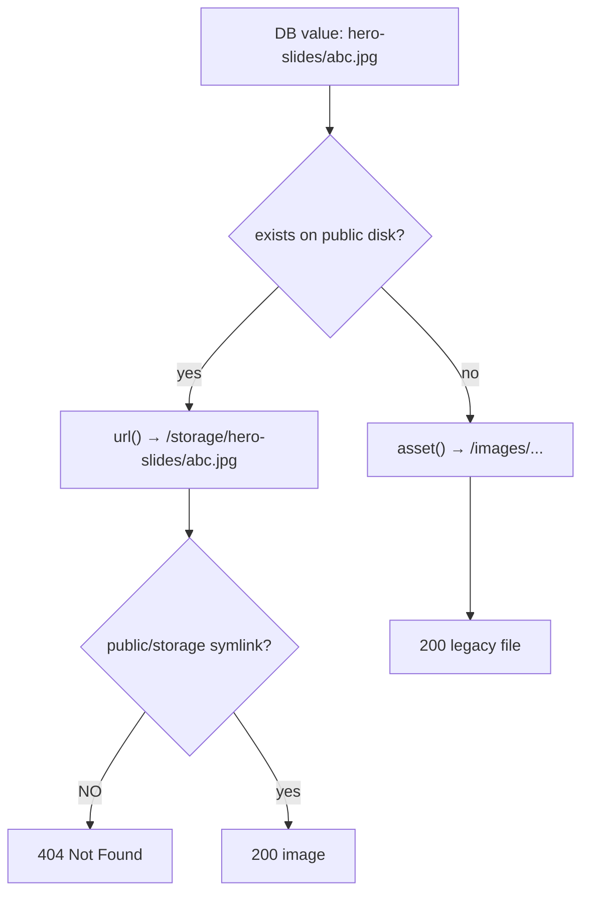
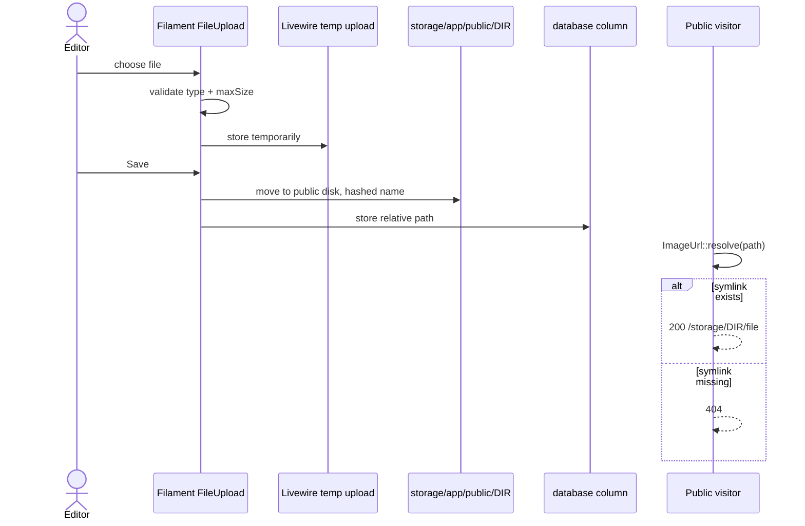

# 14 — Media & Image Pipeline

> **Purpose:** Explain how images are stored, resolved, served, and where the pipeline currently breaks in a fresh deployment.
> **Audience:** Developers, DevOps, and content editors uploading images.
> **Last reviewed:** 2026-10-19
> **Evidence basis:** `app/Support/ImageUrl.php` (read in full), all 10 Filament resources' `FileUpload` definitions, `config/filesystems.php`, `public/.htaccess`, filesystem glob of `public/` and `storage/app/public/`. **No upload was performed.**

**Verification legend:** ✅ source-verified · 🟡 runtime-unverified · ⚠️ partial · ⛔ missing · ❓ unknown

---

## 1. The core problem this pipeline solves

The site has **two generations of images**:

| Generation | Location | Example | Created by |
|---|---|---|---|
| Legacy / shipped | `public/images/**` | `images/hansa_logo_new.png` | the original CodeIgniter site |
| Admin uploads | `storage/app/public/<dir>/**` | `hero-slides/abc123.jpg` | Filament `FileUpload` |

A single database column (`hero_slides.image`, `posts.cover_image`, `settings.logo`, …) can hold **either** kind of path. `App\Support\ImageUrl` exists to resolve both into a browser-usable URL.

---

## 2. Resolution algorithm

`ImageUrl::resolve(?string $path): string` (`app/Support/ImageUrl.php:41-65`):

```text
trim the path
  ├─ empty → ''
  ├─ memoised? → return memo
  ├─ starts with http:// or https:// → return as-is
  ├─ Storage::disk('public')->exists($path) → url(Storage::disk('public')->url($path))
  └─ otherwise → asset(ltrim($path, '/'))
```

### 2.1 Branch outcomes

| Stored value | Disk file exists? | Result |
|---|---|---|
| `images/hansa_logo_new.png` | no (not on `public` disk) | `https://host/images/hansa_logo_new.png` |
| `hero-slides/abc.jpg` | yes | `https://host/storage/hero-slides/abc.jpg` |
| `https://cdn.example.com/x.jpg` | n/a | unchanged |
| `''` / `null` | n/a | `''` |
| `  logo.png  ` | — | trimmed, shares memo entry with `logo.png` |

### 2.2 Memoisation

`private static array $memo` (39) caches by trimmed path **for the lifetime of the PHP process**. The docblock (19-38) is explicit: under php-fpm that is one request; the app does not run Octane, so no cross-request leakage. `flush()` (75-78) exists for tests and mid-request disk changes; **nothing in the request lifecycle calls it**.

**Why it matters:** the logo is requested by the header, footer, and structured data in one render. Without memoisation the public disk is `stat()`ed once per occurrence per request.

**Failure semantics:** the memo entry is only assigned when a branch produces a value (53-55). If the disk throws, nothing is cached and the exception surfaces — it is not silently swallowed. ✅ Covered by `tests/Unit/ImageUrlTest.php::test_a_disk_error_is_never_remembered` (line 134).

### 2.3 Where `resolve()` is used

| Consumer | Call site |
|---|---|
| Models | `HeroSlide`, `Client`, `Concern`, `Project`, `GalleryImage`, `TeamMember`, `Post` accessors |
| Settings | `Settings::imageUrl()` (282-303) — a parallel implementation with its own memo |
| Filament uploads | `getUploadedFileUsing(fn ($file) => ['url' => ImageUrl::resolve($file)])` in every resource |
| Views | indirectly, via model accessors |

⚠️ `Settings::imageUrl()` **duplicates** the logic instead of calling `ImageUrl::resolve()`. The two can drift. Currently they agree on the branch order.

---

## 3. The shared upload pattern

Every image field in the admin panel is built the same way. Representative example from `HeroSlideResource.php`:

```php
FileUpload::make('image')
    ->image()
    ->disk('public')
    ->directory('hero-slides')
    ->visibility('public')
    ->acceptedFileTypes(['image/jpeg', 'image/png', 'image/webp'])
    ->maxSize(2048)
    ->imagePreviewHeight('200')
    ->fetchFileInformation(false)
    ->getUploadedFileUsing(fn (string $file): ?array => [
        'name' => basename($file),
        'size' => 0,
        'type' => null,
        'url'  => ImageUrl::resolve($file),
    ]);
```

### 3.1 Why `fetchFileInformation(false)`

Filament normally asks the disk for size/MIME of the stored file. Because a field may hold a `public/`-relative legacy path that is **not** on the `public` disk, that lookup can fail or throw. Disabling it and supplying a custom preview array lets one field preview both kinds of path.

⚠️ **Trade-off:** the admin UI reports `size: 0` and `type: null` for every existing image. File size and MIME are unavailable in the panel.

### 3.2 Upload directories and limits

| Resource | Field | Directory | Max size | Required |
|---|---|---|---|---|
| `HeroSlideResource` | `image` | `hero-slides` | **2 MB** | ✅ |
| `ClientResource` | `image` | `clients` | **2 MB** | ✅ |
| `ConcernResource` | `image` | `concerns` | **2 MB** | ✅ |
| `ProjectResource` | `image` | `projects` | 3 MB | ⛔ |
| `GalleryResource` | `image` | `gallery` | 3 MB | ⛔ |
| `TeamMemberResource` | `image` | `team` | 3 MB | ⛔ |
| `HomepageSectionItemResource` | `image` | `homepage` | 3 MB | ⛔ |
| `PostResource` | `cover_image` | `posts` | 3 MB | ⛔ |
| `PostResource` | `og_image` | `posts/og` | 3 MB | ⛔ |
| `ManageSettings` | `logo`, `footer_logo`, `favicon`, `og_image` | `branding` | (default) | ⛔ |

Accepted types are always `image/jpeg`, `image/png`, `image/webp`. **SVG is rejected** — a deliberate XSS mitigation, since SVG can carry script. ✅

⚠️ The 2 MB vs 3 MB split correlates with whether the field is `required`: logo/hero fields are required and capped at 2 MB; optional content images get 3 MB. There is no stated rationale in code; treat it as convention, not policy.

### 3.3 No image processing

⛔ There is **no** resizing, cropping, thumbnail generation, WebP conversion, or optimisation step. The uploaded file is stored byte-for-byte under its generated filename. Consequences:

- A 3 MB hero photo is served at 3 MB to every visitor.
- No responsive `srcset` is generated from uploads (the legacy `public/images` tree does contain hand-made `-120x111` variants, but those are static files, not generated).
- `width`/`height` attributes in Blade are hard-coded per component, not derived from the file.

---

## 4. Serving files

### 4.1 The intended path

`config/filesystems.php`:

```php
'public' => [
    'driver' => 'local',
    'root' => storage_path('app/public'),
    'url' => env('APP_URL').'/storage',
    'visibility' => 'public',
],
```

Laravel serves `storage/app/public` at `/storage` **only through a symlink** `public/storage → ../storage/app/public`, normally created by `php artisan storage:link`.

### 4.2 The missing symlink

**Confirmed source/filesystem finding:** `public/storage` **does not exist** in this checkout.

Evidence:

- `.gitignore:22` lists `/public/storage` — it is never committed, by design.
- `composer.json` `setup` script (37-44) runs `migrate --force` and `npm run build` but **never** `storage:link`.
- A filesystem glob of `public/` contains no `storage` entry.
- `storage/app/public/` **does** contain uploads: `team/` and `hero-slides/` (at least 3 files observed).

**Impact:** every URL produced by the "file exists on the public disk" branch resolves to `https://host/storage/...`, which 404s because nothing serves that prefix.



### 4.3 Which surfaces are affected

| Surface | Affected when |
|---|---|
| Hero slides uploaded via admin | always (uploads go to `hero-slides/`) |
| Team photos uploaded via admin | always |
| Client / concern logos uploaded via admin | always |
| Project / gallery images uploaded via admin | always |
| Post cover images / OG images | always |
| Branding images in Settings | always |
| Legacy images under `public/images/**` | never — served directly |

⚠️ Because `ImageUrl::resolve()` returns the `/storage/...` URL when the file **exists on the disk**, it does **not** fall back to `asset()`. The file being present is what selects the broken branch. This is the counter-intuitive part: deleting the file would make it fall back to a (probably also missing) `public/` path.

### 4.4 Fix (not applied)

```bash
php artisan storage:link
```

This is a **deployment step**, not a code change. It must run on every environment, and `composer setup` should arguably include it. Recorded as a launch blocker in [21 — Known Issues](21-known-issues-decisions-and-roadmap.md#1-launch-blockers).

---

## 5. Alt text

| Source | Alt source | Fallback |
|---|---|---|
| `hero_slides` | `alt` column (required) | none — required in admin |
| `clients` | `alt` column (required) | none |
| `concerns` | `alt` column (required) | none |
| `projects` | `image_alt`, then `homepage_alt` | `title` (via `imageAlt()`) |
| `gallery_images` | `caption` | none |
| `team_members` | `image_alt` | `"{name}, {role}"` (`TeamMember::imageAlt()`) |
| `posts` | `cover_image_alt` | post title in the card |
| Settings branding | hard-coded `"{legal_name} logo"` in `seo.blade.php:188`, `header.blade.php` | — |

⚠️ `gallery_images.caption` is doing double duty as visible caption and alt text. A caption like "Annual general meeting, 2024 — Dhaka" reads acceptably as alt; a caption like "1/12" would not.

---

## 6. Legacy asset tree

`public/images/` is large and organised by the old site:

| Path | Contents |
|---|---|
| `images/home/slider/` | hero fallbacks |
| `images/pages/` | about/service page art, `icons/` |
| `images/clients/`, `images/concerns/` | logo fallbacks |
| `images/projects/`, `images/gallery/` | project/gallery fallbacks |
| `images/team/` | team fallbacks |
| `images/logo/`, `images/hansa_logo_new.png` | branding |
| `images/insights/` | article fallbacks |

🕓 These are **not managed by the application**. They are referenced by hard-coded Blade fallbacks and by `config/site.php` defaults. Replacing one requires a file drop + deploy, not an admin action.

**Duplicate-name risk:** `public/images/**` and `storage/app/public/**` are separate namespaces. `ImageUrl` checks the storage disk **first**, so an upload named `images/foo.jpg` would shadow the static file. In practice Filament generates hashed filenames, so collision is unlikely but not impossible. ⚠️

---

## 7. Static asset caching

`public/.htaccess:72-97` sets three scoped `Cache-Control` policies:

| Scope | Header | Rationale |
|---|---|---|
| `^/build/` | `public, max-age=31536000, immutable` | Vite hashed filenames |
| `^/(images\|fonts)/` | `public, max-age=604800` (7 days) | replaceable, unhashed |
| `^/(css\|js)/` | `public, max-age=2592000` (30 days) | Filament `?v=` versioned |

`Header set` (not `always set`) means 4xx/5xx never receive these. `tests/Feature/StaticAssetCacheHeadersTest.php` asserts all of the above against the file text. ✅ (not executed)

⚠️ `/storage/**` is **not** covered by any cache rule. Uploaded images will be served with the web server's default caching (often none), even after the symlink is created.

⚠️ These rules are **Apache-only**. The file itself warns at lines 67-70 that they are unverified in production.

---

## 8. Upload lifecycle



**Deleting a record does not delete its file.** ⛔ There is no `FileUpload` cleanup hook, no observer, and no `deleteUploadedFile` configuration. Orphaned files accumulate in `storage/app/public/`. Conversely, deleting the file does not clear the database path — `ImageUrl` falls back to `asset()`, which may 404 too.

---

## 9. Verification status

| Claim | Status |
|---|---|
| Two image generations exist | ✅ verified by paths in code and glob |
| `ImageUrl` branch order | ✅ read in full |
| Memoisation is per-process | ✅ read + unit test exists |
| `public/storage` absent | ✅ glob of `public/` |
| Uploads exist under `storage/app/public` | ✅ glob (`team/`, `hero-slides/`) |
| Uploads would 404 today | 🟡 **strongly inferred** — no HTTP request was made |
| 2 MB / 3 MB limits | ✅ read from resources |
| No image processing | ✅ no package, no code path found |
| Cache headers on the live host | ❓ unverified |

---

## Known limitations

- No upload was executed, so the actual stored filename format and disk path were not observed.
- `public/storage` absence was verified locally only. The production host may have the symlink.
- The count of orphaned files was not measured.
- `config/filesystems.php` was read for the `public` disk only; S3/FTP disks are unused.
- Whether any `storage/app/public` files are actually referenced by database rows is unknown (DB not opened).

---

## Related chapters

- [05 — Configuration Reference](05-configuration-reference.md#7-filesystems-configfilesystemsphp)
- [11 — Admin Panel Reference](11-admin-panel-reference.md#10-shared-upload-pattern)
- [12 — Site Settings](12-site-settings.md#5-image-settings)
- [13 — Database & Data Dictionary](13-database-and-data-dictionary.md)
- [17 — Security & Hardening](17-security-and-hardening.md)
- [20 — Deployment & Operations](20-deployment-and-operations.md)
- [21 — Known Issues](21-known-issues-decisions-and-roadmap.md)
