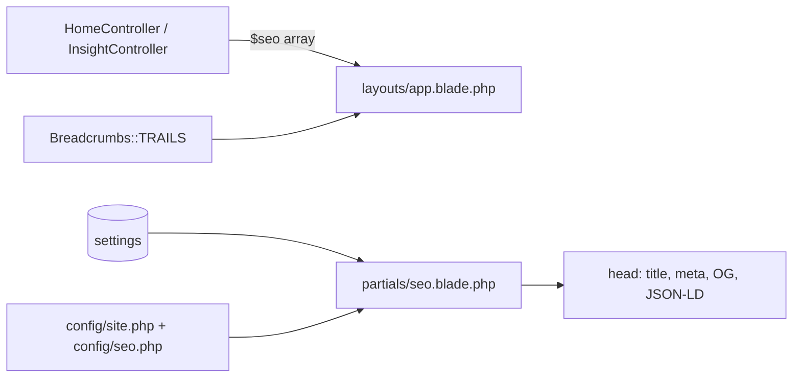

# 15 — SEO & Structured Data

> **Purpose:** Document every SEO mechanism: titles, descriptions, canonicals, robots, Open Graph, Twitter cards, JSON-LD `@graph`, sitemap, RSS, and redirects.
> **Audience:** Developers and marketing/SEO owners.
> **Last reviewed:** 2026-10-19
> **Evidence basis:** `resources/views/partials/seo.blade.php` (read in full, 208 lines), `app/Http/Controllers/HomeController.php` SEO arrays, `app/Http/Controllers/InsightController.php`, `config/seo.php`, `config/site.php`, `app/Console/Commands/GenerateSitemap.php`, `public/sitemap.xml`, `public/robots.txt`, `app/Http/Middleware/SecurityHeaders.php`, `public/.htaccess`, `app/Support/Breadcrumbs.php`. Not validated against Google's Rich Results Test or any crawler.

**Verification legend:** ✅ source-verified · 🟡 runtime-unverified · ⚠️ partial · ⛔ missing · 🕓 legacy · ❓ unknown

---

## 1. Where SEO is produced

All metadata is emitted by one partial, `resources/views/partials/seo.blade.php`, included in `<head>` by `layouts/app.blade.php:7`. Each controller action passes a `$seo` array.



There is **no** SEO package (no spatie/laravel-sitemap, no artesaos/seotools, no SEOmatic). Everything is hand-rolled. ✅

---

## 2. Per-page SEO array

Shape (all keys optional except title/description in practice):

```php
[
    'title'       => string,
    'description' => string,
    'canonical'   => string,   // absolute
    'type'        => 'website'|'article',
    'image'       => string,   // relative or absolute
    'robots'      => string,   // production only
    'feed'        => string,   // RSS link
    'service'     => ['name','type','description'],
    'schema'      => [ ...extra JSON-LD nodes... ],
    'published_time', 'modified_time',
]
```

### 2.1 Defaults when a key is absent

`seo.blade.php:16-22`:

| Key | Fallback |
|---|---|
| `title` | `"{legal_name} \| Hospitality and Facility Management Services in Dhaka"` |
| `description` | `"{legal_name}, a concern of Unique Group. …" + " Information Desk: {phone}."` |
| `canonical` | `url('/')` |
| `type` | `website` |
| `image` | `Settings::imageUrl('og_image')` |

⚠️ The fallback canonical is the **homepage URL**, not the current URL. A page that forgets to pass `canonical` will declare the homepage as canonical — a serious duplicate-content error. All 15 static pages currently do pass one (verified), but this is a trap for new pages.

### 2.2 Canonical URLs

Every page hard-codes the absolute URL:

| Page | Canonical |
|---|---|
| `/` | `https://hansamgt.com/` |
| `/company-profile` | `https://hansamgt.com/company-profile` |
| … | same pattern |
| `/insights/{slug}` | `https://hansamgt.com` + `$post->path()` |

⚠️ **Host is hard-coded** as `https://hansamgt.com` in the controllers, while `Settings::get('site_url')` is separately used for schema `@id`s and the sitemap base. If `site_url` is edited in the admin panel, canonicals do **not** follow — the two can diverge. Currently both are `https://hansamgt.com`.

---

## 3. Robots policy

`seo.blade.php:24-28`:

```php
$robots = app()->isProduction()
    ? ($seo['robots'] ?? config('seo.default_robots'))
    : 'noindex, nofollow';
```

| Environment | Result |
|---|---|
| `production` | per-page `robots` or `index, follow, max-image-preview:large, max-snippet:-1, max-video-preview:-1` |
| anything else | **always** `noindex, nofollow` |

This is a strong safety default: staging and local can never be indexed even if a page asks to be. ✅

`SecurityHeaders.php:36-41` adds a **header-level** `X-Robots-Tag`:

- `/admin*` → `noindex, nofollow, noarchive`
- any status ≥ 400 → `noindex, nofollow`

`public/robots.txt`:

```
User-agent: *
Allow: /
Disallow: /admin

Sitemap: https://hansamgt.com/sitemap.xml
```

✅ Correct and consistent.

---

## 4. Open Graph and Twitter

`seo.blade.php:181-198`:

| Tag | Value |
|---|---|
| `og:locale` | `en_US` (hard-coded) |
| `og:type` | `website` or `article` |
| `og:site_name` | `legal_name` |
| `og:url` | canonical |
| `og:title` | title |
| `og:description` | description |
| `og:image` | resolved image |
| `og:image:alt` | `"{legal_name} logo"` |
| `twitter:card` | `summary_large_image` |
| `twitter:title`, `twitter:description`, `twitter:image` | mirrors |
| `article:published_time`, `article:modified_time` | only on articles |

⚠️ `og:image:alt` is **always** "… logo", even when the image is a post cover photo. Wrong alt on every article share. Minor but real.

⚠️ `og:locale` is hard-coded `en_US` even though the business is in Bangladesh; the locale is `en` and the country is `BD`. Cosmetic.

⛔ No `og:image:width` / `og:image:height`. Some scrapers (notably LinkedIn) prefer them; without them previews may render less reliably. The post cover is designed at 1120×630 but the tag is absent.

---

## 5. JSON-LD structured data

`seo.blade.php:32-149` builds a single `@graph`:

```json
{
  "@context": "https://schema.org",
  "@graph": [
    { "@type": ["Organization","LocalBusiness"], "@id": "…/#organization", … },
    { "@type": "WebSite", "@id": "…/#website", … },
    { "@type": "WebPage", "@id": "{canonical}#webpage", … },
    { "@type": "BreadcrumbList", "@id": "{canonical}#breadcrumb", … },
    { "@type": "Service", "@id": "{canonical}#service", … }
  ]
}
```

Encoded with `JSON_UNESCAPED_SLASHES | JSON_UNESCAPED_UNICODE | JSON_HEX_TAG` (146-149). `JSON_HEX_TAG` is important: it prevents `</script>` inside a value from terminating the block. ✅

### 5.1 Organization / LocalBusiness

Always present. Fields:

| Field | Source | Omitted when |
|---|---|---|
| `name` | `legal_name` | never |
| `url` | `site_url` | never |
| `logo` | `imageUrl('logo')` | never |
| `image` | `imageUrl('og_image')` | never |
| `description` | `description` | never |
| `telephone` | `phone_primary` | never |
| `email` | `email` | never |
| `address` (PostalAddress) | 4 address settings | never (may be empty strings) |
| `parentOrganization` | `parent_name`, `parent_url` | when `parent_name` empty (78-80) |
| `sameAs` | `Settings::sameAs()` | when list empty (82-84) |
| `geo` | `latitude`, `longitude` | unless **both** filled (59-65) |
| `openingHours` | `opening_hours` | unless filled (67-69) |
| `foundingDate` | `founding_year` | unless filled (73-75) |

⚠️ `telephone` and `email` are cast to `(string)` and never omitted. If the settings were cleared they would emit `""` — schema-invalid. Currently both have defaults.

⚠️ `geo` casts to `(float)`. `ManageSettings` validates latitude/longitude as free text (max 20), not numeric (see [12 §4.5](12-site-settings.md#45-tab-seo--structured-data-220-268)). A non-numeric string becomes `0.0`, publishing a coordinate off the coast of Africa. Source-level inconsistency.

### 5.2 WebSite and WebPage

Always present. `WebPage.@id` is `{canonical}#webpage`; `isPartOf` → `#website`; `about` → `#organization`.

### 5.3 BreadcrumbList

Added only when `count($breadcrumbs) > 1` (108). `Breadcrumbs::forRoute()` returns `[Home, Current]` for any route in `TRAILS`, so 15 pages get one. The homepage gets none (empty array). Insight detail pages build their own 3-item trail in `InsightController::show` (62-66).

⚠️ The final crumb has no `url` (44) — correct per schema.org, since it is the current page.

### 5.4 Service

Only on the four service pages. `serviceType` falls back to `name`; `areaServed` is always `Country: Bangladesh`.

⚠️ `areaServed` is hard-coded to Bangladesh for all four services. If HANSA operates elsewhere this is inaccurate, but no source contradicts it.

### 5.5 ItemList (Insights index)

Built in `InsightController::itemListSchema()` (122-141) and passed via `$seo['schema']`, then appended to the graph (142-144).

⚠️ `position` restarts at 1 on each paginated page. `?page=2` produces positions 1-9 for articles 10-18. Acceptable but not ideal.

### 5.6 BlogPosting (article detail)

`InsightController::articleSchema()` (146-172). Author and publisher both point at `#organization` — correct, since there is no author field.

⚠️ `articleSection` is the literal `'Insights'` for every article. There is no real section taxonomy.

### 5.7 No other schema

⛔ No `FAQPage`, `HowTo`, `Product`, `Review`, `Person`, `Event`, `JobPosting`. The careers page has no `JobPosting` because there are no job listings.

---

## 6. Sitemap

### 6.1 Generator

`app/Console/Commands/GenerateSitemap.php`:

- Signature `sitemap:generate` (12).
- `paths()` (22-42) lists **16** static paths.
- Appends every `Post::published()->ordered()` with `lastmod = updated_at` (57-66), wrapped in `try/catch` that warns and continues (64-66).
- Writes `public/sitemap.xml` via `File::put` (81).
- Base URL from `Settings::get('site_url')`, falling back to `config('app.url')` (46).

### 6.2 Current committed file

`public/sitemap.xml` contains **20 URLs**: the 16 static paths + 4 seeded articles. All `lastmod` are `2026-10-17`. ✅ This matches the generator's output shape exactly.

### 6.3 The scheduling gap

**Confirmed source finding:** the command is **never registered** in `routes/console.php` or anywhere else. There is no `Schedule::command('sitemap:generate')`. The file is only regenerated when someone runs the command manually.

Consequences:

- Publishing an article does **not** update `sitemap.xml`.
- The committed file lists 4 articles; if the database has more, they are missing from the sitemap.
- The 16 static entries stay correct, so the damage is limited to article discovery.

**Severity: Medium.** Search engines still discover articles through the `/insights` index and internal links, but the sitemap is stale and misleading. See [21 — Known Issues](21-known-issues-decisions-and-roadmap.md#2-medium-severity).

### 6.4 Stale-documentation note

An earlier document claimed the sitemap had 14 URLs. The committed file has **20**. The claim is outdated; the generator's 16 static paths + 4 posts is the correct figure at the time of review. ✅

---

## 7. RSS

`/insights/feed` — see [09 §5](09-insights-subsystem.md#5-rss-feed--insightsfeed).

SEO-relevant points:

- Advertised via `<link rel="alternate" type="application/rss+xml">` **only on `/insights`** (`$seo['feed']`, seo.blade.php:199-201).
- Not advertised on article pages.
- `Content-Type` is set explicitly.
- ⛔ No `Cache-Control` header, so a feed reader may re-fetch on every poll.

---

## 8. Redirects and canonicalisation

Covered structurally in [06 §4](06-routing-and-url-map.md#4-legacy-redirect-routes). SEO summary:

| Rule | Effect |
|---|---|
| `/index.php/*` → 301 clean URL | removes duplicate legacy URLs |
| `/home/*` → 301 clean URL | removes duplicate legacy URLs |
| Trailing slash → 301 without | one canonical form |
| Query string preserved | no loss of campaign parameters |
| POST never redirected | form submissions unaffected |

⚠️ **Not implemented in application code:**

- `www` → non-`www` (or vice versa)
- `http` → `https`
- Uppercase → lowercase for clean URLs (only legacy segments accept both cases)

These depend entirely on the host. If both `www.hansamgt.com` and `hansamgt.com` serve 200 with the same content and the same canonical, that is acceptable; if they serve different canonicals, it is a duplicate-content problem. **Unverified.**

---

## 9. Headings and accessibility SEO

`tests/Feature/PageHeadingTest.php` asserts exactly one `<h1>` per public page across 16 routes (29-46). This is the only automated SEO guarantee. ✅ (not executed)

- Insight detail pages are **not** in that provider (the test docblock explains they need a fixture).
- Heading hierarchy (`h1 → h2 → h3`) is not tested.
- Images: most have `alt`; decorative SVGs use `aria-hidden="true"`.

---

## 10. Performance signals that affect SEO

| Signal | Status |
|---|---|
| `loading="lazy"` on below-fold images | ✅ most content images |
| `fetchpriority="high"` on hero | ✅ `home.blade.php:4` |
| `decoding="async"` | ✅ on insight cards |
| Preloaded font | ✅ Avenir on homepage |
| Hashed, immutable build assets | ✅ `.htaccess` |
| Image dimensions set (CLS) | ⚠️ partial — hard-coded per component, not for uploads |
| Responsive images (`srcset`) | ⛔ none |
| WebP/AVIF conversion | ⛔ none |
| Critical CSS inlining | ⛔ none |
| HTML compression | ❓ host-dependent |
| CDN | ⛔ none |
| Core Web Vitals measurement | ❓ no RUM/CrUX data inspected |

---

## 11. Verification checklist (not run)

These are the checks a human should perform against the live site. None could be run here (shell unavailable).

| Check | Tool |
|---|---|
| Every page returns exactly one canonical | `curl` + grep |
| Canonical host matches the served host | `curl -I` on `www` and apex |
| `robots.txt` reachable, sitemap declared | browser |
| `sitemap.xml` lists current articles | compare with `/insights` |
| JSON-LD parses | Rich Results Test / Schema Validator |
| OG preview renders | LinkedIn Post Inspector, Facebook Debugger |
| `X-Robots-Tag` on `/admin` | `curl -I /admin` |
| 301 chains are single-hop | `curl -IL` on `/index.php/home/history` |
| Staging is `noindex` | `curl` a staging URL |

---

## Known limitations

- No crawler, validator, or browser was used. All claims are source-derived.
- The live `sitemap.xml` may differ from the committed one if the command has been run in production.
- Whether production sets `APP_ENV=production` (and therefore whether pages are indexable at all) is unknown — `.env` not read.
- Search Console / Analytics property state was not inspected.
- `config/seo.php` contains only `default_robots`; no other SEO config exists.

---

## Related chapters

- [06 — Routing & URL Map](06-routing-and-url-map.md#4-legacy-redirect-routes)
- [07 — Public Pages Reference](07-public-pages-reference.md)
- [09 — Insights Subsystem](09-insights-subsystem.md)
- [12 — Site Settings](12-site-settings.md#45-tab-seo--structured-data-220-268)
- [16 — Analytics, Consent & Privacy](16-analytics-consent-and-privacy.md)
- [18 — Frontend Assets & Accessibility](18-frontend-assets-and-accessibility.md)
- [20 — Deployment & Operations](20-deployment-and-operations.md)
- [21 — Known Issues](21-known-issues-decisions-and-roadmap.md)
