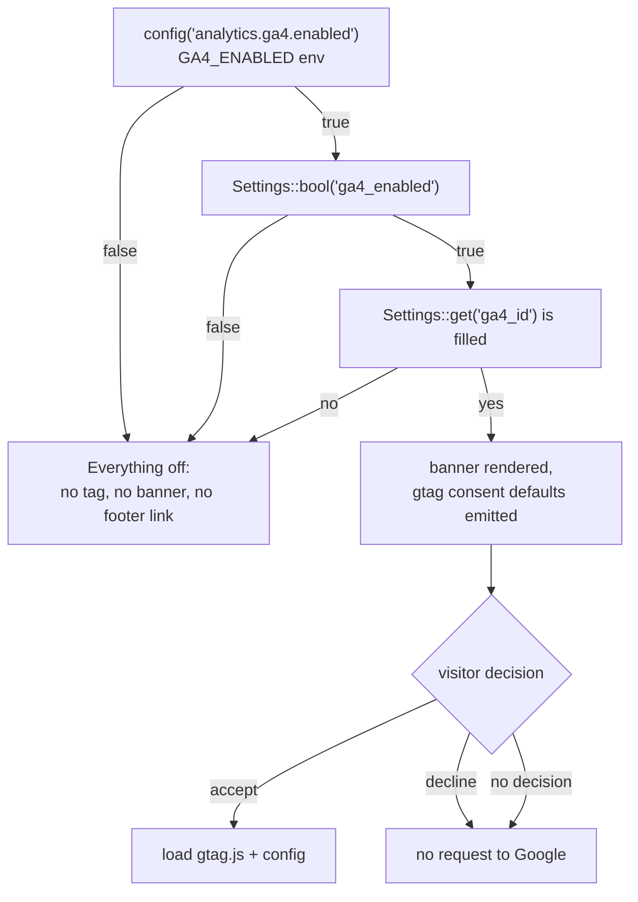
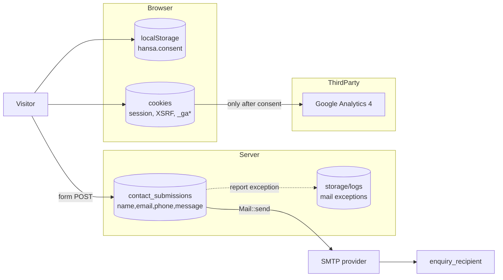

# 16 — Analytics, Consent & Privacy

> **Purpose:** Document the consent-gated GA4 implementation, the cookie banner, the revocation path, and the gap between the published privacy policy and what the code actually does.
> **Audience:** Developers, marketing, and anyone responsible for data-protection compliance.
> **Last reviewed:** 2026-10-24
> **Evidence basis:** `app/Support/Consent.php` (53 lines, full), `resources/views/partials/consent.blade.php` (36 lines, full), `resources/js/consent.js` (132 lines, full), `resources/views/partials/seo.blade.php:154-173`, `resources/views/pages/privacy.blade.php` (258 lines, full), `config/analytics.php`, `config/site.php:75-86`, `app/Filament/Pages/ManageSettings.php:193-218`, `app/Support/Settings.php`.

**Verification legend:** ✅ source-verified · 🟡 runtime-unverified · ⚠️ partial · ⛔ missing · ❓ unknown

> **No visitor data, cookie values, or analytics records are reproduced here.**

---

## 1. Design intent

The implementation is a **prior-consent** model:

1. Nothing is requested from Google until the visitor clicks **Accept analytics**.
2. No cookieless ping, no `gtag.js` preload, no measurement before consent.
3. The decision is revocable from a footer control on every page.
4. Declining leaves the site fully functional.
5. If JavaScript is unavailable, the banner stays hidden and analytics never loads — the default is "no consent, no processing".

This is stated in `consent.blade.php:1-5` and implemented consistently. ✅

---

## 2. Gate chain

Analytics is enabled only if **all** of these hold:



`Consent::analyticsEnabled()` (`Consent.php:17-26`):

```php
if (! config('analytics.ga4.enabled')) return false;
return Settings::bool('ga4_enabled') && filled(Settings::get('ga4_id'));
```

`Consent::measurementId()` returns the id only when `analyticsEnabled()` is true (31-34).

⚠️ **Two independent definitions of `GA4_ENABLED`:**

- `config/analytics.php:18` → `env('GA4_ENABLED', true)`
- `config/site.php:78` → `'ga4_enabled' => env('GA4_ENABLED', true) ? '1' : '0'`

`Consent` reads the **first** as the hard switch and the **second** (via `Settings`) as the panel-controlled toggle. With `GA4_ENABLED=false` both go false, so the kill switch works. But if an operator edits only `config/analytics.php` (or only `config/site.php`), the two layers can disagree. There is no single source of truth. ⚠️

---

## 3. What is emitted before consent

`seo.blade.php:159-173`, only when `analyticsEnabled()`:

```html
<script>
  window.dataLayer = window.dataLayer || [];
  function gtag(){dataLayer.push(arguments);}
  gtag('consent', 'default', {
    ad_storage: 'denied',
    ad_user_data: 'denied',
    ad_personalization: 'denied',
    analytics_storage: 'denied',
    wait_for_update: 500
  });
  gtag('set', 'ads_data_redaction', true);
  window.hansaAnalytics = { id: "G-…" };
</script>
```

Properties:

- Inline, so it is covered by CSP `script-src 'unsafe-inline'` (see [17](17-security-and-hardening.md#3-content-security-policy)).
- Contains **no network request** — `dataLayer` is a local array and `gtag` is a local function until `gtag.js` loads.
- `ads_data_redaction: true` and all ad signals denied. There is no Google Ads on the site, but the defaults are correct.
- The measurement ID is embedded in the HTML. That is not a secret; it is public by nature.

⚠️ `wait_for_update: 500` tells Google to wait 500 ms for an update. Since `consent.js` only calls `gtag('consent','update')` **after** the visitor accepts, the wait expires and the denied state stands. Correct.

---

## 4. Consent banner

`partials/consent.blade.php`:

| Element | Detail |
|---|---|
| Wrapper | `div.consent#consent-banner[role=region][aria-labelledby=consent-title][hidden]` |
| Data | `data-consent-key` = `hansa.consent`; `data-consent-version` = current version |
| Title | `h2#consent-title` with `tabindex="-1"` for programmatic focus |
| Body | explains GA4, cookies, and that nothing loads before acceptance |
| Accept | `button[data-consent-accept]` |
| Decline | `button[data-consent-decline]` |
| Link | `/privacy-policy#cookies` |

Rendered `hidden`; `consent.js` unhides it only when there is no valid stored decision (`consent.js:129-131`).

**No `role="dialog"`, no focus trap, no `aria-modal`.** It is a `region` — deliberately non-modal, so it does not block the page. Acceptable, but keyboard users can tab past it. ⚠️

---

## 5. Consent script

`resources/js/consent.js`:

### 5.1 Storage

| Property | Value |
|---|---|
| Store | `localStorage` (not a cookie) |
| Key | `hansa.consent` (`config/analytics.php` → `consent_storage_key`) |
| Payload | `{ version: number, analytics: boolean, decidedAt: ISO string }` |
| Version check | `parsed.version !== version` → treat as no decision (32) |

Rationale (1-12): storing the choice in `localStorage` means the record of the decision does not itself require consent.

⚠️ If `localStorage` throws (private mode, blocked storage), the decision is **not remembered** (45-47). The visitor is asked again next visit. Fail-safe: default is no analytics.

### 5.2 Loading

`loadAnalytics()` (52-64):

1. Guard: not already loaded, measurement id present, `gtag` is a function.
2. Inject `<script async src="https://www.googletagmanager.com/gtag/js?id=…">`.
3. `gtag('consent','update',{analytics_storage:'granted'})`.
4. `gtag('js', new Date())`, `gtag('config', id)`.

Only called on accept, or on page load when a stored `true` decision exists.

### 5.3 Revoking

`revokeAnalytics()` (66-79):

1. `gtag('consent','update',{analytics_storage:'denied'})` if `gtag` exists.
2. Iterate `document.cookie`, delete `_ga` and every `_ga_*` by setting `expires=Thu, 01 Jan 1970` on `path=/` **and** `domain=.<hostname>`.

On decline (108-116): save `false`, revoke, hide the banner, and **reload the page** if analytics had been running — so in-flight measurement is dropped and the rest of the session continues without the tag.

⚠️ Cookie deletion is best-effort. If `_ga` was set on a parent domain (e.g. `.hansamgt.com`) and the current host is `www.hansamgt.com`, the `.hostname` variant handles it; other domain scopes would not be cleared. Standard limitation of client-side cookie deletion.

### 5.4 Re-opening

`document.querySelectorAll('[data-consent-open]')` (120-125) — the footer **Cookie settings** button. It calls `show(true)`, which unhides and focuses the title.

The footer renders that button only when `Consent::analyticsEnabled()` (`footer.blade.php:57-59`), so the control disappears when analytics is off. Consistent. ✅

### 5.5 Layout shift handling

`syncSpacing()` (83-87) sets `document.body.style.paddingBottom` to the banner height so the fixed banner does not cover the footer. Recomputed on resize.

⚠️ This writes an inline style on `<body>`. CSP `style-src 'unsafe-inline'` permits it. It also means the body gets a non-zero padding that is removed when the banner hides — a small layout shift at decision time. Acceptable.

---

## 6. Retention — the central gap

### 6.1 What the policy claims

`pages/privacy.blade.php:4-15`:

```php
$enquiryRetention   = '24 months';
$analyticsRetention = '14 months';
```

Rendered at lines 187-188:

> **Enquiries:** kept for up to 24 months from our last contact with you, then deleted.
> **Analytics data:** retained for 14 months in our Google Analytics property.

The code comment above the variables is explicit that these are "business decisions, not facts scraped from the code" (5-9).

### 6.2 What the code does

| Claim | Implementation |
|---|---|
| Enquiries deleted after 24 months | ⛔ **no mechanism** — no expiry column, no scheduled command, no pruning job, no observer |
| Analytics retained 14 months | ❓ **configured in the GA4 property**, not in this repository. Cannot be verified from source. |
| Consent choice kept until cleared or version bump | ✅ `localStorage`, version-checked |

**Confirmed source finding:** `contact_submissions` rows persist indefinitely until an admin manually deletes them. There is no `php artisan` cleanup command, and `routes/console.php` registers no schedule.

**Severity: Medium (compliance).** The published policy describes a deletion process that does not exist. Under the Bangladesh Personal Data Protection Act 2026 framework the policy itself invokes (privacy.blade.php:102), an inaccurate retention statement is a real exposure, not a cosmetic one.

### 6.3 Other retention-adjacent facts

- Mail failures are logged via `report()`; log retention depends on the host's log rotation. ⛔ No `daily` channel configured with a `days` limit in `config/logging.php` (default `single`).
- Server access logs may contain IP addresses. ❓ host-dependent, not in repo.
- No database backups were found. ⛔

---

## 7. Privacy policy — accuracy audit

The policy is unusually detailed and mostly matches the implementation. Point-by-point:

| Claim (line) | Accurate? | Evidence |
|---|---|---|
| Collects name, email, phone, message (65-71) | ✅ | `_contact-form.blade.php`, `ContactController` |
| Form cannot be submitted without them (72) | ✅ | `required` + server rules |
| GA4 collects identifier, IP, device, pages (75-81) | ✅ | standard GA4 behaviour |
| Analytics off until accept (154-160) | ✅ | `consent.js`, `seo.blade.php` |
| No GA request before consent (156) | ✅ | banner rendered hidden; script injected on accept |
| Consent state "denied" before accept (158) | ✅ | `gtag('consent','default',…)` |
| Declining sends nothing to Google (160) | ✅ | no script injection |
| Cookie settings link on every page (163) | ✅ | `footer.blade.php:58` |
| Decline after accept clears GA cookies + reloads (163) | ✅ | `consent.js:108-116` |
| Decision stored in `localStorage` under `hansa.consent` (164) | ✅ | `consent.js:18,41-44` |
| Session cookie `hansa-management-session`, 120 min (128-131) | ⚠️ name depends on `APP_NAME` slug; lifetime `config/session.php:35` = 120 ✅ |
| `XSRF-TOKEN` cookie, 120 min (134-137) | ✅ | Laravel default |
| `_ga` / `_ga_<id>` up to 2 years (140-143) | ✅ | Google default |
| Enquiries kept 24 months (187) | ⛔ **no mechanism** | see §6 |
| Analytics retained 14 months (188) | ❓ GA4 property setting | not in repo |
| "limiting which colleagues can see enquiries" (211) | ⛔ **false** | every `is_admin` account sees every enquiry; no per-user roles |
| "access controls on our systems" (211) | ⚠️ authentication + binary `is_admin` gate; no fine-grained authorization | see [17](17-security-and-hardening.md#4-authorization) |
| "encrypted (HTTPS) connection" (211) | ❓ host-dependent; HSTS only emitted when already secure | `SecurityHeaders.php:44-46` |
| Policy published in English, Bangla on request (235) | ✅ | single-locale app |
| Past versions available on request (222) | ⛔ no version history stored | |

⚠️ The cookie table names the session cookie `hansa-management-session`. That is derived from `Str::slug(APP_NAME)` in `config/session.php`. `.env.example:1` ships `APP_NAME=Laravel`, which would produce `laravel-session` — making the policy's cookie name wrong. **Only correct if `APP_NAME` is set to `HANSA Management`** (or similar). Unverified for production.

---

## 8. Legal basis and consent quality

The policy states consent must be "voluntary, specific, clear and revocable" (102). Assessed against implementation:

| Criterion | Status |
|---|---|
| Voluntary | ✅ accept and decline are equally weighted buttons |
| Specific | ✅ analytics-only; no marketing cookies |
| Clear | ✅ plain-language banner; link to detail |
| Revocable | ✅ footer control on every page |
| Prior | ✅ nothing loads before accept |
| Granular | ⚠️ single analytics category — appropriate, since there is only one non-essential purpose |
| No dark patterns | ✅ decline is a first-class button, not a link |

This is a genuinely well-implemented consent flow. The weaknesses are in **retention** and **access control**, not in the consent mechanism itself.

---

## 9. Data map



| Data | Where | Retention | Deletable by |
|---|---|---|---|
| Enquiry PII | `contact_submissions` | indefinite ⛔ | any `is_admin` account (manual) |
| Enquiry copy | recipient inbox | mail-provider policy ❓ | mailbox owner |
| Analytics events | Google | 14 months (claimed) ❓ | GA admin |
| Consent decision | browser `localStorage` | until cleared / version bump | visitor |
| Session | `sessions` table + cookie | 120 min | framework |
| Mail error text | `storage/logs` | host rotation ❓ | operator |

---

## 10. Testing coverage

| Area | Test |
|---|---|
| Consent banner renders when enabled | ⛔ none |
| Banner absent when `GA4_ENABLED=false` | ⛔ none |
| `analyticsEnabled()` gate logic | ⛔ none (unit-testable) |
| `consent.js` behaviour | ⛔ none — no JS test runner |
| Footer control visibility | ⛔ none |
| Privacy page renders | ⚠️ only the single-`h1` check |

⛔ **Zero automated coverage of the consent subsystem.** Given its compliance role, a unit test for `Consent::analyticsEnabled()` across the four gate combinations would be cheap and valuable.

---

## 11. Recommendations (not implemented)

1. Add a scheduled `contact:prune` command that deletes rows older than the policy's stated period, and register it in `routes/console.php`.
2. Either implement retention or change the policy text to "kept until we no longer need it, and reviewed periodically".
3. Remove or qualify the "limiting which colleagues can see enquiries" claim until roles exist.
4. Set `APP_NAME` so the session cookie name matches the policy.
5. Unify `GA4_ENABLED` into one config source.
6. Add `og:image:width/height`.
7. Add a `Consent` unit test matrix.

---

## Known limitations

- `consent.js` was not executed; browser behaviour is source-derived.
- The GA4 property's actual data-retention setting was not inspected (no Google account access).
- The live `.env` (and therefore whether `GA4_ENABLED` is true in production) is unknown.
- Whether the session cookie is actually named `hansa-management-session` in production depends on `APP_NAME`.
- No cookie was inspected in a browser.
- The policy's legal adequacy was not assessed by a lawyer; this chapter checks **code/policy consistency only**.

---

## Related chapters

- [05 — Configuration Reference](05-configuration-reference.md#10-analytics-configanalyticsphp)
- [07 — Public Pages Reference](07-public-pages-reference.md#10-privacy-policy)
- [10 — Contact & Enquiries](10-contact-and-enquiries.md#9-privacy-and-retention)
- [12 — Site Settings](12-site-settings.md#44-tab-analytics--legal-193-218)
- [15 — SEO & Structured Data](15-seo-and-structured-data.md)
- [17 — Security & Hardening](17-security-and-hardening.md)
- [21 — Known Issues](21-known-issues-decisions-and-roadmap.md)
