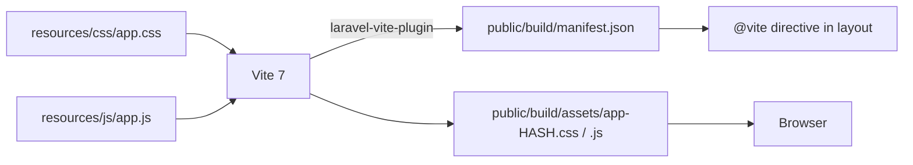

# 18 — Frontend Assets & Accessibility

> **Purpose:** Document the front-end build, CSS architecture, JavaScript modules, interaction patterns, and accessibility posture.
> **Audience:** Front-end developers and QA.
> **Last reviewed:** 2026-10-19
> **Evidence basis:** `resources/css/app.css` (3,400+ lines; read in full for structure and by grep for a11y features), `resources/js/app.js` (469 lines), `consent.js`, `office-map.js`, `office-map-render.js`, `bootstrap.js`, `vite.config.js`, `package.json`, `layouts/app.blade.php`, `partials/header.blade.php`, `partials/footer.blade.php`, all page Blade files. **Not rendered in a browser.**

**Verification legend:** ✅ source-verified · 🟡 runtime-unverified · ⚠️ partial · ⛔ missing · 🕓 legacy · ❓ unknown

---

## 1. Build pipeline



`vite.config.js`:

- Inputs: `resources/css/app.css`, `resources/js/app.js`.
- Plugins: `laravel({ refresh: true })`, `@tailwindcss/vite`.
- Dev server watches, ignoring `storage/framework/views/**`.

`layouts/app.blade.php:8`: `@vite(['resources/css/app.css', 'resources/js/app.js'])`.

### 1.1 Committed build artefacts

| File | Status |
|---|---|
| `public/build/manifest.json` | ✅ exists |
| `public/build/assets/app-BdKPwMxD.css` | ✅ exists |
| `public/build/assets/app-C4PxnG3f.js` | ✅ exists |
| `public/build` in Git | ⛔ ignored (`.gitignore:17`) |
| `public/hot` | ⛔ absent (no dev server running) |

⚠️ A fresh clone has **no build output** and `@vite` throws `ViteManifestNotFoundException`. `npm run build` is mandatory. `composer setup` does run it (37-44), but `composer install` alone does not.

⚠️ The committed hashes may be stale relative to `resources/`. Rebuilding produces new hashes; `.htaccess` caches `/build/` immutably for a year, which is safe **because** the filenames change.

---

## 2. CSS architecture

### 2.1 Tailwind v4

`resources/css/app.css:1-6`:

```css
@import 'tailwindcss';

@source '../../vendor/laravel/framework/src/Illuminate/Pagination/resources/views/*.blade.php';
@source '../../storage/framework/views/*.php';
@source '../**/*.blade.php';
@source '../**/*.js';
```

No `tailwind.config.js` — v4 is CSS-first.

**Design tokens** (`@theme`):

| Token | Value | Usage |
|---|---|---|
| `--color-hansa-navy` | `#002e5b` | primary brand |
| `--color-hansa-navy-dark` | `#001f3f` | gradients |
| `--color-hansa-blue` | `#6c98e1` | accents |
| `--color-hansa-gold` | `#fcb000` | links, CTAs |
| `--color-hansa-gold-dark` | `#b97c00` | hover |
| `--color-hansa-yellow` | `#fde428` | highlights |

⚠️ `@source '../**/*.js'` means Tailwind scans JS string literals. Dynamically concatenated class names (e.g. `` `text-${color}-500` ``) will not be generated. None were found, but it is a trap.

### 2.2 Structure

The stylesheet is **not** a pure utility build. It is a large hand-written component stylesheet (3,400+ lines) layered on top of Tailwind, with a legacy BEM-ish naming convention (`home-rail`, `policy-card`, `office-map__frame`, `vc-hoverbox`). Many class names come from the original CodeIgniter theme (`vc-hoverbox`, `icon_box style_1 hexagon`, `stm93ff` icons). 🕓

Sections observed:

| Range (approx.) | Area |
|---|---|
| 1-100 | imports, theme tokens, base |
| 100-340 | header, nav, submenus |
| 338-540 | mobile header |
| 540-660 | hero, slogan, motion prefs |
| 660-1050 | rail, home sections |
| 1050-1450 | policy cards, icon boxes |
| 1450-2300 | services, projects, gallery, clients, concerns |
| 2300-2900 | insights, article body, aside |
| 2900-3050 | consent banner |
| 3050-3450 | office map, WhatsApp float, print |

⚠️ Line ranges are approximate; the file is long and the boundaries are not marked.

### 2.3 Motion preferences

`@media (prefers-reduced-motion: reduce)` blocks appear at lines 540, 1051, 1307, 2452, 3226, 3445. `no-preference` guards appear at 1058, 2986, 3218. ✅ Motion is gated, not assumed.

---

## 3. JavaScript modules

Five plain ES modules. No framework, no TypeScript, no bundler runtime.

| File | Lines | Responsibility |
|---|---|---|
| `app.js` | 469 | all page interactions + imports of the other modules |
| `consent.js` | 132 | consent banner, GA4 load/revoke |
| `office-map.js` | — | click-to-load gate, slow-load hint |
| `office-map-render.js` | — | iframe activation helper |
| `bootstrap.js` | — | axios setup |

### 3.1 `app.js` responsibilities

| Feature | Approx. lines | Notes |
|---|---|---|
| Sticky header | 9-17 | sets `--hansa-header-h` |
| Mobile menu | 18-84 | `aria-expanded` toggling, submenu slide |
| Hero rotator | 98-190 | 5000 ms, pauses on hover/focus |
| Slogan particles | 191-285 | `<canvas>` |
| Carousels | 286-348 | `[data-carousel]`, per-element interval |
| Rail links | 349-368 | smooth scroll + active state |
| Count-up | 369-425 | `[data-countup]`, IntersectionObserver |
| Scroll reveal | 426-469 | `[data-reveal]` |

All initialisation runs on `DOMContentLoaded` (line 85).

⚠️ Every feature is defensive: `if (!el) return;` guards. A page without a hero does not throw. ✅

### 3.2 `axios` is unused

`bootstrap.js` configures axios and `app.js` imports it, but **no AJAX call exists**. All forms are standard POSTs. This is a dead dependency adding ~15 KB. ⚠️

---

## 4. Interaction inventory

| Interaction | Trigger | JS file | Graceful without JS? |
|---|---|---|---|
| Sticky header | scroll | `app.js` | ✅ header still renders |
| Mobile menu | button | `app.js` | ⚠️ menu hidden — no `<noscript>` fallback |
| Hero rotator | timer + arrows | `app.js` | ⚠️ first slide visible, others not reachable |
| Carousels | timer + arrows | `app.js` | ⚠️ first items visible only |
| Count-up | IntersectionObserver | `app.js` | ⚠️ numbers may render at 0 |
| Scroll reveal | IntersectionObserver | `app.js` | ⚠️ elements may stay hidden |
| Project filter | button | inline page script | ⚠️ all cards visible |
| Gallery lightbox | click | `<dialog>` + script | ⚠️ dialog cannot open |
| Team flip cards | click | `<dialog>` + script | ⚠️ bio unreachable |
| Office map | button | `office-map.js` | ✅ directions link always visible |
| Consent banner | buttons | `consent.js` | ✅ stays hidden, no analytics |
| WhatsApp float | link | none | ✅ |

⚠️ **No `<noscript>` element exists anywhere** (`grep` found none). Scroll-reveal and count-up are the highest-risk: if CSS hides `[data-reveal]` until JS adds a class, a JS failure leaves content invisible. The CSS should be checked for a `no-js` fallback; none was found.

This is a **progressive-enhancement gap**, not a WCAG failure by itself, but it degrades badly on slow connections or script blockers.

---

## 5. Accessibility

### 5.1 What is implemented

| Feature | Evidence |
|---|---|
| `lang="en"` on `<html>` | `layouts/app.blade.php:5` |
| Skip link | `layouts/app.blade.php:12-14`, visible on focus |
| Landmarks | `<header>`, `<main id="main-content">`, `<footer>`, `<nav aria-label>` |
| One `<h1>` per public page | enforced by `PageHeadingTest` |
| `aria-expanded` on menu toggle | `header.blade.php:30`, `app.js` |
| `aria-controls` | `header.blade.php:30` |
| `aria-label` on icon-only links | WhatsApp float, social links, map links |
| `aria-hidden` on decorative SVGs | throughout |
| `role="status"` on form success | `_contact.blade.php:10-11` |
| `role="status" aria-live="polite"` on map status | `office-map.blade.php:55` |
| `aria-describedby` linking map button to privacy note | `office-map.blade.php:37,40` |
| Focus-visible styles | many (`app.css:660, 1012, 1340, 2782, 2917, 2971, 3328, 3353, 3420`) |
| `prefers-reduced-motion` | 6 reduce blocks |
| `<dialog>` for modals (native focus handling) | gallery, team |
| `<time datetime>` | insight cards, article |
| `aria-labelledby` on consent region | `consent.blade.php:10` |
| Programmatic focus to consent title | `consent.js:98-99` |
| `aria-current` for active rail link | `app.js` (rail section) ⚠️ unverified |

### 5.2 Known weaknesses

| Issue | Detail | WCAG ref |
|---|---|---|
| Placeholder-as-label | contact form labels are `sr-only`; the visible cue is the placeholder, which disappears on input | 3.3.2 Labels or Instructions |
| No `autocomplete` on message | fine, but name/email/phone do have it ✅ | — |
| Consent banner is `role="region"`, not a dialog | no focus trap; keyboard users can tab past it into the page | acceptable (non-modal) |
| No visible "required" indication | all fields are required but nothing says so visually | 3.3.2 |
| Validation errors | server-side only; no inline `aria-describedby` on fields | 3.3.1 |
| Hero rotator | auto-advances every 5 s; pauses on hover/focus but there is no explicit pause button | 2.2.2 Pause, Stop, Hide |
| Carousels | auto-advance; no pause control | 2.2.2 |
| Contrast | `text-gray-400` on `bg-black` footer is ~7:1 ✅; gold `#fcb000` on black is ~11:1 ✅; gold on white would fail but is not used | — |
| `<dialog>` browser support | modern browsers only; no polyfill | — |
| Skip link target | `#main-content` exists ✅ | — |
| Form success announced | `role="status"` ✅ but focus is not moved to it | 4.1.3 |

⚠️ **Auto-advancing carousels without a pause control** are the clearest WCAG 2.2.2 issue. The hero pauses on hover/focus, which helps mouse/keyboard users but not everyone.

⚠️ **No accessibility audit tool was run** (axe, Lighthouse, WAVE). All findings are from source inspection.

### 5.3 Keyboard navigation

| Component | Keyboard operable? |
|---|---|
| Header nav | ✅ links + `:focus-within` submenu (`app.css:290`) |
| Mobile menu | ✅ button toggles, links are anchors |
| Hero arrows | ✅ buttons |
| Carousels | ✅ buttons |
| Project filter | ✅ buttons |
| Gallery/team dialogs | ✅ native `<dialog>` traps focus and closes on Esc |
| Office map | ✅ button activates iframe |
| Consent | ✅ buttons + link |
| WhatsApp float | ✅ link |

✅ No `div` with `onclick` was found — interactive elements are real `<button>`/`<a>` elements.

---

## 6. Fonts and icons

| Asset | Type | Notes |
|---|---|---|
| Avenir LT Std Roman | `public/fonts/AvenirLTStd-Roman.woff` | preloaded on homepage |
| Filament Inter set | `public/fonts/filament/` | admin only |
| `stm93ff.woff`, `icomoon0b43.woff` | legacy icon fonts | 🕓 used by `_services` cards |
| Inline SVG | most icons | hand-written paths |
| Heroicons | Filament | admin only |

⚠️ `font-display` is not documented here; the `@font-face` declarations should be checked for `swap`. Not verified line-by-line.

⚠️ The two legacy icon fonts add weight for four service icons. Replacing them with inline SVG would remove ~100 KB and one render-blocking request. Not a defect, an optimisation.

---

## 7. Responsive behaviour

Breakpoints observed in CSS: `480`, `640`, `768`, `900`, `1024`, `1025`, `1100`, `1240`. Mixed Tailwind (`sm:`, `md:`, `lg:`) and hand-written media queries.

| Component | Mobile behaviour |
|---|---|
| Header | desktop header hidden ≤1024; `mobile_header` shown |
| Hero | height clamps down to `min(62vw, 300px)` at ≤640 |
| Rail | hidden or horizontal at small widths (⚠️ unverified) |
| Home sections | stack to one column |
| Insights grid | 1 → 2 → 3 columns |
| Office map | one column |
| Footer | 1 → 2 → 4 columns |
| Contact form | 1 → 2 columns at `sm` |

⚠️ No viewport-level testing was done. Horizontal overflow at 320 px is a common failure and was not checked.

---

## 8. Performance characteristics

| Factor | Assessment |
|---|---|
| CSS size | Large (3,400+ lines hand-written + Tailwind utilities). No purge issue (Tailwind v4 scans sources), but the custom layer is not tree-shaken. |
| JS size | `app.js` + modules, plain ES, no framework. axios is dead weight. |
| Images | No `srcset`, no WebP conversion, no compression pipeline. Legacy images may be oversized. |
| Fonts | 2-4 families, self-hosted. Preload on homepage only. |
| Render blocking | `@vite` CSS in `<head>` (expected). JS is `type="module"` (deferred). |
| Third-party | GA4 only after consent. Google Maps iframe only after click. ✅ Excellent. |
| Caching | `/build/` immutable 1 year; `/images`,`/fonts` 7 days; `/css`,`/js` 30 days. ✅ |
| CDN | none. |
| HTTP/2, Brotli | ❓ host-dependent. |

**Strong points:** third-party requests are fully deferred behind user action. That is better than most sites.

**Weak points:** no responsive images, no modern formats, no minification of the custom CSS beyond Vite's default, unused axios.

---

## 9. Legacy front-end debt

| Item | Status |
|---|---|
| CodeIgniter class names (`vc-hoverbox`, `icon_box style_1`) | 🕓 kept for CSS parity |
| Icon fonts | 🕓 |
| `media-left`/`media-body` (Bootstrap 3 classes) | 🕓 in `header.blade.php:4,7` |
| Inline `style=""` attributes | ⚠️ `header.blade.php:5,17,27` — logo heights, GIF sizing |
| `welcome.blade.php` | ⛔ unused, not routed |
| `pages/placeholder.blade.php` | ⛔ unused, not routed |

⚠️ Inline styles are permitted by CSP `style-src 'unsafe-inline'` and are used for CLS prevention (explicit width/height on the GIF). A Tailwind class would be cleaner but the current approach is functional.

---

## 10. Testing coverage

| Area | Test |
|---|---|
| One `<h1>` per page | ✅ `PageHeadingTest` (16 routes) |
| WhatsApp float on every page | ✅ `WhatsappFloatTest` (includes a page data provider) |
| Office map rendering | ✅ `OfficeMapPageTest` (16 tests) |
| Static asset cache rules | ✅ `StaticAssetCacheHeadersTest` (6 tests, file-text only) |
| Responsive layout | ⛔ none |
| Keyboard navigation | ⛔ none |
| Contrast | ⛔ none |
| JS behaviour | ⛔ none (no JS test runner) |
| Lighthouse/axe | ⛔ none |

⛔ **No browser-based or accessibility testing exists.** All a11y claims are static source review.

---

## Known limitations

- No browser was used. Layout, overflow, contrast, and focus behaviour are unverified.
- `app.css` was read for structure and grepped for a11y features, not read line-by-line end to end.
- `office-map.js` and `office-map-render.js` were read but are summarised here rather than quoted.
- Exact bundle sizes were not measured (`npm run build` not executed).
- Whether `[data-reveal]` content is invisible without JS depends on CSS not fully traced.
- No screen-reader testing.

---

## Related chapters

- [03 — Technology Stack](03-technology-stack.md#3-front-end-stack)
- [08 — Homepage Composition](08-homepage-composition.md#6-front-end-behaviour-inventory)
- [14 — Media & Image Pipeline](14-media-and-image-pipeline.md)
- [15 — SEO & Structured Data](15-seo-and-structured-data.md#10-performance-signals-that-affect-seo)
- [16 — Analytics, Consent & Privacy](16-analytics-consent-and-privacy.md)
- [17 — Security & Hardening](17-security-and-hardening.md#3-content-security-policy)
- [19 — Testing & QA](19-testing-and-qa.md)
