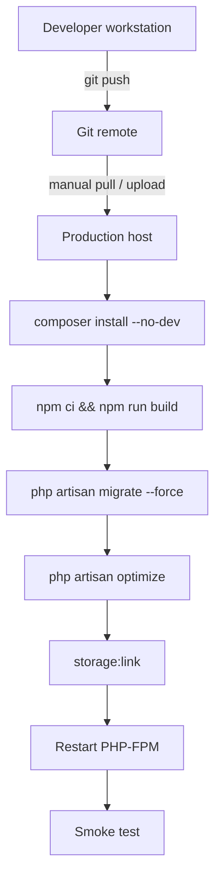

# 20 — Deployment & Operations

> **Purpose:** Everything needed to deploy, run, and maintain the site: prerequisites, build, release steps, environment checklist, web-server configuration, backups, and rollback.
> **Audience:** DevOps, hosting provider, and the developer on call.
> **Last reviewed:** 2026-10-24
> **Evidence basis:** `composer.json`, `package.json`, `public/.htaccess`, `public/index.php`, `.env.example`, `bootstrap/app.php`, `config/*.php`, `docs/HANSA-website-migration-report.md`. **No deployment was performed and no server was inspected.**

**Verification legend:** ✅ source-verified · 🟡 runtime-unverified · ⚠️ partial · ⛔ missing · ❓ unknown

> **There is no CI/CD configuration in this repository.** No `.github/`, no Dockerfile, no `deploy.sh`, no Procfile, no platform config. Deployment is manual.

---

## 1. Deployment model



Every arrow is manual. There is no pipeline, no staging automation, and no automated rollback.

---

## 2. Server requirements

| Requirement | Minimum | Notes |
|---|---|---|
| PHP | 8.2 | 8.3/8.4 likely fine; untested |
| Extensions | `pdo_sqlite`, `mbstring`, `openssl`, `fileinfo`, `tokenizer`, `xml`, `ctype`, `json`, `bcmath`, `curl` | `fileinfo` required for upload validation |
| Composer | 2.x | |
| Node | 20.19+ / 22.12+ | build-time only; not needed at runtime |
| Web server | Apache 2.4 with `mod_rewrite`, `mod_headers`, `mod_setenvif` **or** Nginx with an equivalent config | see §4 |
| Writable paths | `storage/`, `bootstrap/cache/` | |
| Database | SQLite file **or** MySQL/MariaDB/Postgres | default SQLite |
| TLS | required | HSTS is emitted only on HTTPS |

⚠️ **`public/` must be the document root.** The repository root contains `.env`, `storage/`, and `vendor/`; serving it would expose secrets. No `.htaccess` in the project root guards against this.

---

## 3. Release procedure

### 3.1 First deploy

```bash
# on the server, in the release directory
composer install --no-dev --optimize-autoloader
cp .env.example .env
php artisan key:generate

# edit .env  — see §5
# ensure the database exists (SQLite):
#   touch database/database.sqlite   (or create the MySQL database)

php artisan migrate --force
php artisan db:seed --force          # only on a brand-new database
php artisan storage:link

npm ci
npm run build

php artisan optimize                 # config + route + view cache
```

Then point the virtual host at `public/` and smoke-test (§8).

⚠️ `php artisan db:seed --force` **no longer creates a user account** (since 2026-10-24). On a brand-new database the `users` table is empty; on an existing database every row gets `is_admin = 0`. Either way, nobody can enter `/admin` until an administrator is created deliberately.

`php artisan admin:create` refuses to run outside `local`, so on production create the first administrator with a one-off `tinker` command (note `is_admin` is not mass assignable, hence `forceFill`):

```bash
php artisan tinker --execute='$u = App\Models\User::create(["name" => "Operations", "email" => "admin@hansamgt.com", "password" => bcrypt("REPLACE_WITH_A_STRONG_PASSWORD")]); $u->forceFill(["is_admin" => true])->save();'
```

Then verify:

```bash
php artisan tinker --execute='App\Models\User::where("is_admin", true)->pluck("email");'
```

Never commit the password. See [17 §4](17-security-and-hardening.md#4-authorization) and [17 §5.3](17-security-and-hardening.md#53-seeded-account--fixed-2026-10-24).

### 3.2 Subsequent deploys

```bash
git pull
composer install --no-dev --optimize-autoloader
php artisan migrate --force
npm ci && npm run build
php artisan optimize:clear
php artisan optimize
php artisan storage:link          # idempotent; harmless if it exists
```

⚠️ `optimize:clear` before `optimize` matters: cached config/routes/views from the previous release can reference removed files.

⚠️ `storage:link` is idempotent in Laravel 12 (it warns rather than fails if the link exists). Including it on every deploy is the safest way to guarantee it exists.

### 3.3 Maintenance mode

```bash
php artisan down --secret="<random>"   # bypass URL: /<secret>
php artisan up
```

`public/index.php:9-11` checks `storage/framework/maintenance.php`, so `down` works. ⛔ No custom maintenance view was found.

---

## 4. Web server configuration

### 4.1 Apache

`public/.htaccess` provides everything: front controller, legacy redirects, trailing-slash removal, and scoped cache headers.

Requirements:

- `AllowOverride All` (or at least `FileInfo` + `Options`) for `public/`.
- `mod_rewrite`, `mod_headers`, `mod_setenvif` loaded.
- `Options -MultiViews -Indexes` is set inside the file (3).

### 4.2 Nginx

**⛔ No Nginx configuration exists in the repository.** The `.htaccess` file is inert on Nginx. A minimal equivalent must be written by the operator:

```nginx
root /path/to/site/public;
index index.php;

location / {
    try_files $uri $uri/ /index.php?$query_string;
}

location ~ \.php$ {
    fastcgi_pass unix:/run/php/php8.2-fpm.sock;
    fastcgi_param SCRIPT_FILENAME $realpath_root$fastcgi_script_name;
    include fastcgi_params;
}

location ~ /\.(?!well-known).* { deny all; }
```

⚠️ This snippet is **illustrative, not part of the repo**, and it does **not** reproduce the legacy `/index.php/home/*` redirects, the trailing-slash rule, or the cache headers. Those must be ported explicitly. Without them:

- `/index.php/home/history` may serve a 200 duplicate instead of a 301 (the application middleware still catches `/index.php/*` — see [06 §4.2](06-routing-and-url-map.md#42-middleware-level-indexphp)) — so the redirect **does** still work via PHP. ✅
- Cache headers will be absent.
- `/home/*` redirects are registered as Laravel routes, so they work on any server. ✅

So on Nginx, only the **static asset caching** is lost; routing and redirects survive. That is a meaningful mitigation.

### 4.3 Document root mistake

If the host points at the repository root instead of `public/`, the following become web-readable:

- `.env` (secrets) — **critical**
- `storage/logs/laravel.log`
- `database/database.sqlite` (PII)
- `composer.json`, `.git/`

**Verify immediately after any deploy:** `curl https://hansamgt.com/.env` must return 403/404, never content.

---

## 5. Environment checklist

Set these in the production `.env`. Values are **placeholders** — never commit real secrets.

| Key | Production value | Why |
|---|---|---|
| `APP_NAME` | `HANSA Management` | mail from-name; session cookie name matches the privacy policy |
| `APP_ENV` | `production` | enables indexable robots; disables Vite CSP origins |
| `APP_DEBUG` | **`false`** | a stack trace leaks env values |
| `APP_URL` | `https://hansamgt.com` | asset and URL generation |
| `APP_KEY` | generated | encryption; never share |
| `DB_CONNECTION` | `sqlite` or `mysql` | |
| `DB_DATABASE` | absolute path or database name | |
| `SESSION_DRIVER` | `database` | |
| `SESSION_SECURE_COOKIE` | **`true`** | ⚠️ not in `.env.example`; set it explicitly |
| `CACHE_STORE` | `database` | |
| `QUEUE_CONNECTION` | `database` or `sync` | nothing dispatches jobs |
| `MAIL_MAILER` | `smtp` | **`log` means no email is sent** |
| `MAIL_HOST` / `PORT` / `USERNAME` / `PASSWORD` | provider values | secret |
| `MAIL_SCHEME` | `tls` or `smtp` | provider-dependent |
| `MAIL_FROM_ADDRESS` | a real `@hansamgt.com` mailbox | **`hello@example.com` will be rejected or spam-filtered** |
| `MAIL_FROM_NAME` | `${APP_NAME}` | |
| `GA4_ENABLED` | `true` | |
| `GA4_MEASUREMENT_ID` | real property id | |
| `CONSENT_VERSION` | `1` | bump when the policy changes |
| `OFFICE_MAP_ENABLED` | `true` | |
| `LOG_CHANNEL` | `daily` (recommended) | `single` grows unbounded |
| `LOG_LEVEL` | `warning` or `error` | `debug` is verbose and may log PII |
| `LOG_DAILY_DAYS` | `14` | only if using `daily` |

⚠️ **Three launch blockers live in this table:** `APP_DEBUG`, `MAIL_MAILER`/`MAIL_FROM_ADDRESS`, and `SESSION_SECURE_COOKIE`. The real `.env` was not read, so their current values are **unknown**.

### 5.1 Post-deploy config cache

```bash
php artisan config:cache
php artisan route:cache
php artisan view:cache
```

⚠️ After caching, `.env` is **not** read. Editing `.env` without `config:clear` has no effect. This is the most common deployment confusion.

⚠️ `route:cache` works because all routes are closures? **No** — Laravel cannot serialise closure routes. `routes/web.php:46-49` and `53-56` define closure routes, so **`route:cache` will fail**. Use `php artisan optimize` only if it skips route caching, or omit `route:cache`.

```bash
# safe alternative
php artisan config:cache
php artisan view:cache
```

✅ This is a concrete, source-derived finding: closure routes at `routes/web.php:46` and `:53` prevent route caching.

---

## 6. Filesystem and permissions

| Path | Permission | Notes |
|---|---|---|
| `storage/` | writable by web user | logs, cache, sessions (if file), uploads |
| `storage/app/public/` | writable | uploads |
| `bootstrap/cache/` | writable | compiled config/routes/views |
| `public/build/` | readable | built assets |
| `public/storage` | symlink | **must exist** |
| `.env` | readable by web user, **not** web-accessible | |

Typical ownership: `www-data:www-data` (Debian) or the Plesk/cPanel user. Directories `775`, files `664`. **Do not use `777`.**

### 6.1 The storage symlink

```bash
php artisan storage:link
```

Creates `public/storage → ../storage/app/public`. **Absent in this checkout**; without it every uploaded image 404s. See [14 §4](14-media-and-image-pipeline.md#42-the-missing-symlink).

⚠️ On shared hosting, `symlink()` may be disabled. Fallback: a rewrite rule mapping `/storage/*` to `storage/app/public/*`, or move uploads into `public/` (not recommended).

---

## 7. TLS and headers

### 7.1 TLS

- Terminate TLS at the host/proxy.
- The application emits HSTS **only when the request is already HTTPS** (`SecurityHeaders.php:44-46`).
- ⛔ The application does **not** redirect HTTP→HTTPS. Configure it at the server:

```apache
RewriteCond %{HTTPS} off
RewriteRule ^ https://%{HTTP_HOST}%{REQUEST_URI} [L,R=301]
```

⚠️ Add this **before** the Laravel front-controller rule.

### 7.2 Verify headers

```bash
curl -I https://hansamgt.com/
curl -I https://hansamgt.com/admin
curl -I https://hansamgt.com/build/assets/app-<hash>.css
```

Expected:

| URL | Headers |
|---|---|
| `/` | `X-Content-Type-Options`, `Referrer-Policy`, `X-Frame-Options`, `Permissions-Policy`, `COOP`, `CSP`, `HSTS` |
| `/admin` | above + `X-Robots-Tag: noindex, nofollow, noarchive` |
| `/build/...` | `Cache-Control: public, max-age=31536000, immutable` |
| any 404 | `X-Robots-Tag: noindex, nofollow` |

⚠️ On Nginx, the cache-control row will be **absent** unless ported.

---

## 8. Smoke test after deploy

| # | Check | Expected |
|---|---|---|
| 1 | `GET /` | 200, styled, hero visible |
| 2 | `GET /up` | 200 |
| 3 | `GET /admin` | 302 → `/admin/login` |
| 4 | `GET /sitemap.xml` | 200, XML |
| 5 | `GET /robots.txt` | 200 |
| 6 | `GET /.env` | **403/404** |
| 7 | `GET /storage/<known-upload>` | 200 |
| 8 | `GET /index.php/home/history` | 301 → `/company-profile` |
| 9 | `GET /insights/<known-slug>` | 200 |
| 10 | Submit the contact form | success flash + row in admin + email received |
| 11 | `curl -I /` | all security headers present |
| 12 | Devtools network on first load | **no** request to Google before consent |

---

## 9. Backups

⛔ **No backup mechanism exists in the repository.** No command, no package, no scheduled job.

Recommended minimum:

| What | How | Frequency |
|---|---|---|
| Database | `sqlite3 database/database.sqlite ".backup backup-$(date).sqlite"` or `mysqldump` | daily |
| Uploads | archive `storage/app/public/` | daily or on change |
| `.env` | secure offline copy (password manager / vault) | on change |
| Code | Git remote | on push |

⚠️ A backup that has never been restored is not a backup. Perform a restore drill before launch.

⚠️ Because sessions and cache live in the database, restoring a database backup also restores old sessions — users may appear logged in with stale state. Acceptable, but note it.

---

## 10. Logging and monitoring

| Concern | Current state |
|---|---|
| Application log | `storage/logs/laravel.log`, channel `stack` → `single` by default |
| Log rotation | ⛔ none configured; `single` grows forever |
| Error tracking | ⛔ none (no Sentry/Bugsnag/Flare) |
| Uptime monitoring | ❓ unknown |
| Performance monitoring | ⛔ none |
| Failed job monitoring | ⛔ none (no jobs) |
| Disk usage | ❓ unknown — uploads and logs grow unbounded |

⚠️ **Silent failure risk:** every public DB read is wrapped in `try/catch` and falls back to static content. The site returns 200 during a database outage. An uptime monitor checking only status codes **will not detect it**.

**Recommended check:** assert that a known dynamic element is present (e.g. an office title from the database, or a published article slug), not just HTTP 200.

⚠️ `report()` on mail failure writes to the log but nothing alerts. A mail outage could go unnoticed for weeks while enquiries accumulate in the database.

---

## 11. Rollback

No automated rollback exists. Manual procedure:

```bash
git checkout <previous-tag-or-commit>
composer install --no-dev --optimize-autoloader
php artisan optimize:clear
php artisan optimize            # omit route:cache
npm ci && npm run build
```

⚠️ **Migrations are not reversible safely in production.** `down()` methods use `dropIfExists`/`dropColumn` and will destroy data. Prefer a forward fix. If a rollback is unavoidable, restore the database backup taken before the deploy.

⚠️ Because `public/build` is git-ignored, rolling back the code without rebuilding leaves mismatched asset hashes. Always rebuild.

---

## 12. Scheduled tasks

⛔ **Nothing is scheduled.** `routes/console.php` contains only the default `inspire` command (6-8). There is no `Schedule::` call anywhere.

Consequences:

| Task | Should run | Currently |
|---|---|---|
| `sitemap:generate` | on publish / daily | ⛔ manual |
| Contact retention pruning | per policy | ⛔ does not exist |
| Log rotation | daily | ⛔ host-dependent |
| Backup | daily | ⛔ none |

If a cron entry is added on the host, the standard Laravel line is:

```
* * * * * cd /path/to/site && php artisan schedule:run >> /dev/null 2>&1
```

but it would do nothing until tasks are registered in code.

---

## 13. Capacity notes

| Factor | Observation |
|---|---|
| Database | SQLite is fine for a brochure site with low write volume; it serialises writes |
| Sessions | stored in the DB; every request writes `last_activity` |
| Cache | DB-backed; `Settings` is the only consumer |
| Uploads | no size ceiling beyond per-file 2-3 MB; no total quota |
| Traffic | ❓ no analytics data inspected |
| Concurrency | SQLite + `database` sessions can contend under load; MySQL is advisable above modest traffic |

⚠️ SQLite's single-writer model plus database sessions means a traffic spike produces lock contention. For a corporate brochure site this is likely fine; it is not suitable for high concurrency.

---

## Known limitations

- **No deployment was performed.** Every command is standard Laravel but unverified in this environment.
- The live host (Apache vs Nginx, Plesk, shared vs VPS) is unknown.
- The production `.env` was not read.
- TLS configuration, DNS, and CDN state were not inspected.
- No backup, monitoring, or log-rotation system could be observed.
- `route:cache` incompatibility is inferred from closure routes in `routes/web.php`; it was not executed.
- Whether `public/storage` exists on the production host is unknown (it is absent locally).

---

## Related chapters

- [03 — Technology Stack](03-technology-stack.md#4-build-pipeline)
- [04 — Local Development Setup](04-local-development-setup.md)
- [05 — Configuration Reference](05-configuration-reference.md#12-environment-variable-reference-names-only)
- [06 — Routing & URL Map](06-routing-and-url-map.md#43-web-server-level-publichtaccess)
- [14 — Media & Image Pipeline](14-media-and-image-pipeline.md#42-the-missing-symlink)
- [17 — Security & Hardening](17-security-and-hardening.md#12-hardening-checklist)
- [19 — Testing & QA](19-testing-and-qa.md#7-manual-qa-checklist)
- [21 — Known Issues](21-known-issues-decisions-and-roadmap.md)
